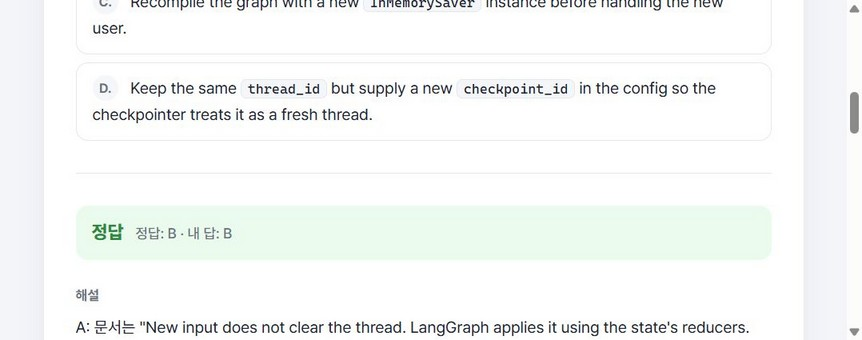
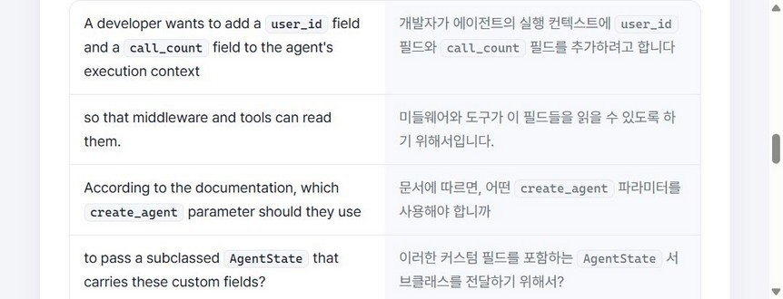
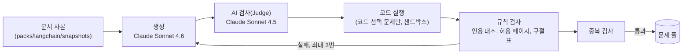

# agent-dev-quiz

LangChain·LangGraph 공식 문서 원문 인용으로 검증한 영어 예상 문제를 10문제 세트로 풀고, 영·한 구절 매핑 해설과 오답 원인 태그에 따른 복습까지 이어가는 로컬 웹앱이다. AX 미니과제(마감 2026-11-06 13:30) 제출물이다.





## 무엇을 하는 앱인가

| 기능 | 내용 |
| --- | --- |
| 문제 | 영어. 형식은 단일 선택, 복수 선택, 단답, 코드 선택 4가지다. 주제 6개(RAG, LangGraph 기초, Tool·MCP, 미들웨어·HITL·가드레일, 멀티 에이전트, 운영 품질) |
| 해설 | 한국어. 보기마다 맞고 틀린 이유, 영어 문장과 한국어를 짝지은 구절 표, 공식 문서 인용과 링크 |
| 근거 | 공식 문서 원문 인용만 쓴다. 인용이 저장한 문서 사본에 글자 그대로 있는지 코드로 검사한다 |
| 오답 | "독해 실수"(헷갈린 구절 선택) 또는 "개념 실수"로 태그한다. 태그해야 다음 문제로 간다 |
| 복습 | 틀린 문제는 2세트 뒤, 복습에서 또 틀리면 5세트 뒤 다시 나온다. 한 세트에 복습은 최대 3개다 |
| 풀이 시점 | AI를 부르지 않는다. 문제는 미리 만들어 고정한 풀(60문항)에서 낸다 |

## 바로 실행해 보기

필요한 것: [uv](https://docs.astral.sh/uv/)(Python 3.14는 uv가 받는다), Node.js와 npm. 풀이에는 AWS 자격 증명이 필요 없다.

1. API 서버(저장소 루트에서, Git Bash 기준):

   ```bash
   cp data/quiz.db data/experiments/review.db   # 제출 DB를 그대로 두려고 사본으로 연다
   cd app
   QUIZ_DB=../data/experiments/review.db uv run uvicorn quiz.server:app --port 8000
   ```

   `QUIZ_DB`를 주지 않으면 `data/quiz.db`(평가받은 제출본)에 풀이 기록이 쌓인다. PowerShell에서는 `$env:QUIZ_DB='..\data\experiments\review.db'`로 준다.

2. 웹(다른 터미널):

   ```bash
   cd web
   npm ci
   npm run dev
   ```

3. 브라우저에서 `http://localhost:5173`을 열고 "새 세트 시작"을 누른다. API 문서는 `http://localhost:5173/docs`다.

자세한 웹 실행법은 [web/README.md](web/README.md)에 있다.

## 문제는 어떻게 만들어지나

문제 생성은 풀이와 따로 돌리는 배치 명령이다. AWS Bedrock(Claude)을 부르므로 저장소 루트 `.env`에 자격 증명이 필요하다. 이미 만든 60문항이 `data/quiz.db`에 있어 실행해 볼 필요는 없다.



- 실패하면 이유를 붙여 다시 쓴다. 3번 넘게 실패하면 이유와 함께 버린다.
- 통과한 문제로 풀을 고정하고, 그중 20문항을 사람이 직접 감사했다.
- 명령: `app/`에서 `uv run quiz generate --plan pool`, `uv run quiz pool freeze`. 전체 명령은 [CLAUDE.md](CLAUDE.md)의 명령 표에 있다.
- 쉬운 설명: [docs/concepts/question-set-flow.md](docs/concepts/question-set-flow.md), [docs/concepts/quize-pipeline.md](docs/concepts/quize-pipeline.md), 감사 지표와 품질 개선은 [docs/concepts/audit-and-quality-loop.md](docs/concepts/audit-and-quality-loop.md)

## 결과

| 항목 | 값 | 근거 |
| --- | --- | --- |
| 고정 풀 | 60문항. 주제마다 10개. 단일 18, 복수 14, 단답 17, 코드 11 | [evaluation.md](docs/05-evaluation-review/output/evaluation.md) 3.1 |
| 본인 감사 | 20문항 중 정답 키 오류 0, 인용 미지지 0, 구절 매핑 불충실 1. 합격 | evaluation.md 3.1 |
| 수용 기준 | 9개 모두 통과. 변형 문제는 면제라 7번은 부분 충족 | evaluation.md 3.2 |
| 평가·리뷰 | 발견 20개(높음 5, 중간 10, 낮음 5). 높음 5개 수정 | [findings.md](docs/05-evaluation-review/output/findings.md) |
| 브라우저 QA | 시나리오 17개, 결함 7개 중 화면 결함 6개 수정. 화면 건강 점수 90 → 98 | [qa-report.md](docs/06-qa/output/qa-report.md) |
| 자동 테스트 | 앱 385개, 웹 35개 통과 | qa-report.md 5.4 |

## 알려진 한계

| 한계 | 내용 | 근거 |
| --- | --- | --- |
| 정답 위치 쏠림 | 고정 풀의 정답이 A에 몰려 있다. "늘 A"만 골라도 단일·코드 29문항 중 25개를 맞힌다 | findings.md F-20, qa-report.md DEF-6 |
| 서버 동시 요청 | 세트 생성이나 답 제출이 동시에 오면 500이 날 수 있다. 화면은 두 번 클릭을 막는다 | findings.md F-10 |
| 샌드박스 격리 | 코드 실행 격리가 운영체제 수준이 아니라 같은 프로세스 안의 방어다 | [design.md](docs/02-spec-design/output/design.md) 8.2 |
| 사람 리뷰 | 앱, 테스트, AI 검사, 평가가 모두 같은 모델 계열이다. 바깥 기준은 실제 실행, 본인 감사 20문항, 다른 계열 모델 교차 풀이다 | evaluation.md 6.1 |

더 많은 개선점은 [RETRO.md](RETRO.md) "설계 개선점"에 있다.

## 폴더 구조

| 폴더 | 내용 |
| --- | --- |
| `app/` | Python 앱(FastAPI 서버, LangGraph 생성 파이프라인, 채점, CLI `quiz`) |
| `web/` | React + Vite 화면 |
| `sandbox/` | 코드 선택 문제의 보기 코드를 실행하는 별도 환경 |
| `packs/langchain/` | 공식 문서 사본(스냅샷), 허용 페이지 목록, 생성·검사 프롬프트 |
| `data/` | SQLite DB(`quiz.db`), 지표, 단가표, 면제 기록, 실험·QA DB |
| `docs/` | 단계별 문서와 진행 기록 |

## 문서 지도

이 프로젝트는 단계를 나눠 진행했다. 단계마다 최종 문서가 하나씩 있다.

| 단계 | 최종 문서 | 내용 |
| --- | --- | --- |
| 01 요구사항 | [requirements.md](docs/01-requirements/output/requirements.md) 4.0 | 기능·비기능 요구사항, 제약, 완료 조건 |
| 02 설계 | [design.md](docs/02-spec-design/output/design.md) 16.0, [seed.yaml](docs/02-spec-design/output/seed.yaml) | 구조, 스키마, 흐름, 설계 결정. 수용 기준 |
| 03 구현 | [implementation.md](docs/03-implementation/output/implementation.md) 1.0 | 코드 구조, 실행 방법, 테스트 결과 |
| 04 실험 | [experiments.md](docs/04-prompt-model-experiments/output/experiments.md) 1.0 | 프롬프트·모델 비교 실험 |
| 05 평가·리뷰 | [evaluation.md](docs/05-evaluation-review/output/evaluation.md) 1.1 | 수용 기준 검증, 적대적 리뷰 발견 |
| 06 QA | [qa-report.md](docs/06-qa/output/qa-report.md) 1.0 | 브라우저 시험, 결함, 출시 판정 |

| 문서 | 내용 |
| --- | --- |
| [SERVICE.md](SERVICE.md) | PRD. 에픽, 사용자 스토리, 추적표(상태·근거) |
| [TASKS.md](TASKS.md) | 구현 작업 순서와 진행 체크 |
| [RETRO.md](RETRO.md) | 프로젝트 회고와 설계 개선점 |
| [docs/concepts/](docs/concepts/) | 단계와 상관없이 쉬운 말로 쓴 설명. 동작 원리(파이프라인, 풀·세트, 검사, 감사와 품질 개선)와 사용법(Langfuse 기록 읽기). 새 값이나 규칙은 정하지 않는다 |

## 만든 방식

- AI 코딩 도구(Claude Code)로 개발했다. 사람은 요구사항·설계 리뷰, 단계 계획 승인, 문제 20개 감사, 최종 문서 확정을 맡았다.
- 단계(요구사항 → 설계 → 구현 → 실험 → 평가 → QA)마다 계획, 기록, 최종 문서, 회고를 남겼다. 진행 규칙은 [docs/dev-process/skillset-by-lifecycle.md](docs/dev-process/skillset-by-lifecycle.md)와 `.claude/skills/stage/`에 있다.
- 모델 호출은 AWS Bedrock(`us-east-1`, `us-west-2`, `ap-northeast-2`)으로만 한다. 관측은 Langfuse(선택)다.

## 주의

- 자격 증명은 저장소 루트 `.env`에 둔다. `.env`는 커밋하지 않는다.
- 서버와 샌드박스에는 `AWS_*`, `LANGFUSE_*`를 넘기지 않는다. 풀이 서버는 자격 증명 없이 돈다.
