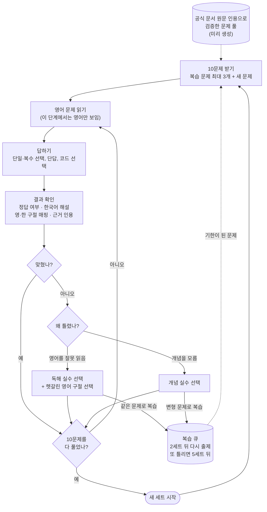
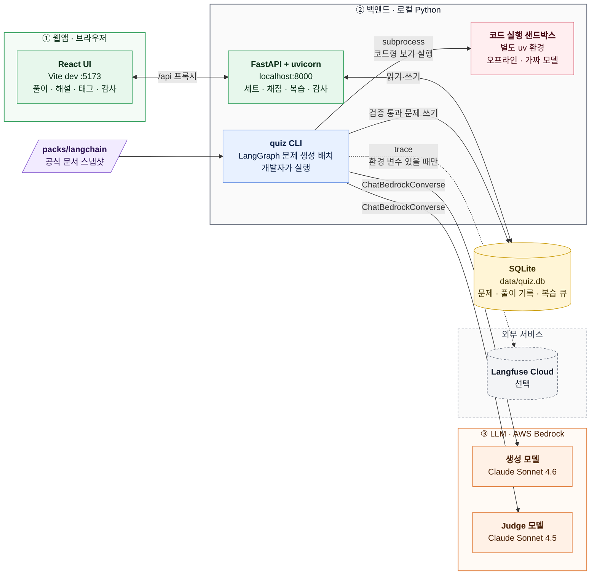

# 제품 요구사항 문서(PRD): agent-dev-quiz (MVP)

| 항목 | 내용 |
| --- | --- |
| 프로젝트 이름 | `agent-dev-quiz` (LLM Agent Dev Quiz) |
| 제품 | LangChain 예상 문제 풀이 웹앱. MVP는 LangChain 팩 하나다 |
| 문서 상태 | 초안 |
| 버전 | 0.5 |
| 작성일 | 2026-11-04 |
| 마감 | 2026-11-06 17:00 (AX 미니과제 제출 마감) |
| 원본 | [requirements.md](docs/01-requirements/output/requirements.md) 2.0, [design.md](docs/02-spec-design/output/design.md) 2.0, [seed.yaml](docs/02-spec-design/output/seed.yaml) 1.1.0 |

이 문서는 요구사항 정의서와 설계서를 애자일 작업 단위(에픽, 사용자 스토리, 수용 기준, 마일스톤)로 다시 묶은 것이다. 새 요구사항을 더하지 않는다. 이 문서와 원본이 다르면 요구사항 정의서를 따르고, 구현 값은 설계서를 따른다. 용어는 [요구사항 정의서 1.4](docs/01-requirements/output/requirements.md)와 [설계서 1.3](docs/02-spec-design/output/design.md)을 따른다.

괄호 안의 `FR-1.4`, `GR-4` 같은 ID는 요구사항 정의서의 요구사항 ID다. `D-9` 같은 ID는 설계서 9장의 설계 결정이다. "제안"이라고 적은 항목은 원본에 없고 이 문서가 작업 순서를 위해 정한 것이다.

## 1. 제품 개요

### 1.1 한 줄 설명

공식 문서 원문 인용으로 검증한 LangChain·LangGraph 영어 예상 문제를 10문제 세트로 풀고, 영·한 구절 매핑 해설과 오답 원인 태그에 따른 복습까지 이어가는 로컬 웹앱이다.

학습자 흐름:

- 틀린 문제에 원인을 고르지 않으면 다음 문제로 넘어갈 수 없다.
- 복습에서 맞히면 큐에서 빠진다. 두 번째 복습에서도 틀리면 더 내지 않는다.

### 1.2 해결할 문제

| 문제 | 이 제품의 대응 |
| --- | --- |
| LLM이 만든 문제는 정답과 해설이 틀릴 수 있다 | 정답·해설 근거를 공식 문서 원문 인용으로만 인정하고, 인용이 문서 스냅샷에 실제로 있는지 코드로 대조한다(C-3, GR-1, GR-4) |
| 코드 동작을 묻는 문제는 모델 판단만으로 정답을 믿기 어렵다 | 보기 코드를 별도 샌드박스에서 실제로 실행해 Judge 판단과 맞춰 본다(GR-7) |
| 영어 문제를 틀렸을 때 영어를 잘못 읽은 것인지 개념을 모르는 것인지 구분되지 않는다 | 영·한 구절 매핑을 보여주고, 오답마다 "독해 실수"와 "개념 실수"를 직접 고르게 한다(FR-2.3, FR-4) |
| 한 번 틀린 문제를 다시 보지 않는다 | 세트 간격 기반 복습 큐로 틀린 문제를 다시 낸다. 개념 실수는 변형 문제로 낸다(FR-5, FR-6) |

### 1.3 제품 목표

> LangChain·LangGraph로 LLM 앱을 만드는 한국인 개발자(본인)가, 공식 문서 원문 인용으로 검증된 영어 예상 문제(day2~day7, 4개 형식)를 10문제 세트 단위로 원할 때마다 풀고, 영·한 구절 매핑 해설과 독해 실수/개념 실수 태그에 따른 복습까지 이어가는 로컬 웹앱(FastAPI + SQLite + React, Bedrock 모델 호출)을 2026-11-06 17:00까지 완성한다. 완료 기준은 검증 통과 문제 60개, 본인 20문항 감사 통과, 3세트 풀이다.

(요구사항 정의서 1.2 원문)

### 1.4 제품 원칙

1. **근거 없는 정답은 없다.** 통과 문제는 모두 허용 목록 페이지의 원문 인용을 가진다.
2. **풀이 시점에는 모델을 부르지 않는다.** 풀이 경로는 SQLite만 읽고 쓴다(FR-1.3, FR-3.4).
3. **판정은 모델과 코드가 이중으로 한다.** Judge 판단 위에 결정적 게이트를 둔다(D-1).
4. **나중을 막지 않는다.** 서버 배포, 새 문제 형식, CCA-F 팩을 붙일 수 있게 나누되, 지금 만들지는 않는다(NFR-1, 요구사항 1.3).

### 1.5 시스템 구성

웹앱, 백엔드, LLM의 관계다. LLM은 문제 생성 배치에서만 부른다. 풀이할 때 웹앱과 백엔드는 SQLite만 쓴다. 상세 구성은 [설계서 2장](docs/02-spec-design/output/design.md)에 있다.

색은 경로를 나타낸다. 초록은 풀이 경로(모델 호출 없음), 파랑은 생성 경로(Bedrock 호출), 주황은 LLM이다.

| 구성 요소 | 언제 도나 | LLM 호출 |
| --- | --- | --- |
| React UI | 풀이할 때 | 없음 |
| FastAPI 서버 | 풀이할 때 | 없음. AWS 자격 증명도 없다 |
| `quiz` CLI 생성 배치 | 개발자가 수동으로 실행할 때 | Bedrock으로 생성·Judge 호출 |
| 코드 실행 샌드박스 | 배치가 코드형 문제를 검증할 때 | 없음. `GenericFakeChatModel`만 쓴다 |

## 2. 사용자

### 2.1 페르소나

첫 사용자는 본인 한 명이다. 한 사람이 세 역할을 맡는다.

| 역할 | 하는 일 | 주로 쓰는 화면·도구 |
| --- | --- | --- |
| 학습자 | 세트를 풀고, 해설과 매핑을 읽고, 오답에 태그를 붙인다 | React UI |
| 출제 운영자 | 허용 목록을 만들고, 생성 배치를 돌리고, 풀을 고정하고, 지표를 본다 | `quiz` CLI, Langfuse |
| 감사자 | 고정한 풀에서 뽑은 20문항의 정답 키, 근거, 매핑을 직접 검토한다 | React UI 감사 화면 |

사용자 배경: LangChain·LangGraph로 LLM 앱을 만드는 한국인 개발자다. 이후 CCA-F 자격이 필요하다(요구사항 2.1).

### 2.2 핵심 사용 흐름

**출제 운영자 흐름**

1. `quiz allowlist build`로 허용 목록과 페이지 스냅샷을 고정한다.
2. `quiz generate --plan pilot`으로 버킷당 1문제를 만들어 시간과 비용을 잰다.
3. `quiz generate --plan pool`로 60문제를 채운다. 중단되면 `--resume`으로 잇는다.
4. `quiz pool freeze`로 풀 스냅샷을 고정한다.
5. 감사자 역할로 20문항을 감사한다. 미달이면 실패 문제를 빼고 다시 채워 재감사한다.
6. `quiz metrics`로 기준선 지표를 남긴다.

**학습자 흐름**

1. 새 세트를 시작한다. 영어 문제 10개가 나온다.
2. 한 문제에 답한다. 정답 여부, 한국어 해설, 영·한 구절 매핑, 근거(문서 페이지와 인용 구절)가 나온다.
3. 틀렸으면 "독해 실수" 또는 "개념 실수"를 고른다. 독해 실수면 헷갈린 영어 구절도 고른다.
4. 태그를 붙여야 다음 문제와 다음 세트로 넘어갈 수 있다.
5. 2세트 뒤 틀린 문제(또는 변형 문제)가 복습으로 다시 나온다.

## 3. 범위

### 3.1 MVP에 넣는 것

- LangChain 팩 하나. 출제 버킷 6개(day2~day7), 버킷당 10문제(CR-1, CR-2)
- 문제 형식 4개(단일 선택, 복수 선택, 단답, 코드 선택), 문제 유형 4개(개념 구분, 코드 동작 예측, 에러 원인 찾기, 설계 판단)(CR-3, CR-4)
- 문제 생성 배치 파이프라인과 검증 게이트(FR-7, GR-1~GR-7)
- 세트 출제, 풀이 화면, 채점, 오답 태그, 복습 큐(FR-1~FR-5)
- 개념 실수 변형 문제(FR-6, 축소 대상). 2026-11-05에 면제했다(7.2)
- 감사 지원(FR-9)
- 기준선 지표와 Langfuse 관측(NFR-5, 요구사항 7.3)

출제 버킷:

| 버킷 | 노트 | 주제 |
| --- | --- | --- |
| RAG | day2 | 문서 로드, 청킹·메타데이터, 임베딩, Chroma, Retriever, 하이브리드 검색(EnsembleRetriever), 재랭킹 |
| LangGraph 기초 | day3 | State·노드·엣지, 조건부 엣지, 사이클, `add_messages` 리듀서, ReAct, LangSmith Studio |
| Tool · MCP | day4 | `@tool`, ToolNode 병렬·에러 처리, FastMCP 서버, MCP 클라이언트, `langchain-mcp-adapters`, 장애 주입 |
| 미들웨어 · HITL · 가드레일 | day5 | 훅 호출 순서, 로깅·마스킹·요약 미들웨어, checkpointer·`thread_id`, `interrupt()`·`Command(resume)`, 가드레일 |
| 멀티 에이전트 | day6 | Supervisor, handoff, 계층 구조, 서브 Agent 설계, 라우팅 검증 |
| 운영 품질 | day7 | Plan-and-Execute, 단기·장기 기억, 콜백 관측, LLM-as-judge 평가, 통합 점검 |

### 3.2 MVP에 넣지 않는 것

| 항목 | 이유·조건 |
| --- | --- |
| 서버 배포와 인증 | 로컬 전용. 배포할 때 FastAPI가 빌드된 정적 파일을 서빙하고 인증을 붙인다(NFR-1.1, D-7) |
| 약점 도메인 가중 출제 | MVP는 버킷 균등, 세트 내 주제·형식 무작위 |
| 풀이 시점 LLM 채점, 자동 오답 태그 | FR-3.4, FR-4.3 |
| 파이프라인의 사람 검수 interrupt | 사람 검토는 20문항 감사로 한다 |
| 이의 제기 버튼(Judge 재판정), 문서 변경 감지 세트 | - |
| 개념 다리(Claude ↔ LangChain), 팩 추상화 | 팩 교체 구조는 만들지 않는다 |
| 노트 품질 피드백 | - |
| 서술형 등 추가 형식 | 풀이 시점 채점 방식을 따로 정해야 한다 |
| 설계안 B(OpenWiki 지식층) | A안 파일럿에서 통합형 문제 품질 부족이 확인되면 다시 검토한다 |

출제하지 않는 내용(CR-9): 실습용 가상 사내 규정(`docs/leave_policy.md`, `remote_work_policy.md`, `travel_policy.md`), 계정·자격 증명 설정과 패키지 설치 같은 환경 설정, 노트에 없는 LangChain 기능, 허용 목록에 없는 내용.

## 4. 성공 지표

### 4.1 MVP 완료 조건

다음 네 가지를 2026-11-06 17:00까지 모두 만족하면 완료다(요구사항 7.1).

| # | 조건 | 측정 |
| --- | --- | --- |
| 1 | 검증 통과 문제 60개. 버킷당 10개, 형식마다 10개 이상 | 고정한 풀 스냅샷의 `passed` 문제 수 |
| 2 | 결정적 게이트 100%: 인용 원문 일치, 영·한 매핑 존재, 코드형 Judge-실행 불일치 0 | `verification_results` |
| 3 | 본인 감사 통과: 정답 키 오류 ≤ 1, 인용 미지지 ≤ 2, 매핑 불충실 ≤ 2 (20문항 중) | `audits.result = 'pass'` |
| 4 | 통과 풀에서 3세트를 풀고 모든 오답에 태그 | `attempts`에서 서로 다른 `set_id` 3개 × 10행, 태그 없는 오답 0행 |

### 4.2 기준선 지표

목표치 없이 기준선만 기록한다. 파일은 `data/metrics/baseline.json`이다(요구사항 7.3, 설계서 5.4).

| 지표 | 내용 |
| --- | --- |
| Judge 통과율 | Judge를 거친 시도 중 통과 비율 |
| 버린 문제 | 수와 이유별 개수(재생성 소진, Judge-실행 불일치, 버전 충돌, 중복 등) |
| 본인 정답률 변화 | 세트별 정답률 |
| Bedrock 비용 | 배치별 입력·출력 토큰과 비용 |
| 배치 소요 시간 | 배치별 초. 파일럿에서 60문제 소요를 추정한다 |

## 5. 에픽과 사용자 스토리

### 5.0 표기

- 우선순위: **필수**는 MVP 완료에 필요하다. **축소 대상**은 일정이 부족하면 뺀다(7.2).
- 스토리 형식: "<역할>로서 <원하는 것>을 원한다. <이유> 때문이다."
- 수용 기준(AC)은 체크리스트다. 각 항목은 요구사항 ID나 설계서 절에서 왔다.
- 의존: 먼저 끝나야 하는 스토리.

### 에픽 목록

| 에픽 | 이름 | 가치 | 우선순위 | 요구사항 |
| --- | --- | --- | --- | --- |
| E0 | 개발 기반 | 앱·샌드박스·웹 골격과 DB 운영 | 필수 | NFR-2, NFR-3, 설계서 8.4 |
| E1 | 근거 자료 | 인용할 공식 문서를 고정 | 필수 | GR-1, GR-2, GR-3 |
| E2 | 문제 생성 파이프라인 | 검증된 문제 60개를 만든다 | 필수 | FR-7, FR-10, GR-3~GR-8, CR |
| E3 | 풀 고정과 감사 | 사람이 품질을 확인한다 | 필수 | FR-9, 요구사항 7.2 |
| E4 | 세트 풀이 | 학습자가 문제를 푼다 | 필수 | FR-1, FR-2, FR-3, FR-8 |
| E5 | 오답 태그와 복습 | 틀린 문제를 다시 본다 | 필수 | FR-4, FR-5 |
| E6 | 변형 문제 | 개념 실수를 다른 질문으로 다시 확인한다 | 축소 대상. 2026-11-05 면제 | FR-6 |
| E7 | 관측과 지표 | 생성 품질과 비용을 기록한다 | 필수(일부 축소 대상) | NFR-5, 요구사항 7.3 |

### E0 개발 기반

**US-0.1 프로젝트 골격과 버전 고정** · 필수

출제 운영자로서 앱, 샌드박스, 웹이 각자 고정된 의존성으로 돌기를 원한다. 생성 결과와 코드 실행 결과를 재현해야 하기 때문이다.

- [ ] `app/`, `sandbox/`는 각자 uv 프로젝트이고 각자 `uv.lock`을 커밋한다(설계서 3.1, 4.1)
- [ ] 앱 Python 버전과 `langchain`, `langgraph` 버전은 교안 `sds-ax-practice` 코드가 도는 버전으로 `.python-version`, `requires-python`, `uv.lock`에 고정한다(NFR-3.1)
- [ ] 앱에 FastAPI, uvicorn, `langchain-aws`, `langfuse`, pytest(dev)가 있다(NFR-2)
- [ ] 샌드박스는 `langchain`, `langgraph`, `langchain-core`를 lock 시점 최신으로, `mcp==1.30.0`, `fastmcp==2.13.0`, `langchain-mcp-adapters==0.3.2`, `mcp-server-time==2026.10.10`을 고정으로 둔다(GR-7.2)
- [ ] `web/`은 React + Vite(`react-ts`)이고 `/api`를 `localhost:8000`으로 프록시한다. CORS 설정은 없다(D-7)
- [ ] 코드는 `docs/` 밖에 둔다

**US-0.2 DB 마이그레이션과 백업** · 필수 · 의존: US-0.1

출제 운영자로서 스키마 변경과 배치 전에 DB가 자동으로 백업되기를 원한다. 풀이 기록과 검증 결과를 잃으면 안 되기 때문이다.

- [ ] `migrations/0001_init.sql`이 설계서 5.1 스키마를 만든다
- [ ] 서버 시작 시와 `quiz migrate` 실행 시 `schema_version` 기준으로 미적용 마이그레이션을 적용한다(설계서 8.4)
- [ ] 마이그레이션과 배치 전에 `sqlite3` backup API로 `data/backups/`에 백업한다
- [ ] `*.db`는 커밋하지 않는다

### E1 근거 자료

**US-1.1 허용 목록과 페이지 스냅샷 고정** · 필수 · 의존: US-0.1

출제 운영자로서 인용해도 되는 공식 문서 페이지와 그 원문을 저장소 파일로 고정하기를 원한다. 인용을 코드로 대조하고 나중에 같은 근거로 재현하기 때문이다.

- [ ] 스냅샷 수집 방법을 정한다. 후보는 Python MCP 클라이언트 스크립트, 에이전트 세션에서 MCP로 받아 쓰기다. 큰 페이지의 30KB 출력 한도 처리도 확인한다(설계서 1.4, 4.3)
- [ ] 스냅샷은 `packs/langchain/snapshots/`에 둔다. 파일 이름은 경로의 `/`를 `__`로 바꾼 값이다. 문서는 `.mdx`, API 레퍼런스는 `get_symbol` 출력 텍스트다
- [ ] `quiz allowlist build`가 [page-allowlist.md](docs/02-spec-design/output/page-allowlist.md) 표를 읽어 `packs/langchain/allowlist.yaml`을 만든다. 행마다 `snapshot`, `sha256`, `fetched_at`이 있다(GR-2.2)
- [ ] 스냅샷 해시가 `allowlist.yaml`과 다르면 오류로 멈춘다
- [ ] MCP 결과와 스냅샷 안의 지시문처럼 보이는 텍스트는 데이터로만 다룬다(GR-1.5)

### E2 문제 생성 파이프라인

**US-2.1 결정적 게이트** · 필수 · 의존: US-1.1

출제 운영자로서 모델 없이 코드로 인용, 매핑, 단답 답안, 중복을 판정하기를 원한다. 모델 판단만으로는 근거를 믿을 수 없기 때문이다.

- [ ] 인용 정규화: `quote`와 스냅샷 양쪽에 NFKC와 연속 공백 1칸 축약만 적용한다. 대소문자를 구분하고 마크다운 기호는 그대로 둔다(D-2)
- [ ] 정규화한 `quote`가 정규화한 스냅샷 안에 그대로 있어야 한다. `quote`는 정규화 후 30자 이상이다(GR-4.1)
- [ ] `page`가 `allowlist.yaml`에 없으면 `page_not_allowed`로 실패한다(GR-2.3, GR-3.2)
- [ ] `segments`가 없으면 `mapping_missing`으로 실패한다(GR-5)
- [ ] 단답 허용 답안이 1~5개가 아니면 실패한다(D-3)
- [ ] 같은 버킷 `passed` 문제와 같은 `quote`를 쓰거나 정규화한 본문 토큰 Jaccard가 0.6 이상이면 `duplicate`다(D-4)
- [ ] `gates.py`는 표준 라이브러리만 쓰고 모델 호출과 DB 쓰기를 하지 않는다
- [ ] 각 규칙에 pytest가 있다

**US-2.2 생성과 Judge** · 필수 · 의존: US-2.1

출제 운영자로서 생성 모델이 만든 문제를 다른 모델이 검토하고, 실패하면 이유를 넣어 다시 생성하기를 원한다. 사람이 60문제를 전부 검토할 시간이 없기 때문이다.

- [ ] `generate` 노드는 슬롯, 그 주제의 스냅샷 원문, 직전 실패 이유를 받아 구조화 출력을 낸다. 문제, 보기, 정답 키, 허용 답안, 한국어 해설, `segments`, `grounding_records`, 코드형 `exec_spec`을 포함한다(설계서 6.1)
- [ ] 생성 프롬프트는 스냅샷 원문을 주고 `quote`를 그대로 복사하게 한다
- [ ] 문제는 영어, 해설은 한국어이고 API·클래스 이름은 원문 그대로다(CR-6)
- [ ] 문제마다 버킷, 형식, 유형, CCA-F 도메인 태그(`n/a` 허용), 근거 레코드 1개 이상, 문서 조회 날짜를 가진다(FR-10)
- [ ] `judge` 노드는 생성과 다른 모델(`global.anthropic.claude-sonnet-4-5-20250929-v1:0`)로 정답, 근거의 정답 지지, 오답 보기, 매핑 충실도, 빠진 단답 변형을 확인한다(GR-6, NFR-4)
- [ ] 노드 순서는 생성 → Judge → 실행(코드형만) → 게이트 → 중복 검사다(FR-7.1, D-10)
- [ ] 실패하면 이유를 다음 생성 입력에 넣어 재생성한다. 문제당 최대 3회다. 넘기면 `regen_exhausted`로 버린다(FR-7.2)
- [ ] 시도마다 `verification_results`에 한 행을 쓴다. 마지막 판정만 `questions.status`에 반영한다
- [ ] `dropped` 문제에는 `drop_reason`이 반드시 있다

**US-2.3 코드형 실행 검증** · 필수 · 의존: US-2.2

출제 운영자로서 코드 선택 문제의 보기 코드를 실제로 실행해 Judge 판단과 맞춰 보기를 원한다. 코드 동작은 실행해야 확실하기 때문이다.

- [ ] 앱은 샌드박스를 subprocess로만 부른다. stdin JSON 하나를 주고 stdout JSON `{ok, stdout, error_type}` 하나를 받는다(GR-7.1, 설계서 8.2)
- [ ] 자식 프로세스 환경에서 `AWS_*`, `LANGFUSE_*`를 지운다. 샌드박스는 네트워크, Bedrock, 앱 DB에 접근하지 않는다
- [ ] 모델은 `GenericFakeChatModel`(도구 호출이 필요하면 `bind_tools`를 붙인 하위 클래스)이다(GR-7.3)
- [ ] 보기 1개당 30초 타임아웃이다. 넘기면 `timeout`이다
- [ ] 실행 결과와 Judge 예측이 다르면 `judge_exec_mismatch`로 재생성한다(GR-7.4)
- [ ] 실행 결과가 정답 키와 다르고 Judge도 정답 키에 동의하면 `version_conflict`로 재생성 없이 버리고 개수를 센다(GR-7.5, D-11)
- [ ] 코드형 문제는 lock 해시와 "코드 보기"용 `doc_url`을 가진다(GR-7.6, FR-2.4)

**US-2.4 슬롯 계획** · 필수 · 의존: US-1.1

출제 운영자로서 버킷과 형식이 고르게 나오도록 배치가 슬롯을 미리 정하기를 원한다. 완료 조건이 버킷당 10개, 형식마다 10개 이상이기 때문이다.

- [ ] 버킷당 10개다. 형식은 버킷마다 2~3개씩 돌려 형식별 10개 이상이 되게 한다(CR-2, 설계서 6.1)
- [ ] MCP 주제(MCP 클라이언트, `langchain-mcp-adapters`, MCP 도구 에러)는 개념·설계 문제만 낸다. 코드형은 내지 않는다(D-9)
- [ ] FastMCP 서버 주제는 허용 목록에 페이지가 없어 출제하지 않는다
- [ ] 코드 선택은 MCP 주제와 허용 목록 상태가 `없음`인 주제에 배정하지 않는다
- [ ] 허용 목록 상태가 `근접`인 주제(ReAct, 계층 구조, Plan-and-Execute 등)는 프롬프트에 "문서가 그 이름으로 패턴을 정의한다고 쓰지 말 것"을 넣는다
- [ ] 코드형 재료는 공식 문서 예시 코드가 1순위, 실습 `.py`가 2순위다(GR-8)

**US-2.5 배치 실행과 재개** · 필수 · 의존: US-0.2, US-2.2, US-2.3, US-2.4

출제 운영자로서 배치를 한 명령으로 돌리고, 중단되면 이어서 돌리기를 원한다. 60문제 생성은 오래 걸리고 중간에 끊길 수 있기 때문이다.

- [ ] `quiz generate --plan pilot|pool [--count N]`이 슬롯을 `batch_slots`에 먼저 쓰고 그래프를 돈다. `pilot`은 버킷당 1문제다(FR-7.3, 설계서 6.2)
- [ ] `question_id`는 `{batch_id}-{slot_no:03d}`이다. 쓰기는 upsert다(D-13)
- [ ] `quiz generate --resume <batch_id>`는 `passed`·`dropped`가 아닌 슬롯만 처음부터 다시 돈다
- [ ] Bedrock은 `ChatBedrockConverse`로 부른다. adaptive 재시도 5회, 배치 동시 호출 2, 비용 상한 없음이다(D-8)
- [ ] `AWS_REGION`이 `us-east-1`, `us-west-2`, `ap-northeast-2` 밖이면 시작 시 오류로 멈춘다(D-12)
- [ ] 호출별 입력·출력 토큰을 `verification_results`와 `batches`에 쌓고, 단가표가 있으면 `cost_usd`를 계산한다. 없으면 NULL이다(NFR-4.4)
- [ ] Anthropic API를 직접 호출하지 않는다(C-2)

**US-2.6 파일럿 배치** · 필수 · 의존: US-2.5

출제 운영자로서 버킷당 1문제를 먼저 만들어 시간과 비용을 재기를 원한다. 60문제가 마감 안에 나오는지 판단해야 하기 때문이다.

- [ ] 6문제 파일럿 배치를 돈다
- [ ] 문제당 시간, 토큰, 비용, Judge 통과율, 버린 이유를 기록한다
- [ ] 이 값으로 60문제 소요를 추정하고 7.2 축소 판단에 쓴다
- [ ] 첫 배치에서 Bedrock 요청 제한 발생 여부를 확인한다(설계서 1.4)

### E3 풀 고정과 감사

**US-3.1 풀 스냅샷 고정** · 필수 · 의존: US-2.5

출제 운영자로서 통과 문제 집합을 고정하기를 원한다. 세트 출제와 감사가 같은 기준을 봐야 하기 때문이다.

- [ ] `quiz pool freeze`가 현재 `passed` 문제(변형 제외)로 풀 스냅샷을 만든다
- [ ] `pool_snapshot_id`는 `"ps_" + sha256("\n".join(sorted(question_ids)))[:12]`다. 같은 문제 집합이면 같은 ID다(설계서 5.2)

**US-3.2 감사 표본과 기록** · 필수 · 의존: US-3.1

감사자로서 고정한 풀에서 무작위 20문항을 받아 문항별로 판정을 기록하기를 원한다. 생성 품질을 사람이 표본으로 확인해야 하기 때문이다.

- [ ] 시드는 `int(sha256(pool_snapshot_id)[:16], 16)`, 표본은 `random.Random(seed).sample(sorted(question_ids), 20)`이다(D-5)
- [ ] 같은 스냅샷이면 `POST /api/audits`가 기존 감사를 돌려준다
- [ ] 감사 화면은 문항마다 정답 키, 근거, 매핑을 보여준다
- [ ] 문항별로 정답 키 오류, 근거 미지지, 매핑 오류를 저장한다(FR-9.2)
- [ ] 20개가 모두 차면 통과 기준(정답 키 오류 ≤ 1, 근거 미지지 ≤ 2, 매핑 불충실 ≤ 2)으로 `result`를 계산한다
- [ ] 감사는 풀이와 별도로 한다

**US-3.3 감사 미달 처리** · 필수 · 의존: US-3.2

출제 운영자로서 감사에서 떨어진 문제를 빼고 다시 채워 재감사하기를 원한다. 미달 상태로는 완료할 수 없기 때문이다.

- [ ] 감사 실패 문제는 `audit_failed`로 바꾸고 풀에서 뺀다
- [ ] 60개로 다시 채운 뒤 새 풀 스냅샷에서 시드를 다시 만들어 20문항을 새로 뽑는다(요구사항 7.2)
- [ ] 2026-11-06 17:00까지 미달이면 미달 목록과 함께 `data/waivers.yaml`에 사용자 면제로 기록한다

### E4 세트 풀이

**US-4.1 세트 시작** · 필수 · 의존: US-0.2, US-3.1

학습자로서 원할 때마다 10문제 세트를 받기를 원한다. 정해진 시간 없이 틈날 때 풀기 때문이다.

- [ ] `POST /api/sets`는 항상 10문제를 낸다. 하루 중 언제든, 횟수 제한 없이 만들 수 있다(FR-1.1, FR-1.2)
- [ ] 문제는 고정한 풀에서만 낸다. 풀이 시점에 생성하지 않는다(FR-1.3)
- [ ] 채우는 순서: 기한이 된 복습 문제 최대 3개 → 새 문제(무작위) → 새 문제가 소진되면 맞힌 적이 있고 복습 큐에 없는 문제 중 마지막 풀이가 오래된 순(FR-1.4, FR-1.5, D-6)
- [ ] 첫 세트는 새 문제 10개다
- [ ] `retired` 문제는 다시 내지 않는다
- [ ] 직전 세트에 태그 없는 오답이 있으면 409다(설계서 8.6)
- [ ] 응답에 정답 키, 해설, 매핑, 근거가 없다(FR-2.1)

**US-4.2 답하고 해설 보기** · 필수 · 의존: US-4.1, US-4.3

학습자로서 답한 뒤 정답 여부와 함께 해설, 구절 매핑, 근거를 바로 보기를 원한다. 영어를 잘못 읽었는지 개념을 몰랐는지 그 자리에서 확인하기 때문이다.

- [ ] 답하기 전에는 영어 문제만 보인다(FR-2.1)
- [ ] 답한 뒤 정답 여부, 정답 키, 한국어 해설, 영·한 구절 매핑, 근거(문서 페이지 링크와 인용 구절)가 보인다(FR-2.2)
- [ ] 매핑은 구절 단위로 영어 원문과 한국어를 짝지어 보여준다(FR-2.3)
- [ ] 근거 링크는 `https://docs.langchain.com` + `page`다. API 레퍼런스는 `page`가 전체 URL이다
- [ ] 코드형 문제의 "코드 보기"는 공식 문서 페이지로 연결한다(FR-2.4)

**US-4.3 채점** · 필수 · 의존: US-2.1

학습자로서 형식에 맞는 일관된 규칙으로 채점되기를 원한다. 같은 답이 다르게 채점되면 정답률을 믿을 수 없기 때문이다.

- [ ] 단일 선택, 복수 선택, 코드 선택은 정답 키와 정확히 일치해야 정답이다. 복수 선택은 부분 점수가 없다(FR-3.1)
- [ ] 단답은 대소문자, 공백, 백틱, 끝의 `()`를 정규화한 뒤 허용 답안 목록과 비교한다(FR-3.2)
- [ ] 풀이 시점에 LLM 채점을 하지 않는다. 서버는 Bedrock 자격 증명 없이 돈다(FR-3.4, 설계서 8.5)
- [ ] 채점 함수는 형식별로 등록한다. 형식 목록을 DB `CHECK`로 고정하지 않는다(NFR-1.2)
- [ ] 각 형식에 pytest가 있다

**US-4.4 이어 풀기** · 필수 · 의존: US-4.2

학습자로서 새로고침하거나 서버를 다시 시작해도 풀던 세트를 이어 풀기를 원한다. 풀이 기록이 남아야 복습과 지표가 맞기 때문이다.

- [ ] 풀이 기록은 `question_id`, `set_id`, `ts`, `answer`, `correct`, `mistake_tag`, `schema_version`으로 SQLite에 저장한다(FR-8.1)
- [ ] `GET /api/sets/{set_id}`가 세트와 이미 푼 문제의 결과를 돌려준다
- [ ] 서버를 다시 시작한 뒤에도 기록이 남아 있다

### E5 오답 태그와 복습

**US-5.1 오답 원인 태그** · 필수 · 의존: US-4.2

학습자로서 틀린 문제마다 독해 실수인지 개념 실수인지 직접 고르기를 원한다. 원인에 따라 복습 방식이 달라야 하기 때문이다.

- [ ] 오답 화면에서 "독해 실수" 또는 "개념 실수"를 고른다(FR-4.1)
- [ ] 독해 실수면 헷갈린 영어 구절(`segment_id`)도 고른다(FR-4.2)
- [ ] 자동 태그는 없다(FR-4.3)
- [ ] 태그는 오답 행에만 붙일 수 있다
- [ ] 태그 없는 오답이 있으면 다음 문제와 다음 세트 요청을 409로 거절한다(설계서 8.6)

**US-5.2 복습 큐 스케줄** · 필수 · 의존: US-5.1

학습자로서 틀린 문제가 정해진 세트 간격 뒤에 다시 나오기를 원한다. 잊기 전에 다시 확인하기 때문이다.

- [ ] 세트 `n`에서 틀리면 세트 `n+2`에 다시 나온다(FR-5.1)
- [ ] 복습에서 맞히면 큐에서 뺀다(FR-5.3)
- [ ] 1회차 복습(세트 `m`)에서 또 틀리면 세트 `m+5`에 다시 나온다(FR-5.2)
- [ ] 2회차 복습에서도 틀리면 큐에서 빼고 더 내지 않는다(`retired`)
- [ ] 한 세트에 복습 문제는 최대 3개다. 넘치면 기한이 이른 순으로 3개만 내고 나머지는 다음 세트로 넘긴다(FR-5.4)
- [ ] 복습에서 다시 틀리면 태그를 새로 받고 큐 항목의 태그를 마지막 태그로 바꾼다
- [ ] 간격 계산에 pytest가 있다

**US-5.3 태그별 복습 문제** · 필수 · 의존: US-5.2

학습자로서 독해 실수는 같은 문제로, 개념 실수는 같은 개념을 다르게 묻는 문제로 복습하기를 원한다. 개념 실수는 같은 문제를 외워서 맞힐 수 있기 때문이다.

- [ ] 독해 실수는 같은 문제를 다시 낸다(FR-5.5)
- [ ] 개념 실수는 `variant_of`가 원래 문제이고 `passed`인 변형 문제가 있으면 그것을 내고, 없으면 원래 문제를 낸다(FR-5.6)
- [ ] 변형 문제 풀이 결과는 원래 문제의 큐 항목에 반영한다

### E6 변형 문제 (축소 대상, 2026-11-05 면제)

**US-6.1 개념 실수 변형 문제 생성** · 축소 대상 · 의존: US-2.5, US-5.1

출제 운영자로서 개념 실수로 태그된 문제의 변형 문제를 배치로 만들기를 원한다. 학습자가 같은 개념을 새 질문으로 다시 확인해야 하기 때문이다.

- [ ] `quiz generate --variants`가 변형 문제가 없는 `concept` 큐 항목으로 변형 배치(`kind='variant'`)를 돈다(FR-6.1)
- [ ] 입력은 원래 문제와 저장된 풀이 기록이다
- [ ] 같은 그래프와 같은 게이트를 통과해야 노출한다. 재생성 3회 제한도 같다(FR-6.2, FR-7.2)
- [ ] 변형 문제는 `variant_of`로 원래 문제를 가리키고 풀 스냅샷에 넣지 않는다(FR-6.3)
- [ ] 변형 문제는 MVP 완료 조건의 60개에 세지 않는다(FR-6.4)

### E7 관측과 지표

**US-7.1 Langfuse 선택 적용** · 필수 · 의존: US-2.5

출제 운영자로서 Langfuse가 있으면 배치 trace를 보고, 없어도 배치가 돌기를 원한다. 관측 서비스 장애가 생성을 막으면 안 되기 때문이다.

- [ ] `LANGFUSE_PUBLIC_KEY`, `LANGFUSE_SECRET_KEY`, `LANGFUSE_HOST`가 모두 있을 때만 LangChain 콜백 핸들러를 붙인다(설계서 8.3)
- [ ] 환경 변수가 없어도 생성 배치와 앱이 오류 없이 돈다(NFR-5.4)
- [ ] 환경 변수가 있으면 배치 1회 뒤 Langfuse에 그 배치의 trace가 1개 이상 있다. `batch_id`를 세션 ID와 태그로 단다
- [ ] Langfuse Cloud Hobby(월 5만 units, 보관 30일)를 쓴다(NFR-5.1)

**US-7.2 기준선 지표 파일** · 필수 · 의존: US-2.5, US-4.4

출제 운영자로서 지표를 저장소 파일로 남기기를 원한다. Langfuse 보관 기간(30일)이 지나도 기록이 남아야 하기 때문이다.

- [ ] `quiz metrics`가 SQLite에서 `data/metrics/baseline.json`을 다시 만든다(NFR-5.3)
- [ ] 파일에 Judge 통과율, 버린 문제 수와 이유별 개수, 세트별 정답률, 배치별 토큰·비용·소요 시간이 있다(설계서 5.4)
- [ ] 단가표 `data/pricing/bedrock.yaml`에 모델 ID별 입력·출력 1K 토큰당 USD, 출처 URL, 확인 날짜를 둔다

**US-7.3 Langfuse trace 내보내기** · 축소 대상 · 의존: US-7.1

출제 운영자로서 2026-11-06에 Langfuse UI trace를 1회 내보내기를 원한다. 과제 결과물로 관측 기록을 보여주기 때문이다(NFR-5.2).

- [ ] 2026-11-06에 UI trace를 1회 내보낸다

## 6. 백로그 우선순위 (제안)

의존 관계로 정한 작업 순서다. 같은 단계 안의 스토리는 병렬로 할 수 있다.

| 순서 | 스토리 | 비고 |
| --- | --- | --- |
| 1 | US-0.1, US-0.2, US-1.1 | 스냅샷 수집 방법을 가장 먼저 정한다 |
| 2 | US-2.1, US-2.4, US-4.3 | 모델 없이 테스트할 수 있는 결정적 로직 |
| 3 | US-2.2, US-2.3, US-2.5, US-7.1 | 파이프라인 전체 |
| 4 | US-2.6 | 파일럿 배치. 결과로 일정 판단 |
| 5 | 풀 배치(US-2.5 실행), US-4.1, US-4.2, US-4.4, US-5.1~US-5.3 | 배치가 도는 동안 서버·UI를 만든다 |
| 6 | US-3.1, US-3.2, US-3.3 | 풀 고정과 감사 |
| 7 | 3세트 풀이, US-7.2 | 완료 조건 4, 기준선 지표 |
| 8 | US-7.3 | 축소 대상. US-6.1은 면제(7.2) |

## 7. 릴리스 계획

### 7.1 마일스톤

| 날짜 | 마일스톤 | 판정 | 출처 |
| --- | --- | --- | --- |
| 2026-11-04 | 요구사항·설계·Seed 확정 | 완료 | 원본 문서 |
| 2026-11-05 17:00 (제안) | 최소 경로 완료 | 빈 DB에서 생성부터 풀이 결과 화면까지 돈다([TASKS.md](TASKS.md) M0) | 제안 |
| 2026-11-05 24:00 (제안) | 파일럿 배치 완료, 60문제 소요 추정, 풀 배치 시작 | US-2.6 | 제안 |
| 2026-11-06 09:00 | 축소 판단 체크포인트 | 통과 문제 30개 이상이면 그대로 진행. 미만이면 7.2의 남은 항목 적용 | 05-output A.3 |
| 2026-11-06 12:00 (제안) | 풀 60개 고정, 감사 시작 | US-3.1, US-3.2 | 제안 |
| 2026-11-06 17:00 전 | Langfuse UI trace 1회 내보내기 | US-7.3 | NFR-5.2 |
| 2026-11-06 17:00 | MVP 완료, 제출 | 4.1의 네 조건 | C-1 |

### 7.2 축소 기준

1번은 2026-11-05에 체크포인트를 기다리지 않고 적용했다(사용자 결정, 마감 단축). 2026-11-06 09:00까지 통과 문제가 30개 미만이면 2, 3번을 순서대로 적용한다. React UI는 유지한다([05-output.md](docs/dev-process/01-requirements/05-output.md) A.3).

1. 변형 문제 생성을 뺀다(E6). 복습 큐는 원래 문제로 충족한다.
2. Langfuse 내보내기를 뺀다(US-7.3).
3. 풀 목표를 30개(버킷당 5개)로 낮추고 형식별 개수와 함께 `data/waivers.yaml`에 사용자 면제로 기록한다.

면제 기록이 없으면 축소 조건으로 완료할 수 없다(seed.yaml `scope_cut_waiver`).

## 8. 비기능 요구사항

| 영역 | 요구사항 | 출처 |
| --- | --- | --- |
| 실행 환경 | 로컬에서만 돈다. 이후 서버 배포를 막지 않는다 | NFR-1.1 |
| 확장 | 문제 형식과 유형을 고정 목록으로 박지 않는다. 형식 추가는 채점 함수 등록과 UI 컴포넌트 추가로 한다 | NFR-1.2, 설계서 5.2 |
| 스택 | FastAPI + uvicorn, SQLite(`sqlite3`), React + Vite, LangChain·LangGraph, `ChatBedrockConverse`, Langfuse | NFR-2 |
| 모델 | 생성 `global.anthropic.claude-sonnet-4-6`, Judge `global.anthropic.claude-sonnet-4-5-20250929-v1:0`, 예비 `global.anthropic.claude-haiku-4-5-20251001-v1:0` | NFR-4 |
| 비용 | 상한 없음. 배치별 비용을 기록한다 | NFR-4.4 |
| 보안 | 서버와 샌드박스에 AWS 자격 증명을 넘기지 않는다. UI는 답 제출 전 정답 키·해설·매핑·근거를 받지 않는다. MVP는 인증이 없다 | 설계서 8.5 |
| 신뢰성 | 배치는 중단 뒤 재개할 수 있다. 마이그레이션과 배치 전에 백업한다 | 설계서 6.2, 8.4 |
| 관측 | Langfuse를 꺼도 파이프라인이 돈다. 지표는 저장소 파일로도 남긴다 | NFR-5 |

## 9. 제약, 가정, 의존성

### 9.1 제약

| ID | 제약 |
| --- | --- |
| C-1 | 마감은 2026-11-06 17:00이다 |
| C-2 | 모델은 AWS Bedrock으로만 부른다. Anthropic API를 직접 호출하지 않는다 |
| C-3 | 정답·해설 근거는 공식 문서 원문 인용만 인정한다 |

### 9.2 외부 의존성

| 의존 대상 | 쓰는 곳 | 비고 |
| --- | --- | --- |
| AWS Bedrock | 생성 배치 | 리전 `us-east-1`, `us-west-2`, `ap-northeast-2` 중 하나 |
| `docs-langchain` MCP, `reference-langchain` MCP | 허용 목록과 스냅샷 수집 | 설계안 A(GR-1.4) |
| Langfuse Cloud Hobby | 관측(선택) | 월 5만 units, 보관 30일 |
| 학습 노트 저장소 `Lana-sds/sds-ax-practice` (`20df7f6`) | 주제 탐색, 2순위 코드 재료, 앱 버전 기준 | GR-8.3, NFR-3.1 |

## 10. 리스크

| ID | 리스크 | 영향 | 대응 |
| --- | --- | --- | --- |
| R-1 | 문제당 생성 시간과 비용을 아직 모른다 | 60문제가 마감 안에 안 나온다 | 파일럿 배치로 측정(US-2.6). 11-06 09:00 체크포인트와 축소 기준(7.2) |
| R-2 | Bedrock 요청 제한 | 배치가 느려지거나 실패한다 | adaptive 재시도 5회, 동시 호출 2. 첫 배치에서 확인. `--resume`으로 재개 |
| R-3 | 코드 선택 형식 10개 확보가 어렵다 | 완료 조건 1 미달 | MCP 주제와 `없음` 주제는 코드 선택에서 빠지므로 나머지 주제에 코드 선택 슬롯을 먼저 배정한다(D-9) |
| R-4 | 모델이 `quote`를 원문 그대로 복사하지 못한다 | `quote_mismatch` 재생성이 늘고 소진으로 버려진다 | 프롬프트에 스냅샷 원문을 주고 그대로 복사하게 한다. 실패 이유를 다음 생성에 넣는다 |
| R-5 | 문서와 고정 버전의 동작이 다르다 | 코드형 문제가 `version_conflict`로 버려진다 | 재생성 없이 버리고 개수를 기록한다(GR-7.5). MCP 코드형은 처음부터 내지 않는다 |
| R-6 | `근접` 주제는 근거가 약하다 | 감사에서 근거 미지지가 나온다 | 문서가 그 이름으로 패턴을 정의한다고 쓰지 않게 프롬프트로 막는다 |
| R-7 | 단답 허용 답안에 동의어가 빠진다 | 맞는 답이 오답 처리된다 | 답을 식별자·단일 용어로 제한하고 Judge가 빠진 변형을 보탠다(D-3) |
| R-8 | 스냅샷 수집 방법이 정해지지 않았다. 큰 페이지는 MCP 출력 한도(30KB)에 걸린다 | 허용 목록 고정이 늦어지고 이후 작업이 모두 밀린다 | 첫 작업으로 정한다(US-1.1) |
| R-9 | 감사 미달 | 재생성과 재감사로 시간이 든다 | 미달 처리 절차(US-3.3). 마감까지 미달이면 면제로 기록한다 |

## 11. 구현 단계에서 확인할 항목

설계서 1.4에서 옮겼다. 확인하면 설계서와 lock 파일에 고정한다.

| 항목 | 확인 방법 | 관련 스토리 |
| --- | --- | --- |
| 앱 Python 버전 | 확인함(2026-11-05): 3.14.8. 교안 `.venv` 기준 | US-0.1 |
| 앱 `langchain`, `langgraph` 버전 | 확인함(2026-11-05): `langchain` 1.4.7, `langgraph` 1.2.17. 앱 `uv.lock`에 고정 | US-0.1 |
| Langfuse SDK 설정 키 이름 | Langfuse 문서로 확인 | US-7.1 |
| Bedrock 비용 단가 | AWS 가격 페이지로 `data/pricing/bedrock.yaml`을 채운다 | US-7.2 |
| 페이지 스냅샷 수집 방법 | 확인함(2026-11-05): Python MCP 클라이언트, 줄 범위 분할, sha256 서버 대조(설계서 4.3, D-14) | US-1.1 |
| Bedrock 요청 제한과 비용 | 첫 배치에서 확인 | US-2.6 |
| 생성 시간 | 파일럿 배치로 측정 | US-2.6 |
| 백업 보관 개수 | 구현 시 정한다 | US-0.2 |

## 12. 완료 정의 (Definition of Done)

### 12.1 스토리 공통

- 수용 기준을 모두 만족한다.
- 요구사항 정의서의 검증 방법이 "테스트"인 항목은 pytest가 통과한다.
- 풀이 경로(FastAPI, React)에 모델 호출과 AWS 자격 증명이 없다.
- 커밋에 비밀 값이 없다. `*.db`는 커밋하지 않는다.
- 설계서와 다르게 구현했으면 설계서를 고친다.

### 12.2 MVP

- 4.1의 네 조건을 모두 만족한다.
- [seed.yaml](docs/02-spec-design/output/seed.yaml) 수용 기준 9개가 통과한다. 또는 축소 기준(7.2)에 따라 면제가 기록되어 있다.

## 13. 추적표

Seed 수용 기준 번호: 1 풀, 2 감사, 3 3세트 풀이, 4 세트 출제, 5 풀이 화면, 6 채점, 7 복습 큐, 8 기준선 지표, 9 Langfuse.

| 스토리 | 요구사항 | 설계서 | Seed AC |
| --- | --- | --- | --- |
| US-0.1 | NFR-2, NFR-3, GR-7.2 | 3.1, 4.1 | - |
| US-0.2 | FR-8 | 5.1, 8.4 | 3 |
| US-1.1 | GR-1, GR-2 | 4.3 | 1 |
| US-2.1 | GR-2.3, GR-3.2, GR-4, GR-5, FR-3.3 | 4.4 | 1 |
| US-2.2 | FR-7.1, FR-7.2, FR-10, GR-3, GR-5, GR-6, CR-6, CR-7 | 6.1 | 1 |
| US-2.3 | GR-7, FR-2.4 | 6.1, 8.2 | 1 |
| US-2.4 | CR-1~CR-5, CR-8, CR-9, GR-8 | 6.1 슬롯 계획 | 1 |
| US-2.5 | FR-7.3, NFR-4, C-2 | 6.2, 8.1 | 1, 8 |
| US-2.6 | 요구사항 7.3 | 6.2 | 8 |
| US-3.1 | FR-8.2 | 5.2, 7.2 | 1, 2 |
| US-3.2 | FR-9 | 6.6, 7.1 | 2 |
| US-3.3 | 요구사항 7.2 | 5.3, 5.4 | 2 |
| US-4.1 | FR-1, FR-2.1 | 6.3, 7.1 | 4 |
| US-4.2 | FR-2 | 6.4, 7.1 | 5 |
| US-4.3 | FR-3, NFR-1.2 | 4.4, 6.4 | 6 |
| US-4.4 | FR-8.1 | 6.4, 7.1 | 3 |
| US-5.1 | FR-4 | 6.4, 8.6 | 3 |
| US-5.2 | FR-5.1~FR-5.4 | 6.5 | 7 |
| US-5.3 | FR-5.5, FR-5.6 | 6.5 | 7 |
| US-6.1 | FR-6 | 6.1, 7.2 | 7 |
| US-7.1 | NFR-5.1, NFR-5.4 | 8.3 | 9 |
| US-7.2 | NFR-5.3, NFR-4.4, 요구사항 7.3 | 5.4 | 8 |
| US-7.3 | NFR-5.2 | - | - |

## 부록. 개정 이력

| 버전 | 날짜 | 내용 |
| --- | --- | --- |
| 0.1 | 2026-11-04 | requirements.md 1.1, design.md 1.1, seed.yaml 1.0.1에서 작성 |
| 0.2 | 2026-11-04 | 1.5 시스템 구성도를 설계서 2.1 도식 형식(경로별 색, 외부 서비스 묶음)으로 다시 그렸다. 원본을 design.md 1.3으로 맞추고 US-1.1 스냅샷 수집 후보 문구를 설계서 4.3과 같게 고쳤다 |
| 0.3 | 2026-11-04 | 프로젝트 이름을 `agent-dev-quiz`로 정하고 제목과 머리 표에 반영했다 |
| 0.4 | 2026-11-05 | 마감을 2026-11-06 17:00으로 당겼다(requirements 2.0, seed 1.1.0). 7.1 마일스톤을 다시 잡고 체크포인트를 2026-11-06 09:00으로 옮겼다. 변형 문제(E6)를 면제했다 |
| 0.5 | 2026-11-05 | 11장 확인 항목 3개(앱 Python, `langchain`·`langgraph` 버전, 스냅샷 수집 방법)를 구현 M0 결과로 채웠다. 원본을 design.md 2.0으로 맞췄다 |
