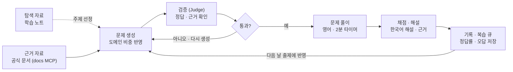

# AI 과제 : CCA-F 예상 문제 풀이 LLM 웹앱

2026년 10월 29일 · @Lana

> 같은 주제의 LangChain 버전은 [candidate_langchain.md](candidate_langchain.md)에 있다. 두 버전은 앱 구조가 같고, 출제 설계도, 근거 자료, 검증 방식이 다르다.

## 개요

학습 노트, Anthropic Claude 공식 문서, Skilljar 과정 내용을 기준으로 Claude Certified Architect – Foundations(CCA-F) 예상 문제를 매일 10개씩 풀 수 있는 LLM 웹앱을 만든다.

- **배경**: Anthropic 파트너 자격 시험을 준비 중이다. 나는 한국인이고 시험은 영어로 치른다.
- **목표**: 시험 전까지 매일 10문제를 풀며 영어 시나리오 문제에 익숙해지고, 약한 영역을 집중적으로 보완한다.
- **용어 정리**: 실제 문항은 공개되지 않으므로 "기출"이 아니라 시험 도메인과 학습 자료에 맞춘 "예상 문제"를 생성한다.

## 시험 정보

공식 시험 가이드(Version 1.0, 2026년 7월, 시험 코드 CCAR-F) 기준이다.

| 항목 | 내용 |
| --- | --- |
| 문항 수 / 시간 | 60문항 / 120분 (문항당 약 2분) |
| 문항 형식 | 단일 선택 + 복수 선택 (문항마다 고를 개수 명시) |
| 시험 구성 | 6개 시나리오 중 4개가 무작위로 출제 |
| 합격 기준 | 100~1,000점 척도에서 720점 |
| 응시료 / 유효기간 | 125달러 / 취득 후 12개월 |

출처: [Claude Certified Architect – Foundations Exam Guide (PDF)](https://everpath-course-content.s3-accelerate.amazonaws.com/instructor/6nizmqk8tpzpfjvt6qmmav7rh/public/1783542750/Claude+Certified+Architect+%E2%80%93+Foundations+Exam+Guide.pdf)

## 출제 범위

공식 시험 가이드를 출제 설계도로 쓴다.

### 도메인별 비중

| 도메인 | 비중 | 주제 탐색에 쓰는 AX 교육 노트 |
| --- | --- | --- |
| 1. Agentic Architecture & Orchestration | 27% | day3 ReAct, day6 Supervisor·멀티 에이전트, day7 Plan-and-Execute |
| 2. Tool Design & MCP Integration | 18% | day4 Tool·ToolNode·MCP 서버·클라이언트 |
| 3. Claude Code Configuration & Workflows | 20% | `day5/docs/01_agent_hooks_vs_middleware.md`, `day5/docs/06_claude_code_security_boundary.md`, `day6/docs/03_claude_code_multi_agent.md` |
| 4. Prompt Engineering & Structured Output | 20% | day1 구조화 출력 |
| 5. Context Management & Reliability | 15% | day5 요약 미들웨어·checkpointer·가드레일, day7 기억·LLM-as-judge 평가 |

비중은 공식 가이드 값이다. 표의 노트는 [candidate_langchain.md](candidate_langchain.md)에서 쓰는 AX 교육 노트 중 CCA-F 도메인과 겹치는 부분이다. 노트는 주제 탐색용이고, 정답·해설의 근거는 Claude 공식 문서만 인정한다.

### 시나리오 6개

1. Customer Support Resolution Agent
2. Code Generation with Claude Code
3. Multi-Agent Research System
4. Developer Productivity with Claude
5. Claude Code for Continuous Integration
6. Structured Data Extraction

### 문항 유형

| 유형 | 예시 | 근거 |
| --- | --- | --- |
| 시나리오 설계 판단 | 시나리오의 요구 사항에 가장 맞는 에이전트 구조나 도구 설계 고르기 | 공식 샘플 문제, Task Statement |
| 개념 구분 | 비슷한 기능이나 설정의 차이와 쓰임 구분하기 | Claude 공식 문서 |
| 문제 상황 진단 | 시나리오에서 생긴 문제의 원인과 해결책 고르기 | Claude 공식 문서 |

모든 문항은 실제 시험처럼 영어로 쓰고, 6개 시나리오 중 하나를 배경으로 한다. 해설은 한국어로 쓴다.

형식은 단일 선택, 복수 선택(고를 개수 명시), 단답, 코드 선택(보기 중 올바른 코드나 실행 결과 고르기)으로 한다.

### 앱 설계에 쓸 부분

- **도메인별 세부 목표(Task Statement)**: 문제를 만들 때 "어떤 목표를 묻는 문제인지"를 지정하는 출제 설계도로 쓴다.
- **공식 샘플 문제 12개**: 문제 생성 프롬프트의 few-shot 예시로 쓴다.
- **출제 범위 밖 주제 목록**: 파인튜닝, 인증·결제, 스트리밍, 컴퓨터 사용 등 시험에 나오지 않는 주제의 문제를 걸러낸다.

## 데이터 소스

정답·해설의 근거는 공식 문서 원문 인용만 인정한다. 학습 노트는 주제 탐색과 해설 표현 참고용으로만 쓰고, 외부 자료는 용도를 나눠서 쓴다.

| 소스 | 용도 | 앱 데이터로 사용 | 주의점 |
| --- | --- | --- | --- |
| 공식 시험 가이드 PDF | 출제 설계도, few-shot 예시 | 사용 | 버전이 바뀔 수 있으니 버전 기록 |
| Claude 공식 문서 (공식 docs MCP로 조회, 아래 참고) | 정답·해설 근거 (유일) | 사용 | 내용이 자주 바뀌므로 수집 날짜 기록 |
| 학습 노트 (Obsidian, [anthropic-partners-courses-note](https://github.com/Lana-sds/anthropic-partners-courses-note)) | 주제 탐색, 한국어 해설 표현 참고 | 탐색용 (정답 근거 아님) | 내가 정리한 내용이라 오류가 섞일 수 있음 |
| AX 교육 노트 (`sds-ax-practice`) | 겹치는 도메인의 주제 탐색 | 탐색용 (정답 근거 아님) | LangChain 중심이라 CCA-F와 겹치는 부분만 사용 |
| Skilljar 과정 | 개념 학습 | 학습 노트로 대신함 | 로그인이 필요해 직접 수집이 어려움 |
| paullarionov GitHub 한국어 가이드 | 개념 이해 보조 | 참고만 | 연습 문제는 실제 시험 자료라고 밝히고 있어 사용하지 않음 |
| 모의고사 사이트 (certsafari, cyberskill, flashgenius, claudecertificationguide) | 문제 스타일·난이도 비교 | 사용하지 않음 | 저작권 문제, 정답 미검증 |
| wikidocs 책 | 개념 정리 | 확인 필요 | 자동 접근이 막혀 내용 미확인 |
| CCDV-F 자료 (examspire, dev.to 등) | 해당 없음 | 사용하지 않음 | Developer 시험이라 범위가 다름 |

- 학습 노트와 공식 문서가 다르면 공식 문서를 우선하고, 해당 노트 위치를 "노트 수정 필요"로 표시한다.

### 공식 문서 조회 경로 (docs MCP)

Claude 공식 문서는 Anthropic이 제공하는 문서 MCP로 조회한다. LangChain 버전의 `docs-langchain` MCP 자리에 이 MCP가 들어가며, 근거 추출과 검증 방식은 [설계안 A](design-option-a-docs-mcp-grounding.md)와 같다.

| 소스 | 엔드포인트 | 확인 상태 (2026-11-04) | 담당 도메인 (예상) |
| --- | --- | --- | --- |
| Claude Platform Docs MCP | `https://platform.claude.com/docs/mcp` (streamable-http) | [server card](https://platform.claude.com/docs/mcp/server-card) 확인. 이름 `com.claude.platform/docs`, 설명 "Search and read the Claude Platform documentation and API reference" | 1, 2, 4, 5 |
| Claude Code Docs MCP | `https://code.claude.com/docs/mcp` | GET 요청에 JSON-RPC 405 응답. MCP 엔드포인트로 보이나 도구 목록은 미확인 | 3, 그리고 1의 Agent SDK 부분 |
| Claude Code Docs `llms.txt` | `https://code.claude.com/docs/llms.txt` | 200 응답 확인. 페이지별 `.md` 링크 목록 | Claude Code Docs MCP가 안 될 때 대체 |

- 담당 도메인은 문서 범위로 추정한 값이다. Task Statement별로 실제 페이지를 매핑하며 확정한다.
- 검색 결과는 후보 탐색용이다. 근거는 페이지 원문을 읽어 확정하고, `quote`가 원문에 문자열로 실제 존재하는지 대조한다.
- 근거 레코드는 설계안 A의 스키마(`page`, `quote`, `fetched_at`, `answer_basis`)를 그대로 쓴다.
- MCP 호출은 LangGraph 파이프라인에서 `langchain-mcp-adapters`로 한다. Anthropic의 [MCP connector](https://platform.claude.com/docs/en/agents-and-tools/mcp-connector)는 Amazon Bedrock에서 쓸 수 없으므로, 모델이 MCP를 직접 호출하는 방식은 쓰지 않는다.
- MCP 결과는 외부 콘텐츠다. 문서 안의 지시문처럼 보이는 텍스트는 데이터로만 취급한다.
- 시험 가이드 PDF는 MCP 범위 밖이다. 사용한 버전을 로컬에 보관해 출제 설계도로 고정한다.
- claude.ai의 Claude Docs 커넥터는 내 문서를 만들고 편집하는 도구라 근거 소스가 아니다.

### 시험 비밀유지 주의

공식 가이드에 따르면 응시자는 시험 문항, 보기, 시나리오를 공개하거나 배포하지 않기로 동의해야 하고, 위반하면 결과 무효, 자격 취소, 응시 금지가 될 수 있다. 그래서 "실제 시험 문제"라고 주장하는 자료는 앱에 넣지 않는다.

## 핵심 기능

문제는 실전처럼 영어로 풀고, 이해는 한국어로 돕는 것이 핵심이다.

- **매일 10문제**: 5개 도메인 비중에 맞춰 섞어서 출제한다.
- **영어 문제 + 한국어 해설**: 풀이 전에는 영어만 보이고, 답을 고른 뒤 한국어 해설과 문제 번역이 열린다.
- **용어 도움말**: 모르는 영어 용어를 누르면 한국어 뜻과 관련 노트가 보인다.
- **문항당 2분 타이머**: 실전 속도로 영어 지문을 읽는 연습을 한다.
- **오답 복습 큐**: 틀린 문제는 며칠 뒤 비슷한 변형 문제로 다시 나온다.
- **약점 도메인 집중**: 정답률이 낮은 도메인은 더 자주 출제한다.
- **근거 표시**: 해설마다 근거가 된 공식 문서 위치와 인용 구절을 보여준다.

## 시스템 구조

근거 자료로 만든 문제는 별도 검증을 통과해야 출제되고, 풀이 기록과 오답은 다음 날 문제 생성에 반영된다.

## 미니과제 범위(MVP)와 결과물

미니과제는 "하루 10문제를 풀고 해설과 복습까지 이어지는 한 사이클"이 제대로 도는 것을 목표로 한다.

- **자료**: 공식 docs MCP로 조회한 공식 문서 몇 페이지를 근거 자료로 넣고, 학습 노트 일부는 주제 탐색에만 쓴다.
- **문제 생성**: Bedrock 경유 Claude로 도메인 비중에 맞춘 시나리오 기반 문제 10개를 만든다. 형식은 단일·복수 선택, 단답, 코드 선택이다.
- **검증**: 별도 호출로 정답과 근거를 확인하고, 통과한 문제만 출제한다.
- **풀이 화면**: 영어 문제, 타이머, 답 선택 후 한국어 해설과 근거 표시.
- **기록**: 정답률을 도메인별로 저장하고 틀린 문제를 복습 큐에 넣는다.
- **결과물**: 웹앱 시제품, 그리고 생성·검증 품질을 보여주는 간단한 평가 결과.

## 평가 방법과 발표 포인트

생성된 문제의 정답이 틀리면 오히려 해가 되므로, 문제 품질 검증이 가장 중요한 설명 포인트다.

- **생성 → 검증 2단계**: 문제를 만든 호출과 다른 호출이 정답, 근거, 오답 보기의 타당성을 채점한다. Evals & Judges에서 배운 LLM-as-a-judge를 그대로 적용한다.
- **품질 지표**: 검증 통과율, 내가 직접 검토했을 때 정답 오류 비율, 근거 표시 정확도.
- **학습 효과 지표**: 날짜별·도메인별 정답률 변화, 문항당 풀이 시간 변화.
- **RAG 설명**: 문제와 해설이 공식 문서 원문에 근거한다는 점을 근거 표시로 보여준다.

## 열린 질문과 다음 단계

시험 정보는 공식 자료로 확인하고, 앱의 범위를 정하는 것이 다음 단계다.

- 공식 시험 가이드의 Task Statement를 출제 단위로 정리하기
- 시험 날짜 정하기 (남은 일수 × 10문제 = 전체 문제 수)
- 공식 docs MCP 두 개에 연결해 도구 목록과 동작 확인하기 (Claude Code Docs MCP가 안 되면 `llms.txt`로 대체)
- 근거 자료 범위 정하기 (Task Statement별 공식 문서 페이지 매핑, 탐색에 쓸 노트)
- 웹앱 형태 정하기 (Claude 아티팩트, 직접 만든 웹앱 등)
- LangChain 버전([candidate_langchain.md](candidate_langchain.md))과 비교해 최종 선택
