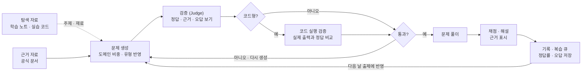

# AI 과제 : LangChain LLM 개발 예상 문제 풀이 웹앱

2026년 11월 4일 · @Lana

> 같은 주제의 CCA-F 버전은 [candidate_ccaf.md](candidate_ccaf.md)에 있다. 두 버전은 앱 구조가 같고, 출제 설계도, 근거 자료, 검증 방식이 다르다.

## 개요

LangChain·LangGraph 공식 문서를 근거로, 삼성SDS AX 교육(7일 과정)에서 정리한 학습 노트와 실습 코드의 범위에 맞춰 LangChain 중심 LLM 개발 지식을 묻는 예상 문제를 매일 10개씩 풀 수 있는 LLM 웹앱을 만든다.

- **배경**: 교육에서 LCEL, RAG, LangGraph, Tool·MCP, 미들웨어·HITL, 멀티 에이전트, 평가까지 배웠다. 실습은 따라 했지만, 개념을 정확히 구분하고 코드의 동작을 예측하는 연습은 부족하다.
- **목표**: 매일 10문제를 풀며 교육 내용을 복습하고, 약한 주제를 집중적으로 보완한다.
- **용어 정리**: 공식 자격 시험이 없으므로 "기출"이 아니라 학습 노트 범위에 맞춘 "예상 문제"를 생성한다.

## 출제 범위

공식 시험 가이드가 없으므로 학습 노트의 일차별 구성을 출제 설계도로 쓴다.

### 도메인별 비중 (안)

| 도메인 | 탐색용 노트 | 비중 |
| --- | --- | --- |
| 1. LLM 호출 · LCEL | day1: 메시지 role·파라미터, 토큰, Prompt/Model/Parser, 구조화 출력, invoke/stream/batch, RunnableParallel, 멀티턴 기록 | 10% |
| 2. RAG | day2: 문서 로드, 청킹·메타데이터, 임베딩, Chroma, Retriever, 하이브리드 검색(EnsembleRetriever), 재랭킹 | 15% |
| 3. LangGraph 기초 | day3: State·노드·엣지, 조건부 엣지, 사이클, `add_messages` 리듀서, ReAct, LangSmith Studio | 15% |
| 4. Tool · MCP | day4: `@tool`, ToolNode 병렬·에러 처리, FastMCP 서버, MCP 클라이언트, `langchain-mcp-adapters`, 장애 주입 | 15% |
| 5. 미들웨어 · HITL · 가드레일 | day5: 훅 호출 순서, 로깅·마스킹·요약 미들웨어, checkpointer·`thread_id`, `interrupt()`·`Command(resume)`, 가드레일 | 15% |
| 6. 멀티 에이전트 | day6: Supervisor, handoff, 계층 구조, 서브 Agent 설계, 라우팅 검증 | 15% |
| 7. 운영 품질 | day7: Plan-and-Execute, 단기·장기 기억, 콜백 관측, LLM-as-judge 평가, 통합 점검 | 15% |

day1은 기초 내용이라 비중을 낮췄고, 나머지는 같게 두었다. 풀이 기록이 쌓이면 약점 도메인 가중치로 조정한다.

### 문항 유형

| 유형 | 예시 | 출제 재료 (정답 근거는 공식 문서) |
| --- | --- | --- |
| 개념 구분 | checkpointer와 store의 차이, ReAct와 Plan-and-Execute의 선택 기준 | `docs/*.md` 노트 |
| 코드 동작 예측 | "이 그래프를 실행하면 `messages`에 몇 개가 남는가?" | 실습 `.py` 코드 |
| 에러 원인 찾기 | `GraphRecursionError`, `wrote to unknown channel` 경고의 원인 | README의 "자주 하는 실수" 표 |
| 설계 판단 | 단일 Agent에서 도구 혼동이 생길 때의 구조 선택 | day6 체크리스트, 시나리오 |

형식은 단일 선택, 복수 선택(고를 개수 명시), 단답, 코드 선택(보기 중 올바른 코드나 실행 결과 고르기)으로 한다. 문제는 영어로 쓰고 해설은 한국어로 쓴다. API·클래스 이름은 원문 그대로 둔다.

### 출제 범위 밖

- 실습용 가상 사내 규정(`docs/leave_policy.md`, `remote_work_policy.md`, `travel_policy.md`)의 내용 자체
- 계정·자격 증명 설정, 패키지 설치 절차 같은 환경 설정
- 노트에 없는 LangChain 기능

## 데이터 소스

| 소스 | 용도 | 앱 데이터로 사용 | 주의점 |
| --- | --- | --- | --- |
| 학습 노트 (`sds-ax-practice`, `day*/README.md`, `day*/docs/*.md`) | 출제 설계도, 주제 탐색 | 탐색용 (정답 근거 아님) | 직접 정리한 내용이라 오류가 섞일 수 있음 |
| 실습 코드 (`day*/**/*.py`) | 코드형 문제 재료, 실행 검증 | 사용 (정답 근거 아님) | 실행에 LLM 호출이 필요한 코드는 가짜 모델로 대체 |
| "자주 하는 실수" 표 (각 README) | 오답 보기, 에러 원인 문제 재료 | 탐색용 (정답 근거 아님) | |
| LangChain · LangGraph 공식 문서 | 정답·해설 근거 (유일), 노트 교차 확인 | 사용 | API가 자주 바뀌므로 수집 날짜와 패키지 버전 기록 |
| 실습 산출물 (`chroma_db`, `*.pckl`, `*.sqlite`, `*.jsonl`, `*.log`) | 해당 없음 | 사용하지 않음 | 실행 결과물이라 근거가 아님 |

- 정답·해설의 근거는 공식 문서 원문 인용만 인정한다. 노트와 실습 코드는 주제 탐색과 문제 재료로만 쓴다.
- 학습 노트 저장소: https://github.com/Lana-sds/sds-ax-practice (2026-11-03 기준 `20df7f6`, 노트 약 1.4만 줄, 실습 코드 약 100개)
- 노트와 공식 문서가 다르면 공식 문서를 우선하고, 해당 노트 위치를 "노트 수정 필요"로 표시한다.
- 패키지 버전은 저장소의 `requirements.txt`를 기준으로 한다. 예: `langchain-mcp-adapters==0.3.2`, `mcp==1.30.0`

## 핵심 기능

- **매일 10문제**: 7개 도메인 비중에 맞춰 섞어서 출제한다.
- **유형 섞기**: 개념 구분, 코드 동작 예측, 에러 원인 찾기, 설계 판단을 섞는다.
- **영어 문제 + 한국어 해설**: 풀이 전에는 영어만 보이고, 답을 고른 뒤 한국어 해설과 문제 번역이 열린다.
- **해설과 근거 표시**: 답을 고른 뒤 해설이 열리고, 근거가 된 공식 문서 위치와 인용 구절을 보여준다.
- **코드 보기**: 코드형 문제는 문제에 쓰인 실습 코드 원본으로 이동할 수 있다.
- **오답 복습 큐**: 틀린 문제는 며칠 뒤 비슷한 변형 문제로 다시 나온다.
- **약점 도메인 집중**: 정답률이 낮은 도메인은 더 자주 출제한다.

## 시스템 구조

CCA-F 버전과 같은 흐름에 코드 실행 검증 단계가 더해진다. 코드형 문제는 LLM 판단만이 아니라 실제 실행 결과로 정답을 확인한다.

앱 자체도 LangGraph로 구현한다. 문제 생성, 검증, 코드 실행을 노드로 두고, 통과 여부를 조건부 엣지로, 재생성을 사이클로 만든다. 교육에서 배운 구조를 과제 구현에 그대로 쓴다.

## 미니과제 범위(MVP)와 결과물

미니과제는 "하루 10문제를 풀고 해설과 복습까지 이어지는 한 사이클"이 제대로 도는 것을 목표로 한다.

- **자료**: day3~day5에 대응하는 공식 문서 몇 페이지를 근거 자료로 넣는다. day3~day5 노트와 실습 코드는 주제 탐색과 문제 재료로 쓴다.
- **문제 생성**: Bedrock 경유 Claude로 도메인 비중에 맞춘 문제 10개를 만든다. 형식은 단일·복수 선택, 단답, 코드 선택이다.
- **검증**: 별도 호출로 정답과 근거를 확인한다. 코드형 문제는 실행 결과와 비교한다. 통과한 문제만 출제한다.
- **풀이 화면**: 영어 문제, 답 선택 후 한국어 해설과 근거 표시.
- **기록**: 정답률을 도메인별로 저장하고 틀린 문제를 복습 큐에 넣는다.
- **결과물**: 웹앱 시제품, 그리고 생성·검증 품질을 보여주는 간단한 평가 결과.

## 평가 방법과 발표 포인트

생성된 문제의 정답이 틀리면 오히려 해가 되므로, 문제 품질 검증이 가장 중요한 설명 포인트다.

- **생성 → 검증 2단계**: 문제를 만든 호출과 다른 호출이 정답, 근거, 오답 보기의 타당성을 채점한다. day7에서 배운 LLM-as-a-judge를 적용한다.
- **실행 기반 검증**: 코드형 문제는 실제 실행으로 정답을 확인한다. LLM judge와 실행 결과가 다르면 문제를 버리고 그 비율을 지표로 남긴다.
- **품질 지표**: 검증 통과율, 직접 검토했을 때 정답 오류 비율, 근거 표시 정확도, judge와 실행 결과 불일치율.
- **학습 효과 지표**: 날짜별·도메인별 정답률 변화.
- **RAG 설명**: 문제와 해설이 공식 문서 원문에 근거한다는 점을 근거 표시로 보여준다.
- **노트 품질 피드백**: 검증 중 노트와 공식 문서가 어긋난 곳을 모아, 학습 노트를 고칠 목록으로 돌려준다.

## 열린 질문과 다음 단계

- 도메인 비중 확정하기
- 코드형 문제의 실행 환경 정하기: Bedrock 경유 Claude 호출 또는 가짜 모델(`GenericFakeChatModel`)
- MVP 근거 자료 범위 정하기 (어느 일차, 어떤 공식 문서 페이지)
- 웹앱 형태 정하기 (Claude 아티팩트, 직접 만든 웹앱 등)
- CCA-F 버전([candidate_ccaf.md](candidate_ccaf.md))과 비교해 최종 선택
