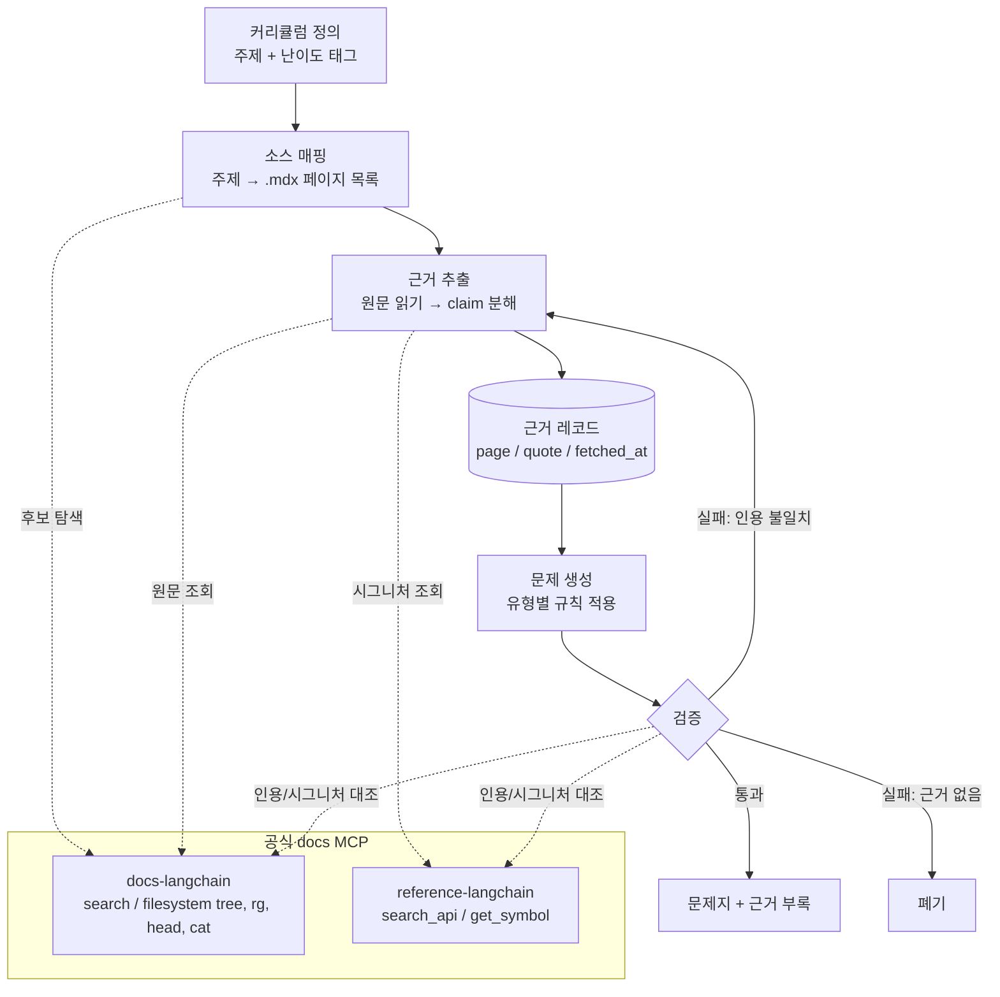
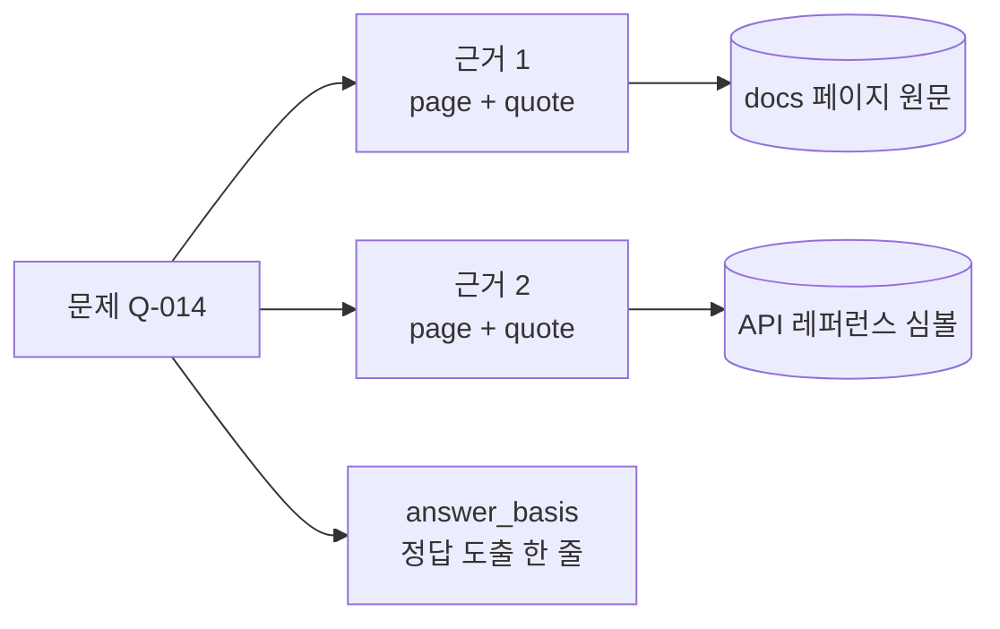

# 설계안 A: 공식 docs MCP 직접 근거 추출 방식

LLM App 개발 학습 문제지의 근거 자료를 LangChain 공식 문서에서 직접 추출하는 설계안이다. OpenWiki 기반 설계안과 비교하기 위한 후보 중 하나다.

## 1. 개요

- 근거 소스: Docs by LangChain 사이트 (`docs.langchain.com`) 공개 페이지.
- 접근 수단: MCP 서버 두 개.
  - `docs-langchain`: 문서 검색(`search_docs_by_lang_chain`), 문서 파일시스템 조회(`query_docs_filesystem_docs_by_lang_chain`, `.mdx` 원문을 `head`/`cat`/`rg`로 읽음).
  - `reference-langchain`: API 레퍼런스 검색(`search_api`), 심볼 상세(`get_symbol`). 시그니처/파라미터 문제의 근거로 쓴다.
- 핵심 아이디어: 문제 한 개마다 "근거 레코드"(페이지 경로, 인용 구절, 조회 시각)를 붙여 추적 가능하게 한다. 중간 위키를 만들지 않는다.

기술 스택(LangChain, LangGraph, Langfuse, AWS Bedrock)은 [tech-stack-common.md](tech-stack-common.md)를 따른다.

## 2. 파이프라인

### 2.1 전체 흐름도



### 2.2 근거 추적 구조



### 2.3 단계 설명

1. **범위 정의**: 학습 주제 목록(커리큘럼)을 먼저 정한다. 예: 모델 호출, 도구 호출, RAG, LangGraph 상태/체크포인트, 메모리, 평가, 관측(LangSmith), 배포.
2. **소스 매핑**: 주제마다 `tree`/`rg -il`로 관련 `.mdx` 경로를 찾아 "주제 → 페이지 목록" 표를 만든다. Python/JS 분기 페이지는 언어를 하나로 고정한다.
3. **근거 추출**: 페이지를 `head`/`cat`으로 읽고 사실 단위(claim)로 쪼갠다. 각 claim에 다음을 기록한다.
   - `page`: 문서 경로(`.mdx` 제거한 URL 경로)
   - `quote`: 원문 인용 1~3문장
   - `anchor`: 가능하면 섹션 앵커
   - `fetched_at`: 조회 일자
4. **문제 생성**: claim 하나 이상을 입력으로 문제를 만든다. 문제 유형별 입력 규칙은 아래 표를 따른다.
5. **검증**: 정답/해설이 `quote`와 모순되지 않는지 별도 패스로 확인한다. 코드 문제는 `get_symbol` 결과와 시그니처를 대조한다.
6. **산출**: 문제지 + 근거 부록(문제 번호 → page/quote 매핑).

| 문제 유형 | 근거 입력 | 비고 |
| --- | --- | --- |
| 개념 이해(단일·복수 선택/단답) | docs 개념 페이지 claim | 보기 오답은 같은 페이지의 인접 개념에서 생성 |
| API 사용(코드 선택: 올바른 코드나 오류 고르기) | `get_symbol` 시그니처 + docs 예제 코드 | 예제 코드는 원문 그대로 인용 후 변형 |
| 설계 판단(단일·복수 선택) | 여러 페이지 claim 조합 | 근거 페이지 2개 이상 요구 |
| 트러블슈팅 | docs의 Note/Warning 블록 | 경고 문구를 정답 근거로 사용 |

## 3. 근거 레코드 스키마 (제안)

```yaml
question_id: Q-014
topic: langgraph-checkpointing
type: concept
sources:
  - page: /oss/python/langgraph/persistence   # 예시 경로, 실제 경로는 조회로 확정
    quote: "<원문 인용>"
    fetched_at: 2026-11-03
answer_basis: "<정답이 어떤 quote에서 도출되는지 한 줄>"
reviewed: false
```

위 `page` 값은 예시다. 실제 경로는 `tree`/`rg`로 확인한 값만 쓴다.

## 4. 장점

- 중간 산출물이 없다. 설정, 모델 키, CI 구성 없이 바로 시작할 수 있다.
- 근거가 공식 문서 원문이다. 생성물 해석 단계가 없어 오류 전파가 적다.
- 문서가 갱신되면 같은 쿼리로 재조회해 문제를 갱신하기 쉽다.
- API 레퍼런스까지 같은 흐름으로 묶을 수 있다.

## 5. 한계와 대응

| 한계 | 대응 |
| --- | --- |
| 공식 문서 범위 밖(사내 앱, 타사 도구) 지식은 근거가 없다 | 해당 주제는 출제 범위에서 뺀다. 설계안 B(OpenWiki)는 탐색용이라 근거를 대신하지 못한다 |
| 문서는 교육용 구조가 아니다(난이도, 선후관계 없음) | 커리큘럼과 난이도 태그를 사람이 먼저 정의 |
| 문서 내용이 버전에 따라 바뀐다 | `fetched_at` 기록, 출제 시점 기준으로 고정, 정기 재검증 |
| Python/JS 페이지 중복 | 언어 하나로 고정하고 문제에 명시 |
| 검색 결과가 관련 없는 페이지를 섞을 수 있다 | 검색은 후보 탐색용, 근거는 반드시 `.mdx` 원문을 읽고 확정 |
| MCP 결과는 외부 콘텐츠다 | 문서 내 지시문처럼 보이는 텍스트는 데이터로만 취급 |

## 6. 품질 게이트

- 모든 문제에 `sources`가 최소 1개 있어야 한다.
- 정답을 뒷받침하는 `quote`가 원문에 실제 존재해야 한다(문자열 대조).
- 코드 문제는 실행 또는 시그니처 대조를 통과해야 한다.
- 근거 없는 문제는 폐기한다. 모델 사전 지식으로 만든 문제는 허용하지 않는다.

## 7. 구현 순서 제안

1. 커리큘럼 10개 내외 주제 확정.
2. 주제별 소스 매핑 표 작성(`tree`, `rg -il` 사용).
3. 주제 1개로 파일럿: claim 추출 → 문제 5개 → 검증.
4. 스키마와 게이트 조정 후 나머지 주제로 확장.

## 8. 설계안 B(OpenWiki)와 비교 포인트

| 항목 | A: docs MCP 직접 | B: OpenWiki 경유 |
| --- | --- | --- |
| 소스 범위 | 공식 문서 | 임의 레포/개인 소스 |
| 준비 비용 | 낮음 | 중간(설치, 모델 설정, 생성 실행) |
| 근거 신뢰도 | 원문 직접 | 생성물 + Claims 증거 |
| 갱신 | 재조회 | `--update` 재생성 |
| 사내 자료 | 불가 | 가능 |
