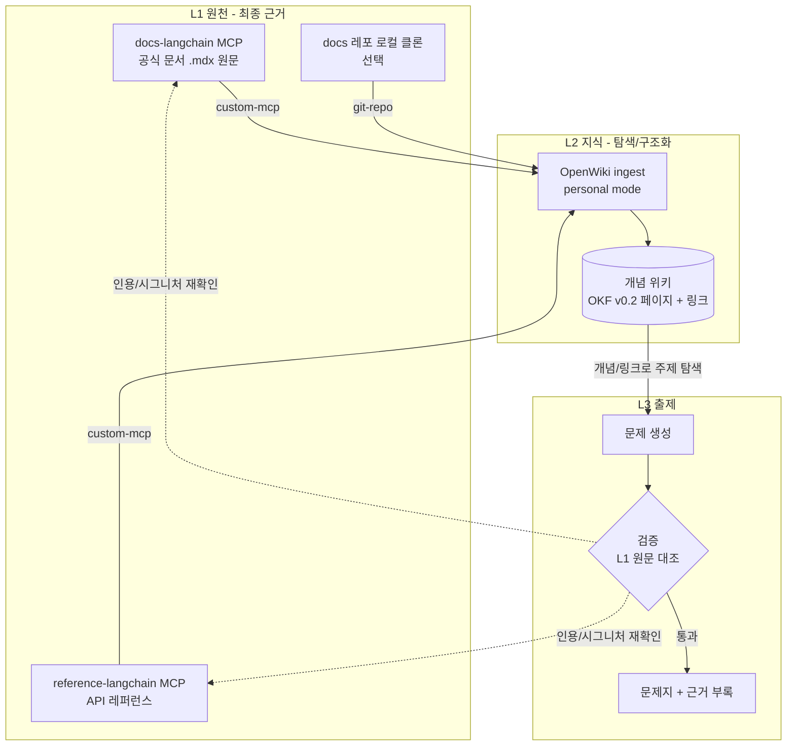
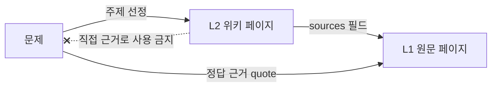

# 설계안 B: 3층 구조 (docs MCP 원천 + OpenWiki 지식층 + 출제층)

설계안 A(공식 docs MCP 직접 근거 추출) 위에 OpenWiki 지식 레이어를 얹는 설계안이다. A를 대체하지 않고 확장한다.

## 1. 개요

- **L1 원천**: 공식 docs MCP가 제공하는 원문과 API 레퍼런스. 학습 문제의 기본 원천 소스이자 최종 근거.
- **L2 지식**: OpenWiki가 L1을 합성해 만든 개념 위키. 개념 통합, 링크, 출처 추적을 담당.
- **L3 출제**: L2로 주제를 탐색하고, L1 원문을 근거로 확정해 문제를 만드는 층.

핵심 원칙은 하나다. **L2는 탐색과 구조화용이고, 정답 근거는 항상 L1 원문 인용으로 확정한다.**

## 2. 구조도

### 2.1 3층 구조

### 2.2 데이터 흐름과 근거 방향

L2 페이지는 문제의 주제와 연관 개념을 찾는 데만 쓴다. 문제의 `quote`는 L2 페이지에서 가져오지 않는다.

### 2.3 기술 스택

공통 스택과 환경 제약은 [tech-stack-common.md](tech-stack-common.md)를 따른다. B안 한정 사항(OpenWiki provider `bedrock` 설정)은 해당 문서 4장에 있다.

## 3. 층별 역할

| 층 | 입력 | 출력 | 신뢰 수준 | 책임 |
| --- | --- | --- | --- | --- |
| L1 원천 | 공식 docs | 원문, 시그니처 | 최종 근거 | 사실의 출처 |
| L2 지식 | L1 원문 | 개념 페이지, 링크, `sources` | 보조(LLM 합성) | 개념 통합, 관계 표현 |
| L3 출제 | L2 + L1 | 문제, 근거 레코드 | 검증 후 확정 | 난이도, 유형, 학습 목표 |

## 4. L2가 더하는 것

- 여러 페이지에 흩어진 개념을 한 페이지로 통합한다.
- 개념 간 링크로 오답 보기 생성과 다단계 추론 문제의 재료를 만든다.
- OKF front matter의 `sources`로 L1 페이지까지 역추적한다.
- docs 외 소스(사내 레포, 블로그, 노트)를 같은 위키에 합칠 수 있다.

## 5. L1 → L2 연결 방식

OpenWiki 문서(personal mode) 기준으로 확인된 경로는 다음과 같다.

| 경로 | OpenWiki 소스 | 확인된 동작 | 비고 |
| --- | --- | --- | --- |
| docs MCP 연결 | `custom-mcp` | HTTP 또는 stdio MCP 서버에 연결하고 명시적으로 안전한 읽기 전용 도구만 허용 | docs MCP 도구를 "안전" 지정하는 방법은 미확인 |
| docs 레포 | `git-repo` | 설정한 로컬 경로의 레포를 읽고 매니페스트 작성 | 레포를 로컬에 먼저 클론해야 함 |

- ingest 시 원시 데이터는 `~/.openwiki/connectors/<connector>/raw/` 아래에 저장되고, 이를 바탕으로 위키가 갱신된다. 이 raw 디렉터리가 L1 스냅샷 역할을 겸한다.
- 자동 스케줄 설치는 문서상 macOS LaunchAgent 기준이다. Windows에서는 `openwiki ingest all` 또는 `openwiki personal --update`를 수동 실행하는 것으로 가정한다. Windows 동작은 미검증이다.

## 6. 검증 규칙

- 문제 근거 `quote`는 L1 원문에 문자열로 실제 존재해야 한다.
- L2 페이지의 `verified` 표시가 있어도 L3 검증을 생략하지 않는다.
- L2 페이지 내용과 L1 원문이 다르면 L1을 따르고, 해당 L2 페이지를 오류 후보로 기록한다.
- 코드 문제는 `get_symbol` 시그니처 대조 또는 실행으로 확인한다.

## 7. 장점

- 흩어진 개념을 묶어 설계 판단형, 다단계 추론형 문제를 만들기 쉽다.
- 공식 docs 외 소스를 같은 구조에 합칠 수 있다.
- L1 근거 원칙을 지키면 A안의 추적성을 유지한다.
- L2를 개념 지도로 쓰면 커리큘럼 설계 자료로도 쓸 수 있다.

## 8. 한계와 위험

| 위험 | 대응 |
| --- | --- |
| L2의 LLM 해석 오류가 문제로 전파됨 | 근거는 L1 `quote`로만 확정, L2 직접 인용 금지 |
| 공정이 늘고 모델 비용이 듦(ingest 시 LLM 호출) | 파일럿 주제 1~2개로 비용 측정 후 확장 |
| OpenWiki가 의도한 용도는 에이전트용 컨텍스트이지 교육용이 아님 | 난이도, 유형, 학습 목표는 L3에서 별도 정의 |
| `custom-mcp` 안전 도구 지정, Windows 동작 등 미확인 사항 | 파일럿 첫 단계에서 연결 가능 여부부터 확인 |
| L2 갱신 시 페이지가 바뀌어 기존 문제와 어긋날 수 있음 | 문제에 `fetched_at`과 L1 인용을 저장, L2 변경은 재검증 트리거로 사용 |

## 9. 구현 순서 제안

1. 파일럿 확인: OpenWiki 설치, `custom-mcp`로 docs MCP 연결 가능 여부 확인. 안 되면 docs 레포를 `git-repo`로 연결.
2. 주제 1개(예: LangGraph 체크포인트)로 ingest 실행, L2 페이지 품질 점검.
3. L2 개념 링크로 문제 5개 생성, 각 문제의 근거를 L1에서 확정.
4. L2 오류율(L1과 불일치한 비율) 측정. 높으면 B안을 접고 A안으로 복귀.
5. 기준 통과 시 주제 확장.

## 10. A안과의 비교

| 항목 | A: docs MCP 직접 | B: 3층(MCP + OpenWiki) |
| --- | --- | --- |
| 소스 범위 | 공식 문서 | 공식 문서 + 임의 소스 |
| 준비 비용 | 낮음 | 중간(설치, 모델 설정, ingest) |
| 문제 유형 | 단일 페이지 중심 | 다단계/통합형 가능 |
| 근거 신뢰도 | 원문 직접 | 원문 직접(L2는 보조) |
| 오류 전파 위험 | 낮음 | L2에서 추가 발생 가능, 게이트로 차단 |
| 적합한 경우 | 공식 docs만으로 충분 | 여러 소스 통합, 개념 연결형 문제 필요 |
