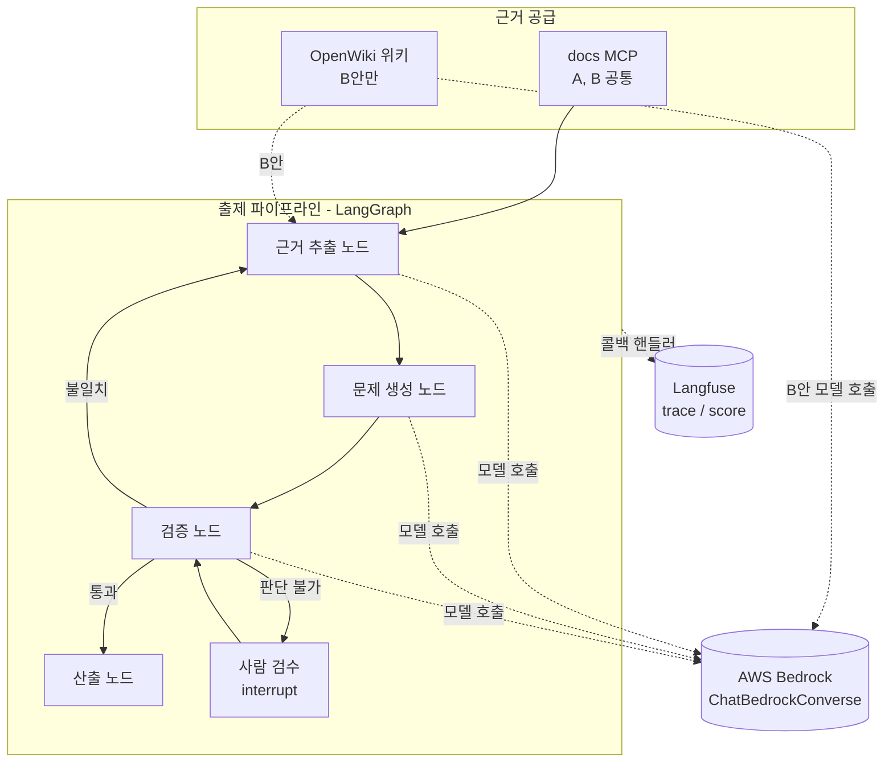

# 기술 스택 (A안, B안 공통)

설계안 A(docs MCP 직접)와 설계안 B(3층, OpenWiki 지식층)가 공통으로 쓰는 기술 스택과 환경 제약이다.

- [설계안 A](design-option-a-docs-mcp-grounding.md)
- [설계안 B](design-option-b-layered-openwiki.md)

## 1. 스택과 제약

- 사용 스택: LangChain, LangGraph, Langfuse
- 환경 제약: AWS Bedrock. LLM 모델이 필요한 모든 곳(출제 파이프라인, B안의 OpenWiki 포함)에서 Bedrock만 사용한다.
- 용어: 모델 호출은 AWS Bedrock 경유로 쓴다. Anthropic API 직접 호출은 쓰지 않는다. 사용 가능 모델은 [bedrock-model-list.md](bedrock-model-list.md)를 따른다(Claude, Amazon Nova).

## 2. 공통 구조

출제 파이프라인(L3)은 A안과 B안에서 동일하다. 차이는 L3가 근거를 얻는 경로뿐이다. A안은 docs MCP 원문만 쓰고, B안은 OpenWiki 위키(L2)로 주제를 탐색한 뒤 docs MCP 원문으로 확정한다.

## 3. 구성 요소별 적용

| 구성 요소 | 적용 방식 | 상태 |
| --- | --- | --- |
| LangGraph | 출제 파이프라인. 검증 실패 시 되돌림은 조건부 엣지, 사람 검수는 interrupt로 구현 | 설계 |
| LangChain | 모델 호출, 구조화 출력, 도구 호출. Bedrock 모델은 `langchain_aws`의 `ChatBedrockConverse` 사용 | 클래스 존재 확인 |
| AWS Bedrock | LangChain 모델 클래스로 호출. AWS 자격증명과 리전 필요 | 설계 |
| Langfuse | LangChain/LangGraph 콜백 핸들러로 trace 수집. 문제별 근거 일치율, 검증 통과율을 score로 기록 | 설계 |

## 4. B안 한정 사항

Bedrock 사용 자체는 공통이다. 아래는 B안에서 OpenWiki가 추가로 필요로 하는 설정이다.

- OpenWiki provider는 `bedrock`으로 설정한다. 필요한 값은 AWS 자격증명과 리전이며, 명시 키 또는 AWS SDK 기본 체인을 쓸 수 있다.
- OpenWiki의 기본 출력 토큰 상한은 Bedrock에서 16000이다. `OPENWIKI_BEDROCK_MAX_TOKENS`로 조정한다.
- OpenWiki의 실행 추적 옵션은 LangSmith이고, Langfuse 연동은 OpenWiki 문서에 없다. L2 ingest는 Langfuse에서 보이지 않는다.

## 5. 미확인 사항

> 모델 ID와 단계별 모델 분리는 [requirements.md](../output/requirements.md) NFR-4, Langfuse 호스팅은 NFR-5에서 정했다. 아래는 작성 당시 기록이다.

- 사용할 Bedrock 모델 ID, 리전, 계정 내 모델 접근 허용 여부.
- 단계별 모델 분리 여부(예: 생성은 저가 모델, 검증은 고성능 모델). 파일럿 비용 측정 후 결정한다.
- Langfuse 호스팅 방식(클라우드 또는 자체 호스팅). 환경 제약에 따라 정한다.
