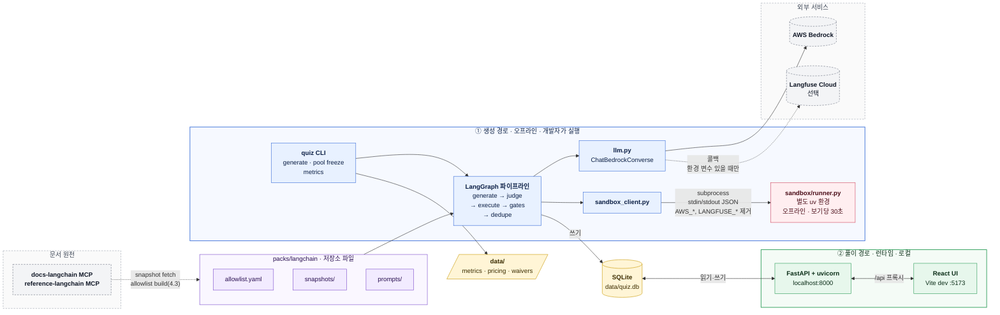
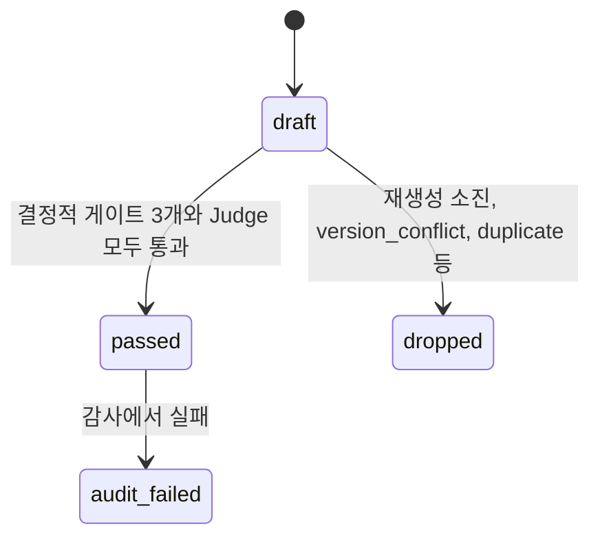
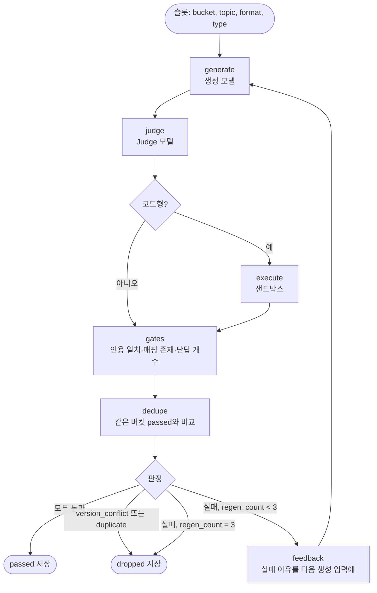
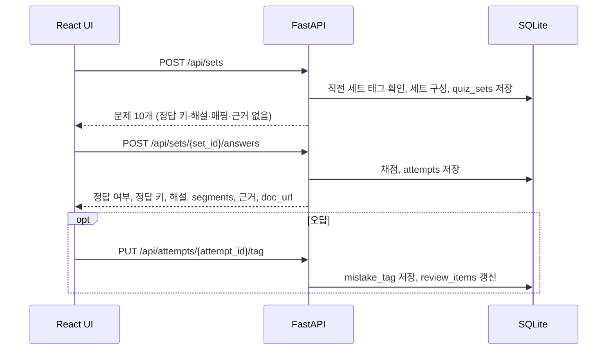

# 설계서: LangChain 예상 문제 풀이 웹앱 (MVP)

| 항목 | 내용 |
| --- | --- |
| 문서 상태 | 확정 |
| 버전 | 12.1 (부록 A) |
| 작성일 | 2026-11-04 |
| 요구사항 | [requirements.md](../../01-requirements/output/requirements.md) |
| 관련 산출물 | [page-allowlist.md](page-allowlist.md), [seed.yaml](seed.yaml) |

이 문서는 요구사항 정의서가 열어 둔 구현 결정의 원본이다. 그 밖의 내용이 요구사항과 다르면 요구사항을 따른다.

## 1. 개요

### 1.1 목적

요구사항 정의서의 MVP 요구사항을 만족하는 아키텍처, 모듈, 데이터, 주요 흐름, 인터페이스를 정의한다. 구현은 이 문서와 Seed 수용 기준(`seed.yaml`, 완료 판정 기준 목록)을 따른다.

### 1.2 설계 목표

| 목표 | 관련 요구사항 |
| --- | --- |
| 풀이 경로는 모델 호출 없이 SQLite만으로 돈다 | FR-1.3, FR-3.4 |
| 정답 근거를 모델 판단과 결정적 검사(모델 없이 코드로 판정해 늘 같은 결과가 나오는 검사)로 이중 확인한다 | GR-4, GR-5, GR-6, GR-7 |
| 로컬 전용으로 만들되 서버 배포를 막지 않는다 | NFR-1.1 |
| 문제 형식과 유형을 나중에 추가할 수 있다 | NFR-1.2 |
| CCA-F(Anthropic 자격증) 팩을 붙일 때 방해되지 않게 팩 데이터(출제 주제별 출처 목록, 출처 원문, 프롬프트)를 분리한다. 팩을 갈아 끼우는 구조는 만들지 않는다 | 요구사항 1.3 |

### 1.3 용어

요구사항 정의서 1.4의 용어를 그대로 쓴다. 이 문서에서 더하는 용어는 다음과 같다.

| 용어 | 뜻 |
| --- | --- |
| 배치 | `quiz generate` 1회 실행. `batch_id`로 식별한다 |
| 슬롯 | 배치가 만들 문제 1개의 자리. 버킷(학습 일차별 주제 묶음), 주제, 형식, 유형을 정한다 |
| 시도 | 슬롯 하나의 생성~검사 1회. 재생성마다 `attempt_no`가 늘어난다 |
| 문제 상태 | `draft`, `passed`, `dropped`, `audit_failed`(5.3) |

### 1.4 구현 단계에서 확인할 항목

| 항목 | 현재 값 | 확인 방법 |
| --- | --- | --- |
| 앱 Python 버전 | 3.14.8. 교안 `.venv`에서 확인(2026-11-05) | 확인함 |
| 앱 `langchain`, `langgraph` 버전 | `langchain` 1.4.7, `langgraph` 1.2.17. 교안 `.venv`에서 확인(2026-11-05) | 확인함 |
| Langfuse SDK 설정 키 이름 | `LANGFUSE_PUBLIC_KEY`, `LANGFUSE_SECRET_KEY`, 호스트 `LANGFUSE_BASE_URL`(deprecated `LANGFUSE_HOST`도 읽음). `langfuse` 5.1.0 소스와 Langfuse LangChain 통합 문서에서 확인(2026-11-05) | 확인함 |
| Bedrock 비용 단가 | 생성·Judge 모델 모두 Global 입력 3.00, 출력 15.00 USD/1M 토큰. AWS Price List API `AmazonBedrockFoundationModels`(공표 2026-10-12)에서 확인(2026-11-05) | 확인함 |
| 페이지 스냅샷(출처 문서 원문) 수집 방법 | Python MCP 클라이언트(4.3). 서버 URL `https://docs.langchain.com/mcp` | 확인함(2026-11-05) |
| Bedrock 요청 제한과 비용 | 파일럿에서 일일 토큰 한도(`ThrottlingException` "Too many tokens per day")가 발생했다. 호출 경로(프로필)·리전을 바꿔(3.1) 이어 갔다. 파일럿(버킷당 1문제 시험 생성) 슬롯당 0.286 USD, 본 생성(pool) 배치 60슬롯 18.60 USD(2026-11-05) | 확인함. 한도 값은 미확인([구현 결과서](../../03-implementation/output/implementation.md) 1.7) |
| 생성 시간 | 파일럿 문제당 약 72초(동시 2). 본 생성 배치 60슬롯 1,334초(2026-11-05) | 확인함 |
| 백업 보관 개수 | 최근 10개(8.4) | 확인함(2026-11-05) |

## 2. 아키텍처

### 2.1 개요

경로가 둘이다. 두 경로는 SQLite 파일 하나로만 만난다.

- **생성 경로(오프라인, 풀이 전에 미리)**: 개발자가 `quiz` CLI로 배치(`quiz generate` 1회 실행)를 돌린다. LangGraph 파이프라인이 Bedrock을 부르고, 코드형은 보기 코드를 샌드박스(앱과 분리된 실행 환경)에서 실행하고, 결과를 SQLite에 쓴다. 풀이 시점에는 돌지 않는다.
- **풀이 경로(런타임, 사용자가 풀 때)**: 브라우저의 React UI가 Vite 프록시(브라우저의 `/api` 요청을 8000번 서버로 넘기는 중계)를 거쳐 FastAPI를 부른다. FastAPI는 SQLite만 읽고 쓴다. 모델 호출과 Bedrock 자격 증명이 없다.



### 2.2 프로세스

| 프로세스 | 시작 | 수명 | 외부 접근 |
| --- | --- | --- | --- |
| `quiz` CLI | `uv run quiz ...`(`app/`) | 배치 1회 | Bedrock, Langfuse(선택) |
| 샌드박스 runner | CLI가 보기 1개마다 subprocess로 띄움 | 실행 1건, 최대 30초 | 없음 |
| FastAPI | `uv run uvicorn quiz.server:app --port 8000`(`app/`) | 풀이하는 동안 | 없음 |
| Vite dev 서버 | `npm run dev`(`web/`) | 풀이하는 동안 | 없음 |

## 3. 기술 스택과 설정

### 3.1 기술 스택

"미확인"은 구현 첫 작업에서 확인해 `uv.lock`, `package-lock.json`, 이 표에 고정한다(1.4). 로컬 도구 버전은 2026-11-04에 이 머신에서 확인한 값이다.

| 구성 요소 | 선택 | 버전·고정 방식 | 근거 |
| --- | --- | --- | --- |
| 앱 Python | CPython | 3.14.8. 교안 `.venv`와 같다. `.python-version`과 `requires-python`(`>=3.14,<3.15`)에 고정 | NFR-3.1 |
| 패키지 관리 | uv | 로컬 0.13.7. `app/`, `sandbox/` 각자 `uv.lock`을 커밋 | 4.1 |
| 파이프라인 | `langchain`, `langgraph` | `langchain==1.4.7`, `langchain-core==1.7.0`, `langgraph==1.2.17`. 교안 `.venv`와 같다 | NFR-2.4, NFR-3.1 |
| 모델 클래스 | `langchain-aws`의 `ChatBedrockConverse` | `langchain-aws==1.9.0`. 교안 `.venv`와 같다 | NFR-2.5 |
| 스냅샷(출처 문서 원문) 수집 | `mcp` Python 클라이언트 | `mcp==1.30.0`(샌드박스 고정 버전과 같다) | GR-1.4 |
| 앱 보조 | `python-dotenv`(CLI `.env` 로드), `pyyaml`(허용 목록 = 출제 근거 출처 목록) | 앱 `uv.lock`에 고정 | - |
| 백엔드 | FastAPI + uvicorn | 구현 시점 최신. 앱 `uv.lock`에 고정 | NFR-2.1 |
| 저장소 | SQLite, Python 표준 `sqlite3` | 별도 설치 없음. 스키마는 `schema_version`과 `migrations/`로 관리 | NFR-2.2, 8.4 |
| 관측(모델 호출 기록 추적) | `langfuse` SDK, Langfuse Cloud Hobby | `langfuse` 5.1.0. 앱 `uv.lock`에 고정. 환경 변수가 없으면 붙이지 않음 | NFR-5, 8.3 |
| 샌드박스 Python | CPython, 별도 uv 프로젝트 | 버전은 앱과 같게 둔다(기본값) | GR-7.1 |
| 샌드박스 패키지 | `langchain`, `langgraph`, `langchain-core`, `langchain-text-splitters`, `numpy` | 버전 고정 파일(lock)을 만들 때의 최신(문서 최신 버전 기준) | GR-7.2 |
| 샌드박스 MCP 고정 | `mcp==1.30.0`, `fastmcp==2.13.0`, `langchain-mcp-adapters==0.3.2`, `mcp-server-time==2026.10.10` | 고정 | GR-7.2 |
| 프론트엔드 | React + Vite, TypeScript(기본값, `react-ts` 템플릿) | React 19.3, Vite 8.3, TypeScript 7.0(2026-11-05 설치). `package-lock.json`을 커밋 | NFR-2.3 |
| JS 런타임·패키지 | Node, npm | 로컬 Node v26.13.0, npm 11.20.0. Bun 1.4.4도 있으나 쓰지 않음(기본값) | NFR-2.3 |
| 테스트 | pytest(기본값), httpx(FastAPI TestClient) | 앱 dev 의존성 | - |
| 생성 모델 | `global.anthropic.claude-sonnet-4-6` | Bedrock 모델 ID | NFR-4.1 |
| 생성 모델 전환 프로필 | `us.anthropic.claude-sonnet-4-6` | 프로필은 Bedrock이 요청을 보낼 리전 묶음이다(global은 전 세계, us는 미국). 일일 토큰 한도(`ThrottlingException`, "per day")에 걸리면 다음 순서로 넘어간다: 환경 변수 리전의 global → us 프로필, 이어서 나머지 허용 리전의 global → us 프로필(ap-northeast-2는 global만). 넘어간 뒤에는 그대로 쓴다. 단가는 실제로 부른 프로필로 매긴다 | NFR-4.1 |
| Judge 모델 전환 프로필 | `us.anthropic.claude-sonnet-4-5-20250929-v1:0` | 생성 모델 전환과 같은 규칙이다 | NFR-4.2 |
| Judge 모델(생성된 문제를 검토하는 모델) | `global.anthropic.claude-sonnet-4-5-20250929-v1:0` | Bedrock 모델 ID | NFR-4.2 |
| 예비 모델 | `global.anthropic.claude-haiku-4-5-20251001-v1:0` | Bedrock 모델 ID | NFR-4.3 |

### 3.2 설정과 포트

| 항목 | 값 | 쓰는 곳 |
| --- | --- | --- |
| Bedrock 리전 | `AWS_REGION`, 없으면 `AWS_DEFAULT_REGION`. `us-east-1`, `us-west-2`, `ap-northeast-2` 중 하나. `llm.py`가 `region_name`으로 직접 넘긴다(D-12). 세 값 밖이면 시작 시 오류로 멈춘다 | CLI |
| `.env` | 저장소 루트 `.env`. CLI만 읽는다(`quiz.env`). 서버는 읽지 않는다 | CLI |
| AWS 자격 증명 | AWS SDK 기본 체인(환경 변수, 프로필) | CLI만. 서버와 샌드박스에는 넘기지 않음 |
| Langfuse | `LANGFUSE_PUBLIC_KEY`, `LANGFUSE_SECRET_KEY`, 호스트 `LANGFUSE_BASE_URL` 또는 `LANGFUSE_HOST` | CLI만 |
| FastAPI 포트 | `localhost:8000` | 서버, Vite 프록시 |
| Vite 포트 | 5173(Vite 기본값) | 브라우저 |
| DB 파일 | `data/quiz.db`, 백업 `data/backups/` | CLI, 서버 |

## 4. 모듈 설계

### 4.1 코드 구조

코드는 저장소 루트의 `docs/` 밖에 둔다. LangChain 전용 데이터와 프롬프트만 `packs/langchain/`에 모은다. 팩(출제 주제)을 갈아 끼우는 인터페이스는 만들지 않는다(요구사항 1.3).

```text
ax_transformation_miniPJT/
├── app/                            # Python 앱(uv 프로젝트). 백엔드, 파이프라인, CLI
│   ├── pyproject.toml              # langchain·langgraph는 교안 코드가 도는 버전으로 고정(NFR-3.1)
│   ├── uv.lock
│   ├── quiz/
│   │   ├── db.py                   # sqlite3 연결, DB 경로(`QUIZ_DB`)
│   │   ├── backup.py               # sqlite3 backup API, 최근 10개(8.4)
│   │   ├── migrate.py              # 마이그레이션 적용
│   │   ├── gates.py                # 모델 없이 코드로 하는 검사: 인용이 원문에 있는지, 영·한 구절 짝, 비슷한 문제 중복, 단답 표기 통일
│   │   ├── grading.py              # 채점(FR-3)
│   │   ├── slots.py                # 만들 문제 자리(슬롯) 계획: pilot(시험 생성)·pool(본 생성)·fill(모자란 만큼)(6.1)
│   │   ├── sets.py                 # 10문제 세트 구성(FR-1)
│   │   ├── review.py               # 복습 큐: 틀린 문제를 몇 세트 뒤 다시 내는 목록(FR-5)
│   │   ├── audit.py                # 감사: 사용자가 직접 검토할 표본 20문항(FR-9)
│   │   ├── metrics.py              # 기준선 지표: 개선 전후 비교용 첫 측정값(요구사항 7.3)
│   │   ├── llm.py                  # Bedrock 모델 호출, 한도에 걸리면 프로필·리전 전환, 토큰 기록, Langfuse 기록 연결
│   │   ├── pricing.py              # 단가표 읽기, 비용 계산(5.4)
│   │   ├── allowlist.py            # 출처 목록(allowlist.yaml) 읽기, 원문 파일이 바뀌지 않았는지 해시 검사
│   │   ├── snapshots.py            # docs-langchain MCP에서 출처 원문 받기
│   │   ├── store.py                # 배치 결과 저장(있으면 고치고 없으면 넣기, upsert)
│   │   ├── batch.py                # 배치(`quiz generate` 1회) 실행
│   │   ├── pool.py                 # 출제할 문제 목록 고정(풀 스냅샷)
│   │   ├── env.py                  # CLI 전용 .env 로드
│   │   ├── crosscheck.py           # 교차 풀이: 다른 모델이 정답을 모른 채 풀어 정답 키와 맞는지 본다. 요구사항 밖 보조 점검이다
│   │   ├── pipeline/               # 문제 생성·검사 단계를 잇는 LangGraph 그래프(6.1)
│   │   │   ├── graph.py            # 그래프 구성
│   │   │   ├── nodes.py            # 단계(노드)별 함수와 통과·실패 판정
│   │   │   ├── prompts.py          # 프롬프트 로더
│   │   │   └── schemas.py          # 모델 출력 JSON 형태: 형식별 문제, Judge 판정
│   │   ├── sandbox_client.py       # 샌드박스 subprocess 호출
│   │   ├── server.py               # FastAPI 앱(7.1)
│   │   └── cli.py                  # `quiz` 명령(7.2)
│   ├── migrations/
│   │   ├── 0001_init.sql
│   │   └── 0002_attempt_cost.sql   # verification_results.cost_usd
│   └── tests/
├── sandbox/                        # 코드형 실행 환경(별도 uv 프로젝트, 앱과 의존성 공유 안 함)
│   ├── pyproject.toml              # langchain·langgraph 등 버전 고정 시점 최신 + MCP 패키지 4개 고정(GR-7.2)
│   ├── uv.lock
│   ├── runner.py                   # stdin JSON 하나를 받아 실행하고 stdout JSON 하나를 낸다
│   ├── fakes.py                    # 코드형 문제가 쓰는 가짜 모델(실제 호출 없음). GenericFakeChatModel, bind_tools 하위 클래스
│   ├── examples/                   # runner 확인 입력
│   └── tests/
├── web/                            # 풀이 화면(React + Vite). `/api` 요청을 localhost:8000 서버로 넘긴다
├── packs/                          # 출제 주제(팩). 팩마다 지식 출처, 출처 원문, 프롬프트를 둔다
│   └── langchain/                  # LangChain 프레임워크 개발 지식. Anthropic 자격증(CCA-F) 팩은 다음에 붙인다
│       ├── allowlist.yaml          # 출제 근거로 쓰는 공식 문서 출처 목록. page-allowlist.md에서 만든다
│       ├── snapshot-manifest.yaml  # 원문이 바뀌지 않았는지 대조할 해시 목록(4.3)
│       ├── snapshots/              # 출처에서 가져온 원문. 문서는 .mdx, API 레퍼런스는 get_symbol 출력 텍스트
│       └── prompts/                # 생성, Judge, 교차 풀이 프롬프트
│           ├── formats/            # 형식별 생성 규칙
│           ├── judge/              # Judge(검토 모델) 규칙: 선택형·단답·코드형
│           └── quality/            # 출제 품질 규칙
├── data/                           # 앱이 읽고 쓰는 데이터: 문제·풀이 DB, 백업, 지표, 단가표, 면제 목록
│   ├── metrics/
│   │   ├── baseline.json           # 기준선 지표: 개선 전후 비교용 첫 측정값(커밋)
│   │   └── trace-<trace_id>.json   # Langfuse 호출 기록 내보내기(커밋)
│   ├── pricing/
│   │   └── bedrock.yaml            # 단가표(커밋)
│   ├── crosscheck/                 # 교차 풀이 결과 .json, .md(커밋)
│   ├── waivers.yaml                # 완료 기준을 못 채웠을 때 사용자가 승인한 예외(커밋)
│   ├── quiz.db                     # SQLite. `.gitignore`의 `*.db`로 커밋 안 함
│   └── backups/                    # SQLite 백업(8.4). 커밋 안 함
└── docs/                           # 단계별 문서. 코드를 두지 않는다
```

### 4.2 모듈 책임과 경계

| 모듈 | 책임 | 의존 | 하지 않는 것 |
| --- | --- | --- | --- |
| 생성 파이프라인 (`quiz/pipeline`, `quiz/cli.py`) | 슬롯 계획, 생성·Judge 검토·보기 코드 실행·코드 검사(게이트)·재생성, 문제와 검증 결과 저장, 출제할 문제 목록 고정(풀 스냅샷), 변형 문제 생성 | `llm.py`, `gates.py`, `sandbox_client.py`, `db.py`, `packs/langchain` | 서버 요청 처리. 서버가 파이프라인을 부르지 않는다(풀이 시점 생성 없음) |
| 결정적 검사 (`quiz/gates.py`) | 인용 정규화·대조, 매핑 존재, 유사 중복, 단답 정규화 | 표준 라이브러리만 | 모델 호출, DB 쓰기 |
| 코드 실행 샌드박스 (`sandbox/`) | 보기별 코드 실행, `{ok, stdout, error_type}` 반환 | 자체 lock만 | 네트워크 호출, Bedrock, 앱 DB 접근. 앱은 subprocess로만 부른다 |
| FastAPI 서버 (`quiz/server.py`, `sets.py`, `review.py`, `grading.py`, `audit.py`) | 세트 구성, 채점, 오답 태그, 복습 큐, 감사 기록 API | `db.py`, `gates.py`(단답 정규화) | 모델 호출. 서버는 Bedrock 자격 증명 없이 돈다 |
| React UI (`web/`) | 풀이 화면, 결과·해설·매핑·근거, 태그 선택, 감사 화면 | `/api`만 | 채점. 답 제출 전에는 정답 키를 받지 않는다 |

### 4.3 팩 데이터

- 허용 목록(출제 근거로 쓸 공식 문서 출처 목록)은 [page-allowlist.md](page-allowlist.md)다. 주제 34개 중 맞는 페이지가 있는 주제(확인) 30, 비슷한 페이지만 있는 주제(근접) 3, 페이지가 없는 주제(없음) 1이다.
- `allowlist.yaml`은 page-allowlist.md 표에서 만든다. 행마다 `snapshot`(파일 이름), `sha256`, `fetched_at`을 둔다.
- 파이프라인은 `allowlist.yaml`에 있는 스냅샷만 읽는다(GR-2.3).
- 스냅샷 파일 이름은 경로의 `/`를 `__`로 바꾼 값이다. 예: `oss__python__langchain__knowledge-base.mdx`
- 스냅샷은 `quiz snapshot fetch <page...>`가 `docs-langchain` MCP를 Python MCP 클라이언트로 불러 받는다(D-14).
- 호출당 출력이 30KB에서 잘리므로 `sed -n 'a,bp'` 줄 범위로 나눠 받는다. 한 범위가 25,000자를 넘으면 범위를 줄인다.
- 합친 바이트의 sha256을 서버 `sha256sum` 값과 대조한다. 다르면 멈춘다.
- 스냅샷은 줄바꿈 변환 없이 저장한다(`.gitattributes` `-text`).
- URL 경로 `<p>`의 원문 파일은 `<p>.mdx`다. 없으면 `<p>/index.mdx`다. 스냅샷 이름은 URL 경로 기준이다.
- 수집 호출은 호출마다 60초 제한이다. 실패하면 3번까지 다시 부른다.
- 기대 해시(받은 원문이 바뀌지 않았는지 대조할 값)는 `packs/langchain/snapshot-manifest.yaml`에 둔다. 스냅샷 이름마다 `sha256`, `fetched_at`이다. 수집 명령이 서버 대조 뒤 쓴다(D-15).
- `allowlist build`는 스냅샷 파일 해시를 manifest와 대조한다. 다르면 멈춘다.
- `allowlist.yaml`은 표 한 행이 한 행이다. 필드는 `bucket`, `topic_no`, `topic`, `path`, `kind`, `status`, `snapshot`, `sha256`, `fetched_at`이다. `없음` 행은 뺀다.
- API 레퍼런스 스냅샷은 `reference-langchain` MCP `get_symbol(package, symbol, language="python")` 출력이다. package는 URL `/python/` 다음 마디, symbol은 마지막 마디다.
- API 레퍼런스 스냅샷 이름은 `reference__<URL 경로의 /를 __로>.md`다. 서버 해시가 없다. 출력 첫 줄이 `# <symbol>`인지 확인하고 로컬 sha256을 manifest에 적는다.

### 4.4 결정적 검사 규칙 (`gates.py`)

모델 없이 코드로 판정하는 검사다. 같은 입력이면 늘 같은 결과가 나온다.

| 검사 | 규칙 |
| --- | --- |
| 인용 정규화 | `quote`와 페이지 스냅샷(출처 원문) 양쪽에 Unicode NFKC 정규화(전각·반각처럼 모양만 다른 글자를 하나로 통일)와 연속 공백(줄바꿈 포함)을 공백 1칸으로 줄이는 것만 적용한다. 마크다운과 코드 블록 기호는 그대로 둔다. 대소문자를 구분한다 |
| 인용 대조 | 정규화한 `quote`가 정규화한 스냅샷 안에 그대로 있어야 한다. `quote`는 정규화 후 30자 이상이다. `page`는 `allowlist.yaml`에 있어야 한다 |
| 매핑 존재 | 문제마다 `segments`(영·한 구절 짝)가 있어야 한다 |
| 단답 허용 답안 | 1~5개여야 한다. 어기면 `accepted_answers_count`다 |
| 단답 채점 정규화 | NFKC, casefold(대소문자 무시), 백틱 제거, 공백 모두 제거, 끝의 `()` 1개 제거 순서다. `_`와 `.`은 둔다. 게이트와 채점이 같은 함수를 쓴다 |
| 유사 중복 | 같은 버킷 안에서 (1) 같은 `quote`를 쓰거나 (2) 정규화한 문제 본문의 토큰 Jaccard(두 본문의 단어 집합이 겹치는 비율)가 0.6 이상이면 `duplicate`다. 모델 호출과 임베딩은 쓰지 않는다. `quote`는 인용 정규화 뒤 비교한다. 본문 토큰은 NFKC·casefold 뒤 `\w+`다. 0.6 비교는 정수 연산이다. 같은 `question_id`는 비교에서 뺀다 |

생성 프롬프트에는 스냅샷 원문을 주고 `quote`를 그대로 복사하게 한다.

## 5. 데이터 설계

### 5.1 SQLite 스키마

`migrations/0001_init.sql`의 초안이다. JSON 열은 TEXT에 JSON을 담는다. 시각은 ISO 8601 UTC 문자열이다.

```sql
CREATE TABLE schema_version (version INTEGER PRIMARY KEY, applied_at TEXT NOT NULL);

CREATE TABLE batches (
  batch_id TEXT PRIMARY KEY,               -- b20261105-01
  kind TEXT NOT NULL CHECK (kind IN ('pool', 'variant')),
  started_at TEXT NOT NULL, finished_at TEXT,
  gen_model TEXT NOT NULL, judge_model TEXT NOT NULL,
  input_tokens INTEGER NOT NULL DEFAULT 0, output_tokens INTEGER NOT NULL DEFAULT 0,
  cost_usd REAL                             -- 단가표로 계산, 단가 없으면 NULL
);

CREATE TABLE batch_slots (
  batch_id TEXT NOT NULL REFERENCES batches, slot_no INTEGER NOT NULL,
  bucket TEXT NOT NULL, topic TEXT NOT NULL, format TEXT NOT NULL, question_type TEXT NOT NULL,
  variant_of TEXT REFERENCES questions,     -- 변형 배치만
  question_id TEXT NOT NULL UNIQUE,
  PRIMARY KEY (batch_id, slot_no)
);

CREATE TABLE questions (
  question_id TEXT PRIMARY KEY,
  batch_id TEXT NOT NULL REFERENCES batches,
  bucket TEXT NOT NULL, topic TEXT NOT NULL,
  format TEXT NOT NULL,                     -- single | multi | short | code. CHECK 없음(NFR-1.2)
  question_type TEXT NOT NULL,              -- concept | code_behavior | error_cause | design. CHECK 없음
  select_count INTEGER,                     -- multi만
  cca_f_tag TEXT NOT NULL,                  -- 'n/a' 허용
  stem_en TEXT NOT NULL,
  choices_json TEXT,                        -- [{id, text}] 또는 [{id, code}]
  answer_key_json TEXT NOT NULL,            -- ["B"] 또는 ["A","C"] 또는 단답 대표 답
  accepted_answers_json TEXT,               -- 단답만, 최대 5개
  explanation_ko TEXT NOT NULL,
  segments_json TEXT NOT NULL,              -- [{segment_id, en, ko}]
  exec_spec_json TEXT,                      -- 코드형만. 보기별 실행 코드
  doc_url TEXT,                             -- 코드형 "코드 보기" 링크
  status TEXT NOT NULL CHECK (status IN ('draft', 'passed', 'dropped', 'audit_failed')),
  drop_reason TEXT,                         -- regen_exhausted | judge_exec_mismatch | version_conflict | duplicate | ...
  regen_count INTEGER NOT NULL DEFAULT 0 CHECK (regen_count BETWEEN 0 AND 3),
  variant_of TEXT REFERENCES questions,
  fetched_at TEXT NOT NULL, lock_hash TEXT,
  created_at TEXT NOT NULL, updated_at TEXT NOT NULL,
  CHECK (status <> 'dropped' OR drop_reason IS NOT NULL)
);

CREATE TABLE grounding_records (
  question_id TEXT NOT NULL REFERENCES questions, idx INTEGER NOT NULL,
  page TEXT NOT NULL, quote TEXT NOT NULL, fetched_at TEXT NOT NULL, answer_basis TEXT NOT NULL,
  PRIMARY KEY (question_id, idx)
);

CREATE TABLE verification_results (
  question_id TEXT NOT NULL REFERENCES questions, attempt_no INTEGER NOT NULL,  -- 0~3
  quote_match INTEGER, mapping_present INTEGER, judge_pass INTEGER, exec_match INTEGER,
  duplicate_of TEXT,
  judge_verdict_json TEXT, exec_result_json TEXT, fail_reasons_json TEXT,
  input_tokens INTEGER, output_tokens INTEGER, created_at TEXT NOT NULL,
  cost_usd REAL,                            -- 0002. 이 시도의 생성·Judge 호출 비용 합. 단가 없는 모델을 쓰면 NULL
  PRIMARY KEY (question_id, attempt_no)
);

CREATE TABLE pool_snapshots (pool_snapshot_id TEXT PRIMARY KEY, created_at TEXT NOT NULL);
CREATE TABLE pool_snapshot_items (
  pool_snapshot_id TEXT NOT NULL REFERENCES pool_snapshots, question_id TEXT NOT NULL REFERENCES questions,
  PRIMARY KEY (pool_snapshot_id, question_id)
);

CREATE TABLE quiz_sets (
  set_id TEXT PRIMARY KEY, set_no INTEGER NOT NULL UNIQUE,   -- 복습 간격은 set_no로 센다
  pool_snapshot_id TEXT NOT NULL REFERENCES pool_snapshots,
  question_ids_json TEXT NOT NULL, created_at TEXT NOT NULL, completed_at TEXT
);

CREATE TABLE attempts (
  attempt_id INTEGER PRIMARY KEY,
  question_id TEXT NOT NULL REFERENCES questions, set_id TEXT NOT NULL REFERENCES quiz_sets,
  ts TEXT NOT NULL, answer TEXT NOT NULL, correct INTEGER NOT NULL CHECK (correct IN (0, 1)),
  mistake_tag TEXT CHECK (mistake_tag IN ('reading', 'concept')),
  confused_segment_id TEXT,
  schema_version INTEGER NOT NULL,
  UNIQUE (set_id, question_id),
  CHECK (correct = 0 OR mistake_tag IS NULL),
  CHECK (mistake_tag IS NOT 'reading' OR confused_segment_id IS NOT NULL)
);

CREATE TABLE review_items (
  question_id TEXT PRIMARY KEY REFERENCES questions,          -- 원래 문제
  mistake_tag TEXT NOT NULL, review_round INTEGER NOT NULL CHECK (review_round IN (1, 2)),
  due_set_no INTEGER NOT NULL,
  state TEXT NOT NULL CHECK (state IN ('pending', 'cleared', 'retired'))
);

CREATE TABLE audits (
  audit_id TEXT PRIMARY KEY, pool_snapshot_id TEXT NOT NULL REFERENCES pool_snapshots,
  seed TEXT NOT NULL, sample_json TEXT NOT NULL, created_at TEXT NOT NULL,
  result TEXT CHECK (result IN ('pass', 'fail'))
);
CREATE TABLE audit_records (
  audit_id TEXT NOT NULL REFERENCES audits, question_id TEXT NOT NULL REFERENCES questions,
  answer_key_error INTEGER NOT NULL, quote_unsupported INTEGER NOT NULL, mapping_unfaithful INTEGER NOT NULL,
  note TEXT, recorded_at TEXT NOT NULL,
  PRIMARY KEY (audit_id, question_id)
);
```

### 5.2 식별자와 값 규칙

| 대상 | 규칙 |
| --- | --- |
| `question_id` | `f"{batch_id}-{slot_no:03d}"`. 같은 슬롯은 항상 같은 ID다(6.2) |
| `pool_snapshot_id` | `"ps_" + sha256("\n".join(sorted(question_ids)))[:12]`. 풀 스냅샷은 출제할 문제 목록을 고정한 것이다. 같은 문제 집합이면 같은 ID라 감사 시드(표본을 뽑는 난수 시작값)가 재현된다(6.6) |
| `audit_id` | `"au_"` + `pool_snapshot_id`의 `ps_` 뒤 12자. 풀 스냅샷당 감사는 하나다(6.6) |
| `bucket` | 학습 일차별 주제 묶음. `rag`, `langgraph_basics`, `tool_mcp`, `middleware_hitl_guardrails`, `multi_agent`, `ops_quality`(day2~day7 순) |
| `format`, `question_type` | `CHECK`를 두지 않는다. 형식 추가는 채점 함수 등록과 UI 컴포넌트 추가로 한다(NFR-1.2) |
| `attempts.answer` | JSON 문자열. 복수 선택은 정렬한 보기 ID 배열이다 |
| `attempts.mistake_tag` | 정답 행에서만 빈 값을 허용한다. 답 제출 때 행이 생기고 태그는 뒤에 붙으므로 빈 값은 DB 제약 대신 API가 막는다(8.6). 값과 `confused_segment_id`는 DB `CHECK`로 막는다 |

### 5.3 문제 상태



- `passed`: 결정적 게이트 3개(인용 일치 GR-4, 영·한 매핑 존재 GR-5, 코드형 Judge-실행 일치 GR-7)와 Judge(GR-6)를 모두 통과한 상태다.
- 감사(사용자가 직접 문제를 검토하는 것)는 고정한 풀 스냅샷의 표본 20문항에만 적용한다. 감사에서 실패한 문제는 `audit_failed`로 바꾸고 풀에서 뺀다.
- `dropped`에는 `drop_reason`이 반드시 있다.

### 5.4 저장소 파일

| 파일 | 내용 | 만드는 곳 |
| --- | --- | --- |
| `packs/langchain/allowlist.yaml` | 허용 목록 행, 스냅샷 파일 이름, `sha256`, `fetched_at` | `quiz allowlist build` |
| `data/metrics/baseline.json` | 기준선 지표: 개선 전후 비교용 첫 측정값(아래 형식) | `quiz metrics`가 SQLite에서 다시 만든다 |
| `data/pricing/bedrock.yaml` | 모델 ID별 입력·출력 1M 토큰당 USD(AWS Price List 단위), 출처 URL, 공표일, 확인 날짜 | 수동 |
| `data/waivers.yaml` | 사용자 면제(완료 기준을 못 채웠을 때 사용자가 승인한 예외). 항목마다 `date`, `exit_condition`(seed의 `scope_cut_waiver`), `reason`, `passed_count`, 버킷·형식별 개수, `audit_failures`(감사 미달 시). 파일이 없거나 비면 면제 없음이다 | 수동 |

`baseline.json` 형식:

```json
{
  "generated_at": "2026-11-05T09:00:00Z",
  "pool_snapshot_id": "ps_...",
  "judge_pass_rate": {"attempts": 0, "passed": 0, "rate": 0.0},
  "drops": {"total": 0, "by_reason": {"regen_exhausted": 0}},
  "sets": [{"set_no": 1, "set_id": "...", "correct": 0, "total": 10, "rate": 0.0}],
  "batches": [{"batch_id": "...", "kind": "pool", "input_tokens": 0, "output_tokens": 0, "cost_usd": null, "seconds": 0}]
}
```

- `judge_pass_rate`는 Judge를 거친 시도 중 `judge_pass=1`인 비율이다. 분모는 `judge_pass`가 기록된 `verification_results` 행 전체(모든 배치, 모든 시도)다.
- `drops`는 `questions.status='dropped'` 전체다. `audit_failed`는 넣지 않는다.
- `sets`는 현재 풀 스냅샷(`pool_snapshot_id`)에서 낸 세트만 담는다.
- `seconds`는 `finished_at - started_at`(정수 초)이다. 끝나지 않은 배치는 `null`이다. 생성 시간 측정(6.2)에 쓴다.
- `rate`는 소수 넷째 자리로 반올림한다.

## 6. 주요 흐름

### 6.1 문제 생성 파이프라인 (FR-7)

배치 명령이 슬롯(만들 문제 1개의 자리)마다 그래프(생성, 검토, 실행, 검사, 중복 확인을 잇는 단계 흐름)를 한 번 돌린다. 그래프 상태는 슬롯 1개다. 슬롯 사이 동시 실행은 2개다(8.1).



| 노드(단계) | 입력 | 출력 | 실패 이유 |
| --- | --- | --- | --- |
| `generate` | 슬롯, 그 주제의 허용 목록 스냅샷 원문, 직전 실패 이유 | 구조화 출력(정해진 JSON 형태, `with_structured_output`): 문제, 보기, 정답 키, 허용 답안, 해설, segments(영·한 구절 짝), grounding_records(근거 레코드), 코드형 `exec_spec`(보기마다 실행할 전체 코드) | `schema_invalid` |
| `judge` | 문제 전체, 인용한 스냅샷 원문 | 정답 확인, 근거가 정답을 뒷받침하는지, 오답 보기가 실제로 틀렸는지, 매핑 충실도, 선택형(`single`, `multi`, `code`) 오답 보기의 그럴듯함(`distractors_plausible`), 단서 없음(`no_cue`), 빠진 단답 변형(합쳐서 최대 5개), 코드형 보기별 예측 `{ok, stdout, error_type}` | `judge_fail:<항목>` |
| `execute` | `exec_spec`, lock 해시(샌드박스 패키지 버전 식별값) | 보기별 실제 `{ok, stdout, error_type}` | `judge_exec_mismatch`, `version_conflict`, `sandbox_module_missing` |
| `gates` | 문제, 스냅샷 | `quote_match`, `mapping_present`, 단답 허용 답안 1~5개, quote 30자 이상, `page`가 `allowlist.yaml`에 있음(4.4) | `quote_mismatch`, `quote_too_short`, `grounding_missing`, `mapping_missing`, `page_not_allowed`, `accepted_answers_count` |
| `dedupe` | 문제, 같은 버킷 `passed` 문제 | 같은 quote 또는 Jaccard ≥ 0.6이면 `duplicate_of`(4.4) | `duplicate` |

판정 규칙:

- 노드 순서는 FR-7.1을 따른다(D-10).
- `version_conflict`: 실행 결과가 정답 키(인용 원문 기준)와 다르고 Judge도 정답 키에 동의한 경우다. 문서와 고정 버전의 동작 충돌로 보고 재생성 없이 버리고 개수를 센다(GR-7.5). 그 밖의 실행-예측 차이는 `judge_exec_mismatch`이며 재생성한다.
- `sandbox_module_missing`: 실행이 `ModuleNotFoundError`이고 정답 키 기준 기대값은 그 오류가 아닌 경우다. 샌드박스에 없는 패키지를 쓴 코드로 보고 재생성한다. 피드백에 샌드박스 패키지 목록을 넣는다. `version_conflict`보다 먼저 판정한다.
- `quote_mismatch` 피드백: 대조에 실패한 근거마다 페이지, 쓴 인용, 인용 앞부분(30자 이상)이 맞는 스냅샷 원문 구간(공백 축약, 인용 길이 + 120자)을 넣는다. 마크다운 링크와 코드 펜스 줄을 원문 그대로 복사하거나 링크·코드 없는 문장을 고르라는 안내를 더한다. 판정(D-2)은 바꾸지 않는다.
- `duplicate`는 재생성 없이 버린다. 슬롯은 다음 배치(`generate --plan fill`)에서 다시 채운다.
- 시도마다 `verification_results`에 한 행을 쓴다. 마지막 판정만 `questions.status`에 반영한다.

생성 규칙:

- 단답의 답은 API·클래스·함수·파라미터 이름이나 단일 용어로 제한한다. 허용 답안은 생성 단계에서 만들고 Judge가 빠진 변형을 보탠다. 최대 5개다.
- 코드형 `exec_spec`은 보기별로 실행 가능한 전체 코드다. 모델은 `sandbox/fakes.py`의 가짜 모델만 import한다. 출력 결과 고르기 문제는 정답 보기 텍스트와 실제 stdout이 같아야 한다.
- 변형 문제 배치(`kind='variant'`)는 같은 그래프를 쓴다. 입력에 원래 문제와 풀이 기록을 더하고 `variant_of`를 채운다. 풀 스냅샷에 넣지 않는다(FR-6.3).

슬롯 계획:

- 버킷당 10개, 형식은 버킷마다 2~3개씩 돌려 형식별 10개 이상이 되게 한다.
- MCP 주제(MCP 클라이언트, `langchain-mcp-adapters`, MCP 도구 에러)는 개념·설계 문제만 현재 문서 기준으로 낸다. 코드형 문제는 내지 않는다(D-9). Tool·MCP 버킷의 코드형은 `@tool`, ToolNode, 재시도·장애 처리에서만 낸다. GR-7.2의 MCP 고정 4개는 그대로 둔다.
- 코드 선택은 MCP 주제와 허용 목록 상태가 `없음`인 주제에 배정하지 않는다.
- 허용 목록 상태가 `근접`(비슷한 페이지만 있음)인 주제는 프롬프트에 "문서가 그 이름으로 패턴을 정의한다고 쓰지 말 것"을 넣는다.
- 주제 상태는 행 중 하나라도 `확인`이면 확인이다. 아니면 `근접`이 있으면 근접, 아니면 없음이다.
- 경로에 `mcp`가 든 행이 MCP 행이다. 모든 행이 MCP인 주제가 MCP 주제다. 장애 주입 주제는 코드 슬롯을 받되 `mcp/tools` 페이지를 근거 페이지에서 뺀다.
- 형식은 버킷 순서대로 단일, 복수, 단답, 코드 선택을 돌려 배정한다. 60슬롯이면 형식마다 15개다.
- 버킷 안에서 코드 선택 슬롯을 먼저 두고, 가장 덜 쓴 주제에 준다.
- 슬롯의 `near`는 주제 전체가 근접일 때 참이다. `near_pages`는 슬롯 근거 페이지 중 근접 행이다.
- 문제 유형: 코드 선택은 `code_behavior`와 `error_cause`를 번갈아 쓴다. MCP 주제는 `concept`와 `design`이다. 단답은 `concept`, `error_cause`, `design`이다. 나머지는 네 유형을 돌린다.

### 6.2 배치 실행과 재개

- 배치는 시작할 때 슬롯 목록(버킷, 주제, 형식, 유형)을 `batch_slots`에 먼저 쓴다. `question_id`는 5.2 규칙으로 정한다.
- `quiz generate --resume <batch_id>`는 상태가 `passed`·`dropped`가 아닌 슬롯만 처음부터 다시 돈다. 중단된 슬롯의 `regen_count`는 0으로 되돌린다.
- 문제·근거·검증 결과 쓰기는 `question_id`(검증은 `question_id, attempt_no`) 기준 upsert(있으면 고치고 없으면 넣기)다.
- 첫 배치는 파일럿(시험 생성)으로 버킷당 1문제(6개)를 돌려 문제당 시간과 비용을 잰다. 이 값으로 60개 소요를 추정한다.

### 6.3 세트 구성 (FR-1)

- 세트 번호 `set_no`는 1부터 늘어난다. 새 세트는 직전 세트의 틀린 행이 모두 태그됐을 때만 만든다(8.6).
- 복습 문제가 3개보다 적으면 빈 자리를 새 문제로 채워 항상 10문제를 낸다. 첫 세트는 새 문제 10개다.
- 새 문제는 버킷·형식을 따지지 않고 무작위로 고른다(가중 출제는 MVP 밖).
- 채우는 순서
  1. 기한이 된 복습 문제 최대 3개
  2. 남은 새 문제
  3. 새 문제가 소진되면, 맞힌 적이 있고 복습 큐에 없는 문제 중 마지막 풀이가 오래된 순서. 같은 시각이면 무작위다.
- 복습에서 두 번 틀려 빠진 문제(`retired`)는 다시 내지 않는다.
- 복습 문제와 채우는 문제는 현재 풀 스냅샷에서만 낸다. 감사 뒤 풀에서 빠진 문제는 기한이 되어도 내지 않는다.
- 10문제를 채우지 못하면 409 `pool_too_small`로 거절하고 아무것도 저장하지 않는다. 기한 전 복습 항목은 채우는 데 쓰지 않는다.
- 현재 풀 스냅샷이 없으면 409 `no_pool`이다.

### 6.4 풀이와 채점 (FR-2, FR-3, FR-4)



- 채점: 단일·복수·코드 선택은 정답 키와 정확히 일치해야 한다. 단답은 4.4 정규화 뒤 허용 답안과 비교한다.
- 새로고침하면 `GET /api/sets/{set_id}`로 이미 푼 문제의 결과를 받아 이어 푼다.

### 6.5 복습 큐 (FR-5)

- `set_no = n`에서 틀리면 `review_round=1, due_set_no=n+2`로 넣는다.
- 복습에서 맞히면 `cleared`. 1회차에서 틀리면 `review_round=2, due_set_no=m+5`(m은 그 세트 번호). 2회차에서 틀리면 `retired`.
- 기한이 된 항목이 3개를 넘으면 `due_set_no`가 이른 순으로 3개만 내고 나머지는 다음 세트로 넘긴다. `due_set_no`가 같으면 `question_id`가 작은 것이 먼저다.
- 넘긴 항목의 m+5는 실제로 나온 세트 번호부터 센다.
- 큐 갱신 시점: 정답은 답 제출 때 `cleared`가 된다. 오답은 첫 태그 때 큐에 넣거나 갱신한다(`review_items.mistake_tag` NOT NULL). 다시 태그하면 태그만 바꾼다.
- `cleared` 뒤 다시 틀리면 1회차(n+2)부터 다시 센다. `retired`는 그대로 둔다.
- `concept`이면 `variant_of = question_id`이고 `passed`인 변형 문제가 있으면 그것을 내고, 없으면 원래 문제를 낸다. 변형 문제가 여럿이면 `question_id`가 가장 작은 것을 낸다. 변형 문제 풀이 결과는 원래 문제의 큐 항목에 반영한다.
- 복습에서 다시 틀린 문제의 태그는 새로 받는다. 큐 항목의 `mistake_tag`는 마지막 태그로 바꾼다.

### 6.6 감사 (FR-9)

- 시드(표본을 뽑는 난수 시작값. `seed.yaml`과 무관): `seed = int(sha256(pool_snapshot_id)[:16], 16)`
- 표본: `random.Random(seed).sample(sorted(question_ids), 20)`
- 시드와 표본 ID를 `audits`에 저장한다. 같은 스냅샷이면 기존 감사를 돌려준다. `audit_id` 규칙은 5.2에 있다.
- 풀 스냅샷이 20문항보다 작으면 409 `pool_too_small`, 풀 스냅샷이 없으면 409 `no_pool`이다. 아무것도 저장하지 않는다.
- 문항별 결과 20개가 모두 차면 요구사항 7.2 기준으로 `result`를 계산한다.
- 같은 문항을 다시 저장하면 행을 바꾸고 `result`를 다시 계산한다. 표본 밖 문항은 400, 없는 감사는 404다.
- 현재 풀 스냅샷의 감사가 없으면 `GET /api/audits/current`는 404다.
- 재감사는 실패 문제를 뺀 새 풀 스냅샷 ID에서 시드를 다시 만든다.

## 7. 인터페이스

### 7.1 FastAPI (`/api`)

| 메서드 | 경로 | 동작 | 요구사항 |
| --- | --- | --- | --- |
| GET | `/api/health` | DB 연결, `schema_version`, 현재 풀 스냅샷 ID | - |
| POST | `/api/sets` | 새 세트 생성. 직전 세트에 태그 없는 오답이 있으면 409. 응답은 문제 10개(정답 키, 해설, 매핑, 근거, `topic` 없음). 문제마다 `review`: 이 세트보다 앞 `set_no`의 풀이 기록을 원래 문제(`variant_of`) 기준으로 모아 오답이 있으면 `"wrong"`, 정답만 있으면 `"seen"`, 없으면 `null` | FR-1, FR-2.1 |
| GET | `/api/sets/{set_id}` | 세트와 이미 푼 문제의 결과. 새로고침 뒤 이어 풀기. 문제의 `review`는 `POST /api/sets`와 같다 | FR-8.1 |
| POST | `/api/sets/{set_id}/answers` | `{question_id, answer}`. 채점하고 `attempts`에 쓴다. 응답에 정답 여부, 정답 키, 해설, segments, 근거(문서 URL, quote), 코드형 `doc_url` | FR-2.2~FR-2.4, FR-3 |
| PUT | `/api/attempts/{attempt_id}/tag` | `{mistake_tag, confused_segment_id?}`. 오답 행만. 복습 큐 갱신 | FR-4, FR-5 |
| GET | `/api/audits/current` | 현재 풀 스냅샷의 감사, 표본 20문항(정답 키, 근거, 매핑 포함) | FR-9 |
| POST | `/api/audits` | 현재 풀 스냅샷에서 시드와 표본을 만든다. 같은 스냅샷이면 기존 감사를 돌려준다 | FR-9.1 |
| PUT | `/api/audits/{audit_id}/records/{question_id}` | 문항별 감사 결과 저장. 20개가 모두 차면 `result` 계산 | FR-9.2 |

- 근거의 문서 URL은 `https://docs.langchain.com` + `page`다. API 레퍼런스는 `page`가 전체 URL이다.
- `GET /api/sets/{set_id}` 응답은 `{set_id, set_no, created_at, completed, questions, results, untagged_attempt_ids}`다. 없는 세트는 404다.
- 답 제출 응답에는 `confused_segment_id`가 있다. 세트 문제가 아닌 `question_id`는 400이다. 10문제를 다 풀면 `quiz_sets.completed_at`을 채운다.
- 태그 응답에는 복습 큐 상태 `review`가 있다. `reading` 태그는 그 문제 segments에 있는 `confused_segment_id`가 필요하다. 없거나 다른 태그 값이면 422다. `concept` 태그는 segment를 NULL로 저장한다. 없는 풀이 기록은 404다.
- 409 응답의 `detail`은 `{"reason": <이유>, ...}` 객체다. 이유 값은 8.6에 있다.
- 요청·응답 필드의 상세 명세는 서버의 `/openapi.json`(화면은 `/docs`)이다. `quiz/server.py`의 응답 모델에서 나오고, 모델에 없는 필드를 돌려주면 API 테스트가 실패한다.

### 7.2 CLI (`uv run quiz ...`, `app/`에서)

| 명령 | 동작 |
| --- | --- |
| `migrate` | 백업 뒤 마이그레이션 적용 |
| `snapshot fetch <page...>` | 문서 페이지 스냅샷을 받아 `packs/langchain/snapshots/`에 쓰고 sha256을 출력 |
| `snapshot fetch-ref <url...>` | API 레퍼런스 스냅샷을 받아 `packs/langchain/snapshots/`에 쓰고 sha256을 출력 |
| `allowlist build [--allow-missing]` | `docs/02-spec-design/output/page-allowlist.md` 표를 읽어 `packs/langchain/allowlist.yaml`을 만들고 스냅샷 해시를 검사. 스냅샷이 없는 행이 있으면 멈춘다. `--allow-missing`이면 그 행을 `snapshot: null`로 둔다 |
| `generate --plan pilot\|pool\|fill [--count N]` / `generate --resume <batch_id>` | 슬롯 계획을 쓰고 그래프를 돈다. 시작 전에 백업. `pilot`은 시험 생성으로 버킷당 1문제. `pool`은 본 생성으로 버킷당 10문제(60슬롯). `fill`은 passed 문제(변형 제외)를 세어 버킷당 10개, 형식마다 10개에 모자란 만큼만 슬롯을 만든다. 형식 부족분(code 먼저)을 부족분이 큰 버킷에 먼저 주고, 나머지는 그 버킷에서 버린 문제가 적은 형식, 그다음 passed가 적은 형식에 준다. 주제는 passed 문제와 버린 문제(`dropped`)를 모두 세어 덜 쓴 주제를 고른다. 버린 조합을 다시 내면 같은 이유로 또 버려지기 때문이다 |
| `generate --variants` | 변형 문제가 없는 `concept` 큐 항목으로 변형 배치를 돈다 |
| `pool freeze` | 현재 `passed`(변형 제외) 문제로 출제할 문제 목록을 고정한다(풀 스냅샷) |
| `metrics` | `data/metrics/baseline.json`을 다시 쓴다 |

## 8. 횡단 관심사(여러 모듈에 공통인 규칙)

### 8.1 Bedrock 호출

- 클라이언트: `ChatBedrockConverse(config=botocore.config.Config(connect_timeout=10, read_timeout=120, retries={"mode": "adaptive", "max_attempts": 5}))`. `config` 필드는 `reference-langchain`에서 확인했다(2026-11-04). `adaptive`는 요청 제한에 걸리면 간격을 조절해 다시 보내는 방식이다.
- 리전은 3.2를 따른다.
- 배치 동시 호출은 2다.
- 비용 상한은 두지 않는다(NFR-4.4). 호출별 입력·출력 토큰을 `verification_results`와 `batches`에 쌓고, 단가표(5.4)로 배치 비용을 계산한다. 단가가 없으면 `cost_usd`는 NULL이다.

### 8.2 샌드박스 격리

- 앱은 샌드박스를 subprocess로만 부른다. stdin JSON 하나를 주고 stdout JSON 하나를 받는다.
- 자식 프로세스 환경에서 `AWS_*`, `LANGFUSE_*`를 지운다. 네트워크 호출, Bedrock, 앱 DB 접근을 하지 않는다.
- 타임아웃은 실행 1건(보기 1개)당 30초다. 넘기면 프로세스를 끝내고 결과를 `timeout`으로 둔다. Judge가 `timeout`을 예측하지 않았으면 불일치다.

### 8.3 관측(모델 호출 기록 추적)

- 환경 변수 `LANGFUSE_PUBLIC_KEY`, `LANGFUSE_SECRET_KEY`와 호스트 키(`LANGFUSE_BASE_URL` 또는 `LANGFUSE_HOST`)가 모두 있을 때만 LangChain 콜백 핸들러(호출마다 Langfuse에 기록을 보내는 연결, `langfuse.langchain.CallbackHandler`)를 붙인다. 없으면 붙이지 않고 그대로 돈다(NFR-5.4).
- 슬롯 실행 config `metadata`의 `langfuse_session_id`와 `langfuse_tags`에 `batch_id`를 단다. 배치가 끝나면 전송 대기열을 비운다.
- 배치 비용은 시도 행 비용(`verification_results.cost_usd`)의 합이다. 시도 행 비용이 하나라도 NULL이면 `batches.cost_usd`도 NULL이다.
- 지표는 `data/metrics/baseline.json`에도 남긴다(5.4).

### 8.4 DB 마이그레이션과 백업

- `schema_version` 테이블과 번호 붙은 SQL 마이그레이션 파일(`migrations/`)을 서버 시작 시 적용한다.
- 마이그레이션과 배치 전에 `sqlite3` backup API로 `data/backups/`에 백업한다. DB 파일 옆 `backups/`다.
- 파일 이름은 `quiz-<UTC 시각>-<migrate|batch>.db`다. 최근 10개만 남긴다. DB 파일이 없으면 백업하지 않는다.

### 8.5 보안

- FastAPI 서버와 샌드박스에는 AWS 자격 증명을 넘기지 않는다.
- UI는 답을 제출하기 전에 정답 키, 해설, 매핑, 근거를 받지 않는다.
- MCP 결과와 페이지 스냅샷 안의 지시문처럼 보이는 텍스트는 데이터로만 다룬다(GR-1.5).
- MVP는 인증이 없다. 배포할 때 FastAPI가 빌드된 정적 파일을 서빙하고 인증을 붙인다(D-7).

### 8.6 API 거절 규칙

- 틀린 행에 `mistake_tag`가 없으면 다음 문제와 다음 세트 요청을 409로 거절한다.
- 태그는 오답 행에만 붙일 수 있다.
- 409 이유 값은 다음과 같다.

| `reason` | 경우 | 더하는 필드 |
| --- | --- | --- |
| `untagged_wrong` | 태그 없는 오답이 있는데 다음 문제나 새 세트를 요청함 | `set_id`, `attempt_ids` |
| `set_closed` | 가장 최근 세트가 아닌 세트에 답을 내거나 태그를 바꿈 | `set_id` |
| `correct_row` | 정답 행에 태그를 붙임 | - |
| `already_answered` | 같은 세트에서 이미 푼 문제에 다시 답함 | - |
| `pool_too_small` | 세트 10문제나 감사 표본 20문항을 채우지 못함 | `message` |
| `no_pool` | 현재 풀 스냅샷이 없음 | `message`(세트) |

## 9. 설계 결정

| ID | 결정 | 검토한 대안 | 이유 | 상세 |
| --- | --- | --- | --- | --- |
| D-1 | `passed`는 결정적 게이트 3개와 Judge 통과다. 감사는 표본에만 적용한다 | 감사까지 통과 조건에 포함 | - | 5.3 |
| D-2 | 인용 비교는 NFKC와 연속 공백 축약만 한다. `quote`는 30자 이상 | 인라인 마크다운도 제거 | - | 4.4 |
| D-3 | 단답은 식별자·단일 용어로 제한하고 허용 답안은 최대 5개 | 3단어 이하 구절 허용 | - | 4.4, 6.1 |
| D-4 | 유사 중복은 같은 quote 또는 토큰 Jaccard ≥ 0.6으로 결정적으로 검출한다 | Judge 판단 | - | 4.4 |
| D-5 | 감사 시드는 풀 스냅샷 ID에서 파생한다 | 고정 정수 시드 | 같은 문제 집합이면 같은 표본이 나와 재현된다 | 6.6 |
| D-6 | 복습 문제가 3개보다 적으면 빈 자리를 새 문제로 채워 항상 10문제를 낸다 | 새 문제 7개 고정 | - | 6.3 |
| D-7 | React와 FastAPI는 Vite dev 서버의 `/api` 프록시로 잇는다. CORS 설정은 없다 | `CORSMiddleware` | 배포 때는 FastAPI가 빌드된 정적 파일을 서빙하고 인증은 그때 붙인다 | 2.1, 8.5 |
| D-8 | Bedrock은 adaptive 재시도 5회, 배치 동시 호출 2, 비용 상한 없음 | 배치 비용 상한 추가 | NFR-4.4 | 8.1 |
| D-9 | MCP 주제는 개념·설계 문제만 낸다. 코드형은 내지 않는다 | - | 현재 문서는 MCP를 `langchain.mcp.MCPAdapter`로 설명하고, GR-7.2 고정 버전과 교안 코드는 `langchain-mcp-adapters`의 `MultiServerMCPClient`를 쓴다 | 6.1 |
| D-10 | 파이프라인 노드 순서는 FR-7.1을 따른다 | 결정적 검사를 Judge 앞에 둔다(비용 감소) | 요구사항 순서를 바꾸지 않는다. 비용이 문제가 되면 파일럿 측정 뒤 요구사항과 함께 고친다 | 6.1 |
| D-11 | `version_conflict`와 `duplicate`는 재생성 없이 버린다 | - | `version_conflict`는 문서와 고정 버전의 동작 충돌이다(GR-7.5) | 6.1 |
| D-12 | 리전을 `region_name`으로 직접 넘긴다. `AWS_REGION`이 없으면 `AWS_DEFAULT_REGION`을 쓴다 | botocore가 `AWS_REGION`을 읽게 둔다 | botocore가 이 변수를 리전으로 읽는지 확인하지 못했다. 자격 증명 `.env`에는 `AWS_DEFAULT_REGION`만 있다 | 3.2 |
| D-13 | 배치는 슬롯을 먼저 기록하고 결정적 `question_id`와 upsert로 재개한다 | - | - | 6.2 |
| D-14 | 스냅샷은 Python MCP 클라이언트로 줄 범위를 나눠 받고 sha256을 서버와 대조한다 | 에이전트 세션에서 MCP로 받아 쓰기 | 30KB 한도를 넘는 페이지(31~74KB)를 바이트 그대로 재현하고 검증할 수 있다 | 4.3 |
| D-15 | 스냅샷 기대 해시는 수집 명령이 쓰는 manifest 파일에 둔다 | 기존 `allowlist.yaml`의 해시와 대조 | `allowlist.yaml`은 표에서 다시 만드는 산출물이라 기대 값의 출처가 될 수 없다 | 4.3 |

## 10. 요구사항 추적표

Seed 수용 기준 번호는 [seed.yaml](seed.yaml) `acceptance_criteria` 순서다. 1 풀, 2 감사, 3 3세트 풀이, 4 세트 출제, 5 풀이 화면, 6 채점, 7 복습 큐, 8 기준선 지표, 9 Langfuse.

| 요구사항 | 설계 위치 | Seed 수용 기준 |
| --- | --- | --- |
| CR-1, CR-2 | 6.1 슬롯 계획 | 1 |
| CR-3~CR-5 | 5.1 `questions.format`, `question_type`, 5.2 | 1 |
| CR-6, CR-7 | 5.1 `stem_en`, `explanation_ko`, `cca_f_tag` | - |
| CR-8, CR-9 | 4.3, 6.1 생성 규칙·슬롯 계획 | 1 |
| FR-1 | 6.3, 7.1 `POST /api/sets` | 4 |
| FR-2 | 4.2 React UI, 6.4, 7.1 | 5 |
| FR-3 | 4.4 단답 채점 정규화, 6.4 | 6 |
| FR-4 | 6.4, 7.1 태그 API, 8.6 | 3 |
| FR-5 | 6.5 | 7 |
| FR-6 | 6.1 변형 배치, 6.5, 7.2 `generate --variants` | 7 |
| FR-7 | 6.1, 6.2, 7.2 `generate` | 1 |
| FR-8 | 5.1, 5.4 | 3 |
| FR-9 | 6.6, 7.1 감사 API | 2 |
| FR-10 | 5.1 `questions`, `grounding_records` | 1 |
| GR-1~GR-3 | 4.3, 5.1 `grounding_records`, 8.5 | 1 |
| GR-4 | 4.4 | 1 |
| GR-5, GR-6 | 6.1 `generate`, `judge`, 4.4 매핑 존재 | 1 |
| GR-7 | 3.1 샌드박스, 6.1 `execute`, 8.2 | 1 |
| GR-8 | 설계에 별도 절 없음 | - |
| NFR-1 | 2.1, 5.2, 8.5 | - |
| NFR-2, NFR-3 | 3.1 | - |
| NFR-4 | 3.1, 8.1 | 8 |
| NFR-5 | 5.4, 8.3 | 8, 9 |
| 요구사항 7.1 완료 조건 | 7.2 `pool freeze`, 6.6, 6.3 | 1, 2, 3 |
| 요구사항 7.3 기준선 지표 | 5.4 `baseline.json`, 7.2 `metrics` | 8 |

## 부록 A. 개정 이력

| 버전 | 날짜 | 내용 |
| --- | --- | --- |
| 1.0 | 2026-11-04 | 확정 |
| 1.1 | 2026-11-04 | 문서 형식 정리. 결정 시점별 1장을 해체해 주제별 절로 옮기고, 설계 결정 표(9장)와 요구사항 추적표(10장)를 더했다. 구현 작업 단위와 모델 등급 권고는 [06-output.md](../../dev-process/02-spec-design/06-output.md)로 옮겼다. 설계 내용은 바꾸지 않았다 |
| 1.2 | 2026-11-04 | 4.3 스냅샷 수집 후보에서 개발 도구 이름을 뺐다. 설계 내용은 바꾸지 않았다 |
| 1.3 | 2026-11-04 | 2.1 아키텍처 도식을 다시 그렸다(경로별 색 구분, 외부 서비스 묶음, SQLite를 두 경로 사이에 배치). 4.1 코드 구조를 디렉터리 트리 형식으로 바꿨다. 설계 내용은 바꾸지 않았다 |
| 2.0 | 2026-11-05 | 구현 M0 결과를 반영했다. 1.4 확인 항목 3개를 닫았다. 3.1 버전 고정, 3.2 리전 대체 변수, 4.1 모듈, 4.3 수집 방법, 5.2 버킷 식별자, 6.1 게이트 실패 이유, 7.2 `snapshot fetch`, D-12 수정, D-14 추가. 기록은 [01-m0.md](../../dev-process/03-implementation/01-m0.md)에 있다 |
| 3.0 | 2026-11-05 | 구현 M1 결과를 반영했다. 1.4 백업 보관 개수를 닫았다. 4.3 index 페이지·manifest·`allowlist.yaml` 필드·API 레퍼런스 스냅샷·호출 제한, 4.4 단답 실패 이유·정규화 순서·유사 중복 세부, 6.1 `accepted_answers_count`와 슬롯 계획 세부, 7.2 `snapshot fetch-ref`·`--allow-missing`, 8.4 백업 규칙, D-15 추가. 기록은 [02-m1.md](../../dev-process/03-implementation/02-m1.md)에 있다 |
| 4.0 | 2026-11-05 | 구현 M2 중 사용자 승인을 반영했다. 1.4 Langfuse 키 이름과 Bedrock 단가를 닫았다. 3.1 `langfuse` 버전, 3.2 Langfuse 호스트 키, 5.1 `verification_results.cost_usd`(마이그레이션 0002), 5.4 단가 단위 1M 토큰, 8.3 콜백·세션·비용 규칙. 기록은 [03-m2.md](../../dev-process/03-implementation/03-m2.md)에 있다 |
| 5.0 | 2026-11-05 | 출제 품질 기준(T2.11) 사용자 승인을 반영했다. 6.1 `judge` 출력에 선택형 항목 `distractors_plausible`, `no_cue`를 더했다. 기록은 [03-m2.md](../../dev-process/03-implementation/03-m2.md)에 있다 |
| 6.0 | 2026-11-05 | 생성 모델 전환 프로필 사용자 승인을 반영했다. 3.1에 `us.anthropic.claude-sonnet-4-6` 행을 더했다. 기록은 [03-m2.md](../../dev-process/03-implementation/03-m2.md)에 있다 |
| 7.0 | 2026-11-05 | 리전 전환과 Judge 전환 사용자 승인을 반영했다. 3.1 생성 모델 전환 행에 리전 순서를 더하고 Judge 모델 전환 행을 더했다. 기록은 [03-m2.md](../../dev-process/03-implementation/03-m2.md)에 있다 |
| 8.0 | 2026-11-05 | 구현 M4 중 사용자 승인을 반영했다. 3.1 샌드박스 패키지에 `langchain-text-splitters`, `numpy`(requirements 3.0 GR-7.2), 6.1 `sandbox_module_missing` 판정, 7.2 `generate --plan fill`. 기록은 [05-m4.md](../../dev-process/03-implementation/05-m4.md)에 있다 |
| 9.0 | 2026-11-05 | 사용자 승인으로 7.2 `generate --plan fill`이 버린 문제도 센다. 기록은 [05-m4.md](../../dev-process/03-implementation/05-m4.md)에 있다 |
| 10.0 | 2026-11-05 | 사용자 승인으로 6.1 판정 규칙에 `quote_mismatch` 재생성 피드백 내용을 더했다. 기록은 [05-m4.md](../../dev-process/03-implementation/05-m4.md)에 있다 |
| 11.0 | 2026-11-05 | 사용자 승인으로 7.1 세트 응답에 문제별 `review`를 더했다(T4.8). 기록은 [05-m4.md](../../dev-process/03-implementation/05-m4.md)에 있다 |
| 12.0 | 2026-11-05 | 구현 결과서 정리 중 사용자 승인을 반영했다. 1.4 요청 제한·비용과 생성 시간을 측정값으로 닫았다. 2.1 도식의 수집 방법 표기, 4.1 코드 구조(모듈, 마이그레이션 0002, 프롬프트 하위 디렉토리, `data/crosscheck/`), 5.2 `audit_id`, 5.4 `baseline.json` 범위 규칙, 6.3 풀 부족·풀 소속, 6.5 동순위·이월·큐 갱신 시점·`cleared` 뒤 오답·변형 선택, 6.6 감사 거절과 다시 기록, 7.1 응답 필드와 422, 8.6 409 이유 값. 8.4는 바꾸지 않았다. 서버 시작 마이그레이션 백업은 구현을 고쳤다. 기록은 [09-output.md](../../dev-process/03-implementation/09-output.md), 근거 결정은 [05-m4.md](../../dev-process/03-implementation/05-m4.md), [06-m5.md](../../dev-process/03-implementation/06-m5.md), [07-m6.md](../../dev-process/03-implementation/07-m6.md)의 결정 표에 있다 |
| 12.1 | 2026-11-05 | 용어 표를 찾지 않고 읽을 수 있게 내부 용어(팩, 허용 목록, 스냅샷, 시드, 결정적 검사 등)를 쓰인 곳에서 괄호로 풀어 썼다. 4.1 `packs/`, `data/` 주석을 더했다. 설계 내용은 바꾸지 않았다 |
