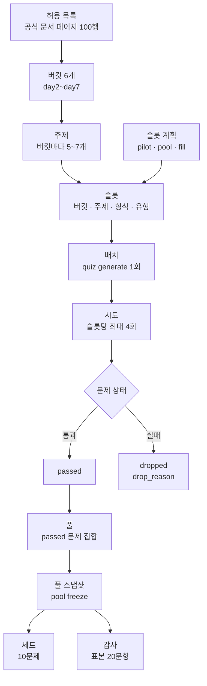
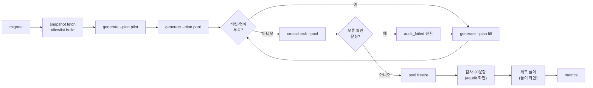

# 구현 결과서: LangChain 예상 문제 풀이 웹앱 (MVP)

| 항목 | 내용 |
| --- | --- |
| 문서 상태 | 초안 |
| 버전 | 0.2 (부록 A) |
| 작성일 | 2026-11-05 |
| 설계서 | [design.md](../../02-spec-design/output/design.md) 12.0 |
| 관련 산출물 | [mvp-checklist.md](mvp-checklist.md), [m0-smoke.md](m0-smoke.md), [notes-link-allowlist-candidates.md](notes-link-allowlist-candidates.md) |

이 문서는 구현 결과의 경로와 검증 결과를 적는다. 코드는 `docs/` 밖에 있다. 구현 값이 설계서와 다르면 5장에 적고, 설계서 개정 여부를 함께 적는다. 요구사항과 다르면 요구사항을 따른다.

## 1. 개요

### 1.1 목적

이 문서는 MVP 구현의 범위, 코드 구조, 실행 방법, 설계 대비 변경, 테스트 결과, 완료 조건 판정, 남은 문제를 정의한다. 다음 단계(프롬프트·모델 실험, 평가)는 이 문서의 구현과 측정값을 기준으로 한다.

### 1.2 단계 목표

| 목표 | 관련 요구사항 |
| --- | --- |
| 검증 통과 문제 60개를 버킷당 10개, 형식마다 10개 이상으로 고정한다 | 요구사항 7.1 조건 1, CR-1, CR-2 |
| 통과 문제 전부가 결정적 게이트를 통과한다 | 요구사항 7.1 조건 2, GR-4, GR-5, GR-7 |
| 본인 감사 20문항을 통과한다 | 요구사항 7.1 조건 3, FR-9 |
| 통과 풀에서 3세트를 풀고 모든 오답에 태그를 붙인다 | 요구사항 7.1 조건 4, FR-4 |
| 기준선 지표를 저장소 파일로 남긴다 | 요구사항 7.3, NFR-5 |

### 1.3 범위

- MVP 구현과 그 검증 결과를 다룬다.
- 변형 문제 생성(FR-6 일부)은 면제했다(2장, 8장).
- 기준 커밋은 `81ad4da`(2026-11-05)다.

### 1.4 용어 정의

요구사항 정의서 1.4와 설계서 1.3의 용어를 그대로 쓴다. 이 문서에서 더하는 용어는 다음과 같다.

| 용어 | 뜻 |
| --- | --- |
| 파일럿 배치 | `generate --plan pilot`. 버킷당 1문제, 6슬롯이다 |
| 풀 배치 | `generate --plan pool`. 60슬롯이다 |
| 보충 배치 | `generate --plan fill`. 버킷·형식 부족분만 슬롯으로 만든다(설계서 7.2) |
| 교차 풀이 점검 | `quiz crosscheck`. Claude 밖 모델 2개가 정답 키 없이 `passed` 문제를 풀어 정답 키 오류 후보를 찾는다. 요구사항 밖 보조 점검이다 |
| 프로필 전환 | 일일 토큰 한도에 걸린 모델 호출을 다른 추론 프로필이나 리전으로 넘기는 것(설계서 3.1) |

#### 문제 구성 개념

문제가 만들어져 세트로 나가기까지 쓰는 개념이다. 뜻은 요구사항 정의서 1.4와 설계서 1.3을 따른다. 이 절은 그 관계를 한곳에 모은다.



| 개념 | 뜻 | 이 구현의 값 |
| --- | --- | --- |
| 버킷 | 출제 주제 묶음. 학습 노트 일차와 1:1이다 | `rag`, `langgraph_basics`, `tool_mcp`, `middleware_hitl_guardrails`, `multi_agent`, `ops_quality`. 버킷당 10문제다 |
| 주제 | 버킷 안의 세부 출제 대상. 허용 목록 행이 주제마다 근거 페이지를 정한다 | 34개(확인 30, 근접만 3, 없음 1). 예: `rag`의 Chroma, Retriever |
| 형식 | 답하는 방식 | `single`, `multi`, `short`, `code`. 형식마다 10문제 이상이다 |
| 유형 | 묻는 내용의 종류 | `concept`, `code_behavior`, `error_cause`, `design` |
| 슬롯 | 배치가 만들 문제 1개의 자리. 버킷, 주제, 형식, 유형과 근거 페이지를 정한다 | `batch_slots` 행. 문제 ID는 `<batch_id>-<슬롯 번호 3자리>`다 |
| 슬롯 계획 | 배치에 넣을 슬롯 목록을 만드는 규칙 | 아래 표의 `pilot`, `pool`, `fill` 세 가지다. 같은 입력이면 같은 계획이다 |
| 배치 | `quiz generate` 1회 실행. 슬롯을 먼저 기록하고 슬롯마다 파이프라인을 돈다 | 동시 2슬롯. 끊기면 `--resume <batch_id>`로 남은 슬롯만 돈다 |
| 시도 | 슬롯 하나의 생성 → Judge → 실행 → 게이트 → 중복 검사 1회 | 첫 시도와 재생성 3회, 최대 4회. 시도마다 `verification_results` 1행 |
| 문제 상태 | 시도의 마지막 판정 | `passed`, `dropped`(`drop_reason` 필수), `audit_failed` |
| 풀 | `passed` 문제(변형 제외) 집합 | 60문제 |
| 풀 스냅샷 | 풀을 고정한 것. ID는 문제 ID 집합의 해시라 같은 집합이면 같은 ID다 | `ps_326384fb5422` |
| 세트 | 풀 스냅샷에서 내는 10문제 묶음. 복습 최대 3개와 새 문제로 채운다 | 풀이 10문제보다 작으면 409 `pool_too_small`이다 |
| 감사 | 풀 스냅샷 ID에서 만든 시드로 뽑은 20문항을 본인이 검토하는 것 | `au_326384fb5422` |

슬롯 계획 세 가지:

| 계획 | 명령 | 슬롯 수 | 목적 | 이 구현의 배치 |
| --- | --- | --- | --- | --- |
| `pilot` | `generate --plan pilot` | 버킷당 1개, 6슬롯 | 문제당 시간·토큰·비용을 재서 60문제 소요를 추정한다 | `b20261105-02` |
| `pool` | `generate --plan pool` | 버킷당 10개, 60슬롯. 형식은 버킷 순서대로 돌려 형식마다 15개다 | 풀을 처음 채운다 | `b20261105-03` |
| `fill` | `generate --plan fill` | 모자란 만큼. 버킷당 10, 형식마다 10에서 지금 `passed` 수를 뺀다 | 버려진 문제를 다시 채운다. 덜 쓴 주제와 덜 버려진 형식을 고른다 | `b20261105-04`~`-06`, `-08`~`-14` |

- `--count N`은 계획의 앞 N슬롯만 돈다.
- `pool` 계획은 버킷마다 `pilot`과 같은 첫 주제부터 배정한다. 그래서 `pool` 배치의 `duplicate` 9개 중 7개가 파일럿 문제와 겹쳤다.
- `b20261105-15`는 계획 명령 없이 슬롯 3개를 직접 넣고 `--resume`으로 돌린 보충 배치다.
- `b20261105-01`은 M0 확인 배치다. `b20261105-07`은 처리 슬롯이 없는 빈 배치다(1.7).
- `batches.kind`는 `pool`, `variant`만 받아 세 계획 모두 `pool`로 남는다(8장).

### 1.5 표기

- 구현 범위 상태: `완료`는 확인 줄이 통과한 것, `부분`은 일부만 구현한 것, `제외`는 면제했거나 필요 없어 하지 않은 것이다.
- 설계서 개정 여부: `반영(n.0)`은 설계서 n.0에 반영한 것, `필요`는 아직 반영하지 않은 것, `불필요`는 설계 규칙 안의 세부 값이라 기록 파일에만 둔 것이다.
- 이 문서는 새 ID 접두어를 매기지 않는다.

### 1.6 참고 문서

| 문서 | 용도 |
| --- | --- |
| [requirements.md](../../01-requirements/output/requirements.md) 3.0 | 요구사항 |
| [design.md](../../02-spec-design/output/design.md) 12.0 | 구현 값의 원본 |
| [seed.yaml](../../02-spec-design/output/seed.yaml) 1.1.0 | 수용 기준 1~9 |
| [page-allowlist.md](../../02-spec-design/output/page-allowlist.md) | 근거 페이지 허용 목록 |
| [TASKS.md](../../../TASKS.md) | 작업 단위와 확인 줄 |
| [mvp-checklist.md](mvp-checklist.md) | 완료 조건 측정 쿼리와 값 |

결정 과정 기록은 [03-implementation](../../dev-process/03-implementation/) 기록 파일 01~09에 있다. 이 문서에서 뺀 과정 기록의 위치는 [09-output.md](../../dev-process/03-implementation/09-output.md)에 있다.

### 1.7 다음 단계에서 확인할 항목

| 항목 | 현재 값 | 확인 방법 |
| --- | --- | --- |
| Bedrock 일일 토큰 한도 값과 초기화 시각 | 미확인. `ThrottlingException` "Too many tokens per day"가 소스 리전·프로필마다 따로 걸린다 | AWS Service Quotas 조회 |
| `version_conflict` 4문항(`b20261105-03-016`, `-024`, `-034`, `-036`)의 원인 | 미확인. 실행 결과가 `expected`와 다르다 | 시도 행 실행 결과와 문서 원문 대조 |
| `quote_mismatch` 재생성 피드백의 효과 | 미확인. 추가 뒤 배치에서 이 피드백이 쓰이지 않았다 | 다음 생성 배치의 `quote_mismatch` 재시도 통과율 |
| 동시 2슬롯의 유사 중복 검사 누락 | 미확인. 같은 버킷 두 슬롯이 동시에 돌면 서로를 비교 대상에 넣지 못한다 | 같은 버킷 슬롯을 동시에 돌린 배치에서 중복 쌍 조회 |
| 배치 `b20261105-07`을 만든 곳 | 미확인. 처리 슬롯 0개, 토큰 0이다 | 로그와 프로세스 기록 |
| 테스트 커버리지 | 측정하지 않았다 | 커버리지 도구로 측정 |

## 2. 구현 범위

작업 단위는 03 계획의 묶음(M0~M7)과 [TASKS.md](../../../TASKS.md)의 작업 ID다.

| 작업 단위 | 상태 | 산출 경로 | 비고 |
| --- | --- | --- | --- |
| M0 최소 경로(T0.1~T0.13) | 완료 | `app/`, `web/`, `packs/langchain/`, [m0-smoke.md](m0-smoke.md) | M0 임시 규칙은 M2, M4에서 없앴다 |
| M1 결정적 로직·근거 자료(T1.1~T1.7) | 완료 | `app/quiz/gates.py`, `grading.py`, `backup.py`, `allowlist.py`, `slots.py`, `packs/langchain/snapshots/` | 허용 목록 100행 모두 스냅샷이 있다 |
| M2 파이프라인(T2.1~T2.9) | 완료 | `app/quiz/pipeline/`, `batch.py`, `llm.py`, `pricing.py`, `sandbox_client.py`, `sandbox/`, `packs/langchain/prompts/` | - |
| M2 T2.10 교차 풀이 점검 | 완료 | `app/quiz/crosscheck.py`, `data/crosscheck/` | 요구사항 밖 보조 점검이다 |
| M2 T2.11 출제 품질 기준 | 완료 | `packs/langchain/prompts/quality/`, `prompts/judge/choice.md` | - |
| M3 파일럿·축소 판단(T3.1, T3.2) | 완료 | `data/quiz.db` 배치 `b20261105-02` | 축소하지 않았다 |
| M4 풀 배치·풀이 기능(T4.1~T4.6) | 완료 | `app/quiz/sets.py`, `review.py`, `server.py`, `web/src/` | 부족분은 보충 배치로 채웠다 |
| M4 UI 보강(T4.7~T4.9) | 완료 | `web/src/markup.ts`, `MarkupText.tsx`, `meta.ts`, `index.css` | 코드 표시, 문제 메타, 테마 |
| M5 풀 고정·감사(T5.1~T5.5) | 완료 | `app/quiz/audit.py`, `web/src/AuditPage.tsx` | 풀 `ps_326384fb5422`, 감사 `au_326384fb5422` |
| M5 감사 미달 처리(T5.6) | 제외 | - | 감사가 통과해 필요 없다 |
| M6 완료 조건(T6.1~T6.3) | 완료 | `app/quiz/metrics.py`, `data/metrics/baseline.json`, [mvp-checklist.md](mvp-checklist.md) | - |
| M7 변형 문제(T7.1) | 제외 | `data/waivers.yaml` | SERVICE.md 7.2 1번 면제다 |
| M7 Langfuse trace 내보내기(T7.2) | 완료 | `data/metrics/trace-c7bbff45367cc6b0fc1b331313f72a71.json` | public key를 가렸다 |

## 3. 실제 코드 구조

### 3.1 디렉토리

설계서 4.1(12.0)과 같다. 11.0의 4.1에 없던 경로에는 `(+)`를 붙였다.

```text
03-implementation/
├── app/
│   ├── .python-version                 # 3.14.8
│   ├── pyproject.toml, uv.lock
│   ├── migrations/
│   │   ├── 0001_init.sql
│   │   └── 0002_attempt_cost.sql       # (+) verification_results.cost_usd
│   ├── quiz/
│   │   ├── db.py                       # 연결, QUIZ_DB 경로
│   │   ├── backup.py                   # (+) sqlite3 backup API, 최근 10개
│   │   ├── migrate.py
│   │   ├── gates.py, grading.py
│   │   ├── slots.py                    # (+) 슬롯 계획(pilot, pool, fill)
│   │   ├── sets.py, review.py, audit.py, metrics.py
│   │   ├── llm.py                      # 모델 생성, 프로필 전환, Langfuse 콜백
│   │   ├── pricing.py                  # (+) 단가표 읽기, 비용 계산
│   │   ├── allowlist.py, snapshots.py
│   │   ├── store.py, batch.py, pool.py, env.py
│   │   ├── crosscheck.py               # (+) 교차 풀이 점검
│   │   ├── pipeline/
│   │   │   ├── graph.py                # LangGraph 그래프
│   │   │   ├── nodes.py                # generate, judge, execute, gates, dedupe, record, feedback
│   │   │   ├── prompts.py              # 프롬프트 로더
│   │   │   └── schemas.py              # 형식별 생성 스키마, JudgeVerdict
│   │   ├── sandbox_client.py, server.py, cli.py
│   └── tests/                          # 23개 파일
├── sandbox/
│   ├── .python-version, pyproject.toml, uv.lock
│   ├── runner.py, fakes.py
│   ├── examples/tool_agent.json        # (+) runner 확인 입력
│   └── tests/test_runner.py            # (+)
├── web/
│   ├── index.html                      # Pretendard CDN 링크
│   ├── vite.config.ts                  # /api → localhost:8000
│   └── src/
│       ├── main.tsx, Root.tsx          # #audit 해시로 화면 선택
│       ├── App.tsx                     # 풀이 화면
│       ├── AuditPage.tsx               # 감사 화면
│       ├── ResultPanel.tsx, Evidence.tsx, TagForm.tsx
│       ├── MarkupText.tsx, markup.ts   # 코드 블록·인라인 코드 표시
│       ├── meta.ts                     # 버킷 라벨, 형식, 복습 배지
│       ├── api.ts, index.css
│       ├── formats/                    # 형식별 입력 컴포넌트와 registry.ts
│       └── markup.test.ts, meta.test.ts
├── packs/langchain/
│   ├── allowlist.yaml                  # 100행
│   ├── snapshot-manifest.yaml          # 스냅샷 기대 해시(설계서 4.3)
│   ├── snapshots/                      # 81개
│   └── prompts/
│       ├── generate.md, judge.md, near.md, fakes.md
│       ├── crosscheck.md               # (+)
│       ├── formats/                    # (+) single, multi, short, code
│       ├── judge/                      # (+) choice, short, code
│       └── quality/                    # (+) choice, short
└── data/
    ├── metrics/baseline.json
    ├── metrics/trace-<trace_id>.json   # (+) Langfuse 내보내기
    ├── pricing/bedrock.yaml
    ├── waivers.yaml
    ├── crosscheck/                     # (+) 교차 풀이 결과 .json, .md
    ├── quiz.db                         # 커밋 안 함
    └── backups/                        # 커밋 안 함
```

### 3.2 설계서 11.0 4.1과의 차이

아래 차이는 설계서 12.0 4.1에 모두 반영했다.

| 경로 | 설계서 4.1 | 구현 |
| --- | --- | --- |
| `app/quiz/backup.py` | `db.py`가 backup API를 맡는다 | 백업을 별도 모듈로 뺐다 |
| `app/quiz/slots.py` | 없음. 슬롯 계획은 파이프라인 책임이다(4.2) | 슬롯 계획 모듈이다 |
| `app/quiz/pricing.py` | 없음. `llm.py`가 비용을 기록한다 | 단가표 읽기와 비용 계산을 뺐다 |
| `app/quiz/crosscheck.py` | 없음 | 교차 풀이 점검이다 |
| `app/quiz/pipeline/` | 그래프, 노드, 프롬프트 로더 | 파일 4개로 나눴다 |
| `app/migrations/0002_attempt_cost.sql` | 없음. 5.1은 반영했다 | 시도 행 비용 열 |
| `packs/langchain/prompts/` 하위 디렉토리 | 없음 | 형식, Judge, 품질 규칙을 파일로 나눴다 |
| `data/crosscheck/` | 없음 | 교차 풀이 결과 |
| `sandbox/examples/`, `sandbox/tests/` | 없음 | 확인 입력과 테스트 |

모듈 책임과 경계(설계서 4.2)는 바꾸지 않았다. 서버는 파이프라인과 모델을 부르지 않는다. 샌드박스는 subprocess로만 불린다.

## 4. 빌드와 실행

### 4.1 준비

| 위치 | 명령 | 용도 |
| --- | --- | --- |
| `app/` | `uv sync` | 앱 의존성 설치 |
| 저장소 루트 | `uv sync --project sandbox --frozen` | 샌드박스 `.venv`. 없으면 `sandbox_client`가 이 명령을 안내하고 멈춘다 |
| `web/` | `npm install` | 웹 의존성 설치 |
| `app/` | `uv run quiz migrate` | 스키마 적용(백업 뒤) |

### 4.2 명령

| 위치 | 명령 | 동작 |
| --- | --- | --- |
| `app/` | `MSYS_NO_PATHCONV=1 uv run quiz snapshot fetch <page...>` | 문서 스냅샷 수집 |
| `app/` | `uv run quiz snapshot fetch-ref <url...>` | API 레퍼런스 스냅샷 수집 |
| `app/` | `uv run quiz allowlist build [--allow-missing]` | `allowlist.yaml` 생성과 해시 검사 |
| `app/` | `uv run quiz generate --plan pilot\|pool\|fill [--count N]` | 생성 배치. Bedrock 호출 |
| `app/` | `uv run quiz generate --resume <batch_id>` | 남은 슬롯 재개 |
| `app/` | `uv run quiz crosscheck --batch <batch_id>` 또는 `--pool <id>` | 교차 풀이 점검. `us-east-1`만 |
| `app/` | `uv run quiz pool freeze` | 풀 스냅샷 고정 |
| `app/` | `uv run quiz metrics` | `data/metrics/baseline.json` 다시 쓰기 |
| `app/` | `uv run uvicorn quiz.server:app --port 8000` | API 서버 |
| `web/` | `npm run dev` | `http://localhost:5173`. `/api`를 8000으로 넘긴다 |
| `web/` | `npm run build` | 타입 검사와 빌드 |

### 4.3 운영 순서



- `audit_failed` 전환은 명령이 없다. 백업 뒤 SQL로 바꾼다(8장).

### 4.4 환경 변수

| 변수 | 쓰는 곳 | 값 |
| --- | --- | --- |
| `AWS_ACCESS_KEY_ID`, `AWS_SECRET_ACCESS_KEY` | `generate`, `crosscheck` | 저장소 루트 `.env`. 서버와 샌드박스에는 넘기지 않는다 |
| `AWS_REGION`, 없으면 `AWS_DEFAULT_REGION` | `generate`, `crosscheck` | `us-east-1`, `us-west-2`, `ap-northeast-2` 중 하나 |
| `LANGFUSE_PUBLIC_KEY`, `LANGFUSE_SECRET_KEY` | `generate` | 둘 다 있고 호스트 키가 있을 때만 콜백을 붙인다 |
| `LANGFUSE_BASE_URL` 또는 `LANGFUSE_HOST` | `generate` | Langfuse 호스트 |
| `QUIZ_DB` | CLI, 서버, 테스트 | DB 경로를 바꾼다. 없으면 `data/quiz.db` |
| `PYTHONIOENCODING` | 샌드박스 자식 프로세스 | `sandbox_client`가 `utf-8`로 넣는다 |
| `MSYS_NO_PATHCONV` | Git Bash | `1`. 문서 경로 인자가 Windows 경로로 바뀌는 것을 막는다 |

샌드박스 자식 프로세스 환경에서는 `AWS_*`, `LANGFUSE_*`, `VIRTUAL_ENV`를 지운다.

### 4.5 lock 파일과 고정 버전

| 대상 | lock 파일 | 고정 값 |
| --- | --- | --- |
| 앱 Python | `app/.python-version` | 3.14.8 |
| 앱 패키지 | `app/uv.lock` | `langchain` 1.4.7, `langchain-core` 1.7.0, `langgraph` 1.2.17, `langchain-aws` 1.9.0, `fastapi` 0.162.0, `uvicorn` 0.54.0, `mcp` 1.30.0, `langfuse` 5.1.0 |
| 샌드박스 Python | `sandbox/.python-version` | 3.14.8 |
| 샌드박스 패키지 | `sandbox/uv.lock` | `langchain` 1.4.9, `langchain-core` 1.7.6, `langgraph` 1.2.19, `langchain-text-splitters` 1.1.3, `numpy` 2.5.4 |
| 샌드박스 MCP 고정 | `sandbox/pyproject.toml` | `mcp==1.30.0`, `fastmcp==2.13.0`, `langchain-mcp-adapters==0.3.2`, `mcp-server-time==2026.10.10` |
| 웹 | `web/package-lock.json` | React 19.3, Vite 8.3, TypeScript 7.0 |
| 단가 | `data/pricing/bedrock.yaml` | Global 입력 3.00, 출력 15.00 USD/1M 토큰. US 교차 리전 프로필 3.30, 16.50 |

## 5. 설계 대비 변경

설계서 개정 이력(부록 A) 2.0~12.0에 반영한 변경과 반영하지 않은 세부 값을 함께 적는다. 이유가 기록에 없으면 "-"다.

| 설계 위치 | 설계 | 구현 | 이유 | 설계서 개정 |
| --- | --- | --- | --- | --- |
| 1.4, 3.1 버전 | 미확인 | 4.5의 앱 고정 값 | 교안 `.venv` 설치본과 같다 | 반영(2.0) |
| 3.2 리전 | `AWS_REGION` | 없으면 `AWS_DEFAULT_REGION` | `.env`에 `AWS_DEFAULT_REGION`만 있다 | 반영(2.0) |
| 4.3 스냅샷 수집 | 후보 2개 | Python MCP 클라이언트, 줄 범위 분할, 서버 sha256 대조 | 30KB를 넘는 페이지를 바이트 그대로 재현한다 | 반영(2.0) |
| 6.1 게이트 실패 이유 | `quote_mismatch`, `mapping_missing`, `page_not_allowed` | `quote_too_short`, `grounding_missing`, `accepted_answers_count` 추가 | - | 반영(2.0, 3.0) |
| 4.3 기대 해시 | `allowlist.yaml` | `snapshot-manifest.yaml` | `allowlist.yaml`은 표에서 다시 만드는 산출물이다 | 반영(3.0) |
| 4.3 index 페이지, API 레퍼런스, 호출 제한 | 없음 | `<p>/index.mdx` 대체, `get_symbol` 출력 저장, 호출당 60초·3회 | 서버에 `<p>.mdx`가 없는 페이지가 있다. 응답 없이 멈춘 호출이 있었다 | 반영(3.0) |
| 4.4 단답 정규화, 유사 중복 세부 | 규칙만 | 정규화 순서, 정수 비교 Jaccard | - | 반영(3.0) |
| 8.4 백업 보관 | 미정 | 최근 10개 | - | 반영(3.0) |
| 5.1 시도 행 | 비용 열 없음 | `verification_results.cost_usd`(0002) | 생성·Judge 모델 단가가 다를 수 있다 | 반영(4.0) |
| 5.4 단가 단위 | 1K 토큰 | 1M 토큰 | AWS Price List 단위다 | 반영(4.0) |
| 8.3 Langfuse 호스트 키 | `LANGFUSE_HOST` | `LANGFUSE_BASE_URL` 또는 `LANGFUSE_HOST` | `langfuse` 5.1.0 키 이름이다 | 반영(4.0) |
| 6.1 Judge 항목 | 정답, 근거, 오답, 매핑 | 선택형에 `distractors_plausible`, `no_cue` 추가 | 출제 품질 기준(정의 회상 금지, 그럴듯한 오답, 단서 금지) | 반영(5.0) |
| 3.1 생성·Judge 모델 | 프로필 1개 | 일일 토큰 한도면 US 프로필, 이어서 다른 리전으로 전환 | 일일 한도가 소스 리전·프로필마다 따로 걸린다 | 반영(6.0, 7.0) |
| 3.1 샌드박스 패키지 | `langchain`, `langgraph`, `langchain-core` | `langchain-text-splitters`, `numpy` 추가 | 문서 예시 코드가 `ModuleNotFoundError`로 `version_conflict`가 됐다 | 반영(8.0) |
| 6.1 실행 판정 | `judge_exec_mismatch`, `version_conflict` | `sandbox_module_missing` 추가. 재생성한다 | 환경 오류를 버전 충돌로 버리지 않는다 | 반영(8.0) |
| 7.2 `generate` | `pilot`, `pool` | `fill` 추가. 버린 문제도 센다 | `duplicate` 슬롯을 다시 채우는 구현이 없었다. 결정적 계획이 같은 조합을 되풀이했다 | 반영(8.0, 9.0) |
| 6.1 재생성 피드백 | 실패 이유 이름 | `quote_mismatch`면 쓴 인용과 원문 구간, 복사 안내 | 모델이 링크와 코드 펜스 속성을 빼는 실수를 되풀이했다 | 반영(10.0) |
| 7.1 세트 응답 | 문제 필드 | 문제마다 `review` | - | 반영(11.0) |
| 4.1 코드 구조 | 모듈 19개, 마이그레이션 1개 | `backup.py`, `slots.py`, `pricing.py`, `crosscheck.py` 추가, `pipeline/` 4개 파일, 마이그레이션 0002, 프롬프트 하위 디렉토리, `data/crosscheck/` | - | 반영(12.0) |
| 2.1 도식 | 스냅샷 수집 "수집 방법 미확인(1.4)" | `quiz snapshot fetch` | 2.0에서 수집 방법을 닫았다 | 반영(12.0) |
| 1.4 확인 항목 | 요청 제한·비용, 생성 시간 미측정 | 파일럿 문제당 약 72초, 슬롯당 0.286 USD. 일일 토큰 한도 발생 | - | 반영(12.0) |
| 7.1, 8.6 API 거절 | 409 거절 두 경우 | 409 `detail` 객체와 이유 값(`untagged_wrong`, `set_closed`, `correct_row`, `already_answered`, `pool_too_small`, `no_pool`), 태그 검증 422 | - | 반영(12.0) |
| 6.3, 6.5 세트·복습 세부 | 규칙만 | 풀 부족이면 409, 복습 동순위는 `question_id` 순, 현재 풀에서만 출제, 태그 시점 큐 갱신, 이월 항목 m+5 기준, `cleared` 뒤 오답은 1회차부터 | - | 반영(12.0) |
| 5.2, 6.6 감사 세부 | 시드·표본 규칙 | `audit_id`는 `au_` + 풀 ID 해시, 표본보다 작은 풀은 409, 다시 기록하면 `result` 재계산 | - | 반영(12.0) |
| 5.4 `baseline.json` 범위 | 키 형식만 | `sets`는 현재 풀 세트만, `drops`는 `dropped`만, `seconds`는 정수 초, `rate`는 넷째 자리 | - | 반영(12.0) |
| 6.1 생성 세부 | 규칙만 | 형식별 스키마, `exec_spec` 형식, 실행 판정 순서, 재생성 판정 순서, `doc_url`·`fetched_at` 규칙, `cca_f_tag` 값 | - | 불필요 |
| 없음 | - | `quiz crosscheck` | 정답 키 오류 후보를 감사 전에 찾는다 | 반영(12.0). 4.1 코드 구조에만 넣었다. 요구사항 밖 보조 점검이라 흐름과 인터페이스에는 넣지 않았다 |

## 6. 테스트 결과

### 6.1 자동 테스트

기준 커밋 `81ad4da`, 실행일 2026-11-05.

| 대상 | 명령 | 수 | 결과 |
| --- | --- | --- | --- |
| 앱 | `uv run pytest`(`app/`) | 323 | 모두 통과 |
| 샌드박스 | `uv run pytest`(`sandbox/`) | 16 | 모두 통과 |
| 웹 단위 | `node --test src/*.test.ts`(`web/`) | 12 | 모두 통과 |
| 웹 빌드 | `npm run build` | - | 통과 |
| 웹 lint | `npm run lint` | - | 경고 1개(`App.tsx` `set-state-in-effect`) |

- 앱과 샌드박스 테스트의 경고 13개는 `langsmith` 패키지의 `asyncio.iscoroutinefunction` 사용 경고다.
- 커버리지는 측정하지 않았다(1.7).
- 웹 컴포넌트 테스트 도구는 없다. 화면은 6.3 브라우저 확인으로 검증했다.

### 6.2 앱 테스트 파일

| 파일 | 수 | 대상 |
| --- | --- | --- |
| `test_gates.py` | 36 | 인용 대조, 단답 정규화, 유사 중복, 인용 원문 구간 |
| `test_slots.py` | 32 | 60슬롯 배정, 금지 배정, 보충 계획 |
| `test_generate.py` | 27 | 4형식 생성 스키마 |
| `test_crosscheck.py` | 24 | 교차 풀이, 정답 키 비공개 |
| `test_sandbox_client.py` | 24 | 실행, 타임아웃, 환경 변수 제거, 실행 판정 |
| `test_quality.py` | 23 | 출제 품질 문구, Judge 선택형 항목 |
| `test_audit.py` | 17 | 시드·표본, 감사 기준 경계값 |
| `test_grading.py` | 14 | 형식별 채점, 미등록 형식 |
| `test_review.py` | 14 | 복습 간격과 상태 전이 |
| `test_api.py` | 13 | API, 409 거절, 이어 풀기 |
| `test_judge.py` | 13 | Judge 판정, 단답 변형, 코드형 예측 |
| `test_pipeline_loop.py` | 12 | 재생성 루프, `duplicate`, 피드백 |
| `test_batch.py` | 11 | 배치, 재개, 보충 |
| `test_failover.py` | 11 | 프로필·리전 전환 |
| `test_sets.py` | 10 | 세트 구성, `review` |
| `test_cost.py` | 9 | 토큰·비용 합 |
| `test_observe.py` | 9 | Langfuse 선택 적용 |
| `test_allowlist_build.py` | 7 | 허용 목록 생성, 해시 검사 |
| `test_snapshots.py` | 5 | 스냅샷 수집 |
| `test_metrics.py` | 4 | `baseline.json` |
| `test_backup.py` | 5 | 백업, 서버 시작 마이그레이션 전 백업 |
| `test_llm.py` | 2 | 리전 검사 |
| `test_migrate.py` | 1 | 마이그레이션 두 번 실행 |

### 6.3 실제 모델과 브라우저 확인

| 확인 | 방법 | 결과 |
| --- | --- | --- |
| 4형식 생성 | 형식마다 슬롯 1개를 실제 생성 모델로 실행 | 모두 스키마 검증 통과 |
| 정답 키 오류 검출 | 정답 키를 바꾼 문제를 실제 Judge에 넣음 | `judge_fail:answer_key_correct`, `judge_fail:quote_supports_answer` |
| 단서 검출 | 정답만 길고 오답에 절대어가 든 문제를 실제 Judge에 넣음 | `judge_fail:no_cue` |
| Langfuse trace | 파일럿 배치 뒤 Langfuse UI 조회 | 세션 `b20261105-02`에 루트 trace 6개 |
| 풀이 화면 | 브라우저에서 형식별 문제 풀이, 결과 화면 다섯 항목 | 통과 |
| 오답 태그·이어 풀기 | 태그 없이 다음 문제 시도, 새로고침 | 막힘, 결과 복원 |
| 코드 표시·문제 메타·테마 | 헤드리스 브라우저와 사용자 브라우저 | 통과. 모바일 390px 포함 |
| 감사 화면 | 1문항 기록 | `audit_records` 1행 |

## 7. 완료 조건 판정

### 7.1 MVP 완료 조건

측정 쿼리는 [mvp-checklist.md](mvp-checklist.md)에 있다. 측정일은 2026-11-05다.

| # | 조건(요구사항 7.1) | 결과 | 판정 |
| --- | --- | --- | --- |
| 1 | 검증 통과 문제 60개. 버킷당 10개, 형식마다 10개 이상 | 풀 `ps_326384fb5422` 60개. 버킷 6개 모두 10. single 18, multi 14, short 17, code 11 | 충족 |
| 2 | 결정적 게이트 100% | 마지막 시도 기준 인용 60/60, 매핑 60/60, 코드형 실행 일치 11/11 | 충족 |
| 3 | 본인 감사 통과 | `au_326384fb5422` `pass`. 정답 키 오류 0, 인용 미지지 0, 매핑 불충실 1 | 충족 |
| 4 | 3세트 풀이와 모든 오답 태그 | 10행 세트 3개(set_no 7, 8, 9). 태그 없는 오답 0. 구절 없는 `reading` 0 | 충족 |

### 7.2 Seed 수용 기준

| 번호 | 기준 | 증거 | 판정 |
| --- | --- | --- | --- |
| 1 | 풀 | 7.1 조건 1, 2. 버린 문제 55개 모두 `drop_reason`이 있다 | 충족 |
| 2 | 본인 감사 | 7.1 조건 3 | 충족 |
| 3 | 3세트 풀이 | 7.1 조건 4. 서버 재시작 뒤 조회 | 충족 |
| 4 | 세트 출제 | `test_sets.py`(첫 세트, 복습 3개 초과, 새 문제 소진) | 충족 |
| 5 | 풀이 화면 | 6.3 풀이 화면, 코드 보기 링크 | 충족 |
| 6 | 채점 | `test_grading.py`, `test_gates.py` 단답 정규화 | 충족 |
| 7 | 복습 큐 | `test_review.py`. 개념 실수 변형 문제는 면제라 원래 문제를 낸다 | 부분. 변형 문제 면제(`data/waivers.yaml`) |
| 8 | 기준선 지표 | `data/metrics/baseline.json` | 충족 |
| 9 | Langfuse 선택 적용 | 환경 변수 없이 배치 통과(`test_observe.py`), 6.3 Langfuse trace, 내보낸 trace 파일 | 충족 |

### 7.3 기준선 지표

`uv run quiz metrics`가 쓴 값이다(`generated_at` 2026-11-05T05:48:35Z).

| 지표 | 값 |
| --- | --- |
| Judge 통과율 | 204 / 209 = 0.9761 |
| 버린 문제 | 55. `duplicate` 27, `regen_exhausted` 17, `version_conflict` 11 |
| 감사·교차 풀이로 뺀 문제 | 2(`audit_failed`) |
| 세트별 정답률 | 세트 7 0.1, 세트 8 0.5, 세트 9 0.2 |
| 배치 | 15개 |
| 입력 토큰 합 | 9,908,263 |
| 출력 토큰 합 | 461,654 |
| 비용 합 | 36.75 USD. 단가가 없던 M0 배치 `b20261105-01`과 빈 배치 `b20261105-07`은 NULL이다 |
| 파일럿 측정 | 문제당 약 72초(동시 2), 슬롯당 0.286 USD, passed 5/6 |
| 풀 배치 `b20261105-03` | 60슬롯, 1,334초, 18.60 USD, passed 36 |

## 8. 알려진 문제와 기술 부채

| 문제 | 영향 | 처리 단계 |
| --- | --- | --- |
| 개념 실수 변형 문제(`generate --variants`)가 없다 | 개념 실수 복습이 원래 문제를 다시 낸다(FR-6) | MVP 범위 밖. 면제 해제 때 |
| `audit_failed` 전환 명령이 없다 | 감사 미달이나 교차 풀이 오류 처리에 백업과 SQL을 손으로 한다 | 다음 구현 반복 |
| page-allowlist.md 파서가 둘이다(`allowlist.parse_page_table`, `slots.load_allowlist_md`) | 표 형식이 바뀌면 둘 다 고쳐야 한다 | 다음 구현 반복 |
| [m0-smoke.md](m0-smoke.md) 절차가 지금 규칙과 맞지 않는다 | 풀이 10문제 미만이면 세트 요청이 409 `pool_too_small`이라 1~2문제 풀로는 결과 화면까지 가지 못한다 | 문서 갱신 |
| Judge 판정이 느슨하다 | 시도 209 중 204가 통과했다. 감사 메모에 해설 오류, 단서 과다, 인용 무관 문항이 있다. 이 문항은 감사 기준 세 항목에 들지 않아 풀에 남았다 | 04 프롬프트·모델 실험 |
| 해설·매핑·근거의 굵은 글씨, 마크다운 표, 백틱이 문자 그대로 보인다 | 결과 화면 가독성이 떨어진다. 코드 블록과 인라인 코드만 처리한다 | 다음 UI 반복 |
| 교차 풀이는 코드형을 건너뛴다 | 코드형 11문항은 교차 풀이 점검을 받지 않았다 | 04 또는 05 |
| 시도별 실제 모델 프로필을 기록하지 않는다 | `batches.gen_model`은 기본 프로필이다. 전환한 프로필은 비용으로만 구분된다 | 다음 구현 반복 |
| `batches.kind`는 `pool`, `variant`만 받는다 | 파일럿·보충 배치도 `pool`로 남아 `baseline.json`에서 배치 종류를 가리지 못한다 | 다음 구현 반복 |
| 샌드박스 네트워크 차단은 Python 수준 패치다 | `_socket` 직접 import는 막지 못한다 | 05 평가에서 판단 |
| 동시 2슬롯의 유사 중복 비교 | 같은 버킷 두 슬롯이 동시에 돌면 서로를 보지 못한다(1.7) | 04 또는 다음 반복 |
| 세 리전의 모든 프로필이 일일 한도에 걸리면 배치가 멈춘다 | 슬롯이 `error`로 남는다. `--resume`으로 이어 간다 | 운영 |
| 빈 배치 `b20261105-07` | 처리 슬롯 0개로 DB와 `baseline.json`에 남아 있다(1.7) | 다음 구현 반복 |
| 웹 컴포넌트 테스트 도구가 없다 | UI 회귀는 브라우저로만 확인한다 | 다음 구현 반복 |
| lint 경고 1개 | `App.tsx` 첫 로드의 비동기 `loadSet`이 effect 안에서 상태를 바꾼다 | 다음 구현 반복 |

## 9. 요구사항 추적표

### 9.1 요구사항

설계 위치는 설계서 절이다.

| 요구사항 | 설계 위치 | 구현 경로 | 검증 |
| --- | --- | --- | --- |
| C-1 | 설계에 별도 절 없음 | - | 7.1 완료 조건(2026-11-05) |
| C-2 | 3.2, 8.1 | `app/quiz/llm.py`, `crosscheck.py` | `test_llm.py`, `test_failover.py` |
| C-3 | 4.3, 4.4 | `app/quiz/gates.py`, `packs/langchain/snapshots/` | `test_gates.py`, 7.1 조건 2 |
| CR-1, CR-2 | 6.1 슬롯 계획 | `app/quiz/slots.py` | `test_slots.py`, 7.1 조건 1 |
| CR-3~CR-5 | 5.1, 5.2 | `app/migrations/0001_init.sql`, `grading.py`, `pipeline/schemas.py` | `test_grading.py`, `test_generate.py` |
| CR-6, CR-7 | 5.1 | `pipeline/schemas.py`, `packs/langchain/prompts/` | `test_generate.py` |
| CR-8, CR-9 | 4.3, 6.1 | `allowlist.py`, `slots.py`, `prompts/near.md` | `test_slots.py`, `test_allowlist_build.py` |
| FR-1 | 6.3, 7.1 | `sets.py`, `server.py` | `test_sets.py`, `test_api.py`, Seed 4 |
| FR-2 | 4.2, 6.4, 7.1 | `web/src/App.tsx`, `formats/`, `ResultPanel.tsx`, `Evidence.tsx`, `MarkupText.tsx`, `meta.ts` | 6.3 브라우저 확인, Seed 5 |
| FR-3 | 4.4, 6.4 | `grading.py`, `gates.py` 단답 정규화 | `test_grading.py`, `test_gates.py`, Seed 6 |
| FR-4 | 6.4, 7.1, 8.6 | `server.py`, `web/src/TagForm.tsx` | `test_api.py`, 7.1 조건 4 |
| FR-5 | 6.5 | `review.py` | `test_review.py`, Seed 7 |
| FR-6 | 6.1, 6.5, 7.2 | 변형 생성 없음(면제). `review.py`가 원래 문제를 낸다 | `data/waivers.yaml` |
| FR-7 | 6.1, 6.2, 7.2 | `pipeline/`, `batch.py`, `store.py`, `slots.py` | `test_pipeline_loop.py`, `test_batch.py`, `test_judge.py`, Seed 1 |
| FR-8 | 5.1, 5.4 | `migrations/`, `db.py`, `backup.py`, `store.py` | `test_migrate.py`, `test_backup.py`, 7.1 조건 4 |
| FR-9 | 6.6, 7.1 | `audit.py`, `server.py`, `web/src/AuditPage.tsx` | `test_audit.py`, 7.1 조건 3 |
| FR-10 | 5.1 | `migrations/0001_init.sql`, `store.py` | `test_batch.py` |
| GR-1~GR-3 | 4.3, 5.1, 8.5 | `snapshots.py`, `allowlist.py`, `packs/langchain/` | `test_snapshots.py`, `test_allowlist_build.py` |
| GR-4 | 4.4 | `gates.py` | `test_gates.py`, 7.1 조건 2 |
| GR-5, GR-6 | 6.1, 4.4 | `pipeline/nodes.py`, `prompts/judge.md`, `prompts/judge/` | `test_judge.py`, `test_quality.py` |
| GR-7 | 3.1, 6.1, 8.2 | `sandbox/`, `sandbox_client.py` | `sandbox/tests/test_runner.py`, `test_sandbox_client.py`, 7.1 조건 2 |
| GR-8 | 설계에 별도 절 없음 | 별도 구현 없음. 생성 입력은 허용 목록 스냅샷이다 | - |
| NFR-1 | 2.1, 5.2, 8.5 | `grading.py` 형식 등록, `web/src/formats/registry.ts` | `test_grading.py` |
| NFR-2, NFR-3 | 3.1 | `app/pyproject.toml`, `sandbox/pyproject.toml`, `web/package.json`, `.python-version` | 4.5 |
| NFR-4 | 3.1, 8.1 | `llm.py`, `pricing.py`, `data/pricing/bedrock.yaml` | `test_failover.py`, `test_cost.py`, Seed 8 |
| NFR-5 | 5.4, 8.3 | `llm.py`, `metrics.py` | `test_observe.py`, `test_metrics.py`, Seed 8, 9 |
| 요구사항 7.1 완료 조건 | 7.2 `pool freeze`, 6.6, 6.3 | `pool.py`, `audit.py`, `sets.py` | 7.1 |
| 요구사항 7.3 기준선 지표 | 5.4, 7.2 `metrics` | `metrics.py` | `test_metrics.py`, 7.3 |

### 9.2 설계 결정

| 결정 | 구현 위치 | 구현 상태 |
| --- | --- | --- |
| D-1 | `pipeline/nodes.py` 판정, `audit.py` | 설계대로 |
| D-2 | `gates.py` 인용 정규화 | 설계대로. 재생성 피드백만 더했다(5장) |
| D-3 | `gates.py`, `pipeline/schemas.py` | 설계대로 |
| D-4 | `gates.py`, `pipeline/nodes.py` `dedupe` | 설계대로 |
| D-5 | `audit.py` | 설계대로 |
| D-6 | `sets.py` | 설계대로. 10문제를 못 채우면 409다(5장) |
| D-7 | `web/vite.config.ts` | 설계대로 |
| D-8 | `llm.py`, `batch.py` | 설계대로. 프로필 전환을 더했다(5장) |
| D-9 | `slots.py` | 설계대로 |
| D-10 | `pipeline/graph.py` | 설계대로 |
| D-11 | `pipeline/nodes.py` | 설계대로. `sandbox_module_missing`을 먼저 판정한다(5장) |
| D-12 | `llm.py` | 설계대로 |
| D-13 | `batch.py`, `store.py` | 설계대로 |
| D-14 | `snapshots.py` | 설계대로 |
| D-15 | `packs/langchain/snapshot-manifest.yaml`, `allowlist.py` | 설계대로 |

## 부록 A. 개정 이력

| 버전 | 날짜 | 내용 |
| --- | --- | --- |
| 0.1 | 2026-11-05 | 초안 |
| 0.2 | 2026-11-05 | 1.4에 문제 구성 개념을 더했다. 설계서 12.0 반영에 맞춰 3장, 5장 개정 열, 6장 테스트 수를 고쳤다. 서버 시작 마이그레이션 백업을 구현해(`81ad4da`) 8장에서 뺐다 |
