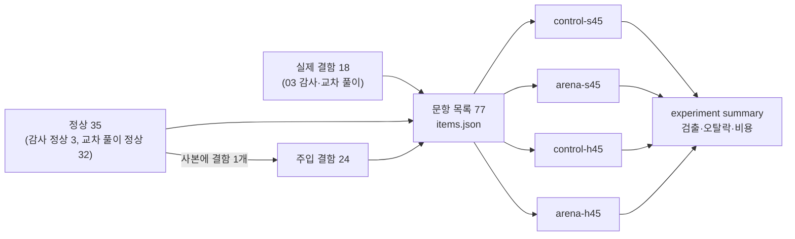
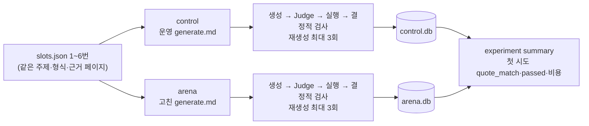

# 실험 보고서: LangChain 예상 문제 풀이 웹앱 (프롬프트와 모델 실험)

| 항목 | 내용 |
| --- | --- |
| 문서 상태 | 확정 |
| 버전 | 1.0 (부록 B) |
| 작성일 | 2026-11-05 |
| 구현 결과서 | [implementation.md](../../03-implementation/output/implementation.md) 1.0 |
| 관련 산출물 | [exp-1.md](exp-1.md), [exp-2.md](exp-2.md) |

이 문서는 04 단계 실험 두 개의 설계, 결과, 결정을 적는다. 실험별 전체 표는 관련 산출물에 있다. 이 문서와 요구사항 정의서가 다르면 요구사항을 따른다. 구현 값은 설계서 [design.md](../../02-spec-design/output/design.md) 13.0을 따른다.

## 쉬운 설명

이 앱에서는 AI 두 개가 일한다.

- 만드는 AI: 공식 문서를 읽고 문제와 해설을 쓴다. 근거로 문서 문장을 그대로 베껴 붙인다.
- 검사하는 AI(Judge): 만든 문제를 읽고 통과시키거나 떨어뜨린다.

AI에게 주는 지시문을 프롬프트라고 한다. 이 단계에서는 프롬프트를 고친 새 버전을 만들었다. 원래 버전과 같은 조건에서 나란히 돌려 숫자로 비교했다.

| 실험 | 물은 것 | 결과 | 결정 |
| --- | --- | --- | --- |
| EXP-1 | 새 검사 프롬프트가 나쁜 문제를 더 잘 떨어뜨리는가 | 사람이 찾은 결함 18개 중 1개를 더 잡았다(원래 0개). 정상 문항 1개를 잘못 떨어뜨렸다. "해설이 맞는가" 검사는 해설 오류를 하나도 잡지 못했다 | 보류. 운영에 넣지 않는다 |
| EXP-2 | 새 생성 프롬프트가 문서 문장을 더 정확히 베끼는가 | 첫 시도에서 6개 중 5개를 맞게 베꼈다(원래 2개). 다시 만든 횟수가 6번에서 1번으로 줄었다. 문제당 비용이 0.39달러에서 0.23달러로 내려갔다 | 채택. 이후 만드는 문제에 쓴다 |

- EXP-1의 차이는 1문항이다. 실험 문항 구성이 원래 프롬프트에 유리하거나 불리하게 짜인 부분도 있다(3.4). 그래서 숫자 기준은 넘었지만 보류했다.
- EXP-2는 주제 6개로만 비교했다. 방향은 분명하지만 크기는 믿기 어렵다(4.4).
- 더 싼 검사 모델(Haiku 4.5)은 값이 3분의 1이지만 결함을 덜 잡았다. 바꾸자고 제안하지 않는다.
- 이미 만든 문제 60개와 운영 DB(`data/quiz.db`, 앱이 실제로 쓰는 데이터베이스)는 바꾸지 않았다.
- 두 실험의 모델 호출 비용 합은 21.45달러다.

## 1. 개요

### 1.1 목적

이 문서는 생성 프롬프트와 Judge 프롬프트·모델을 바꿨을 때 품질과 비용이 어떻게 달라지는지 정의한다. 실험별 설계, 결과, 채택 결정, 결과를 믿을 수 있는 정도, 재현 방법을 적는다. 다음 단계(평가·리뷰)는 이 문서의 채택 결과와 남은 확인 항목을 기준으로 한다.

### 1.2 단계 목표

| 목표 | 관련 요구사항 |
| --- | --- |
| Judge가 사람이 감사에서 찾은 결함을 떨어뜨리게 한다 | GR-6.1, 7.2, implementation.md 8장 "Judge 판정이 느슨하다" |
| 생성 단계의 인용 복사 실패와 그로 인한 재생성 비용을 줄인다 | GR-4.1, FR-7.2, NFR-4.4, implementation.md 1.7 |
| 예비 모델(NFR-4.3)로 Judge를 바꿀 수 있는지 본다 | NFR-4.2, NFR-4.3 |
| 실험이 운영 DB와 고정 풀을 바꾸지 않는다 | C-1, D-16 |

### 1.3 범위

- EXP-1(Judge 프롬프트와 모델), EXP-2(생성 프롬프트의 인용 복사)를 다룬다.
- 프롬프트 파일만 바꿨다. 파이프라인 노드 순서(D-10)와 결정적 검사 규칙(D-2)은 바꾸지 않았다.
- 이번에 하지 않은 실험 후보는 부록 A에 있다.

### 1.4 출발점: 03 기준선

[implementation.md](../../03-implementation/output/implementation.md) 7.3과 `data/metrics/baseline.json`(2026-11-05T05:48:35Z)의 값이다. 두 실험은 아래 두 문제에서 출발했다.

| 문제 | 기준선 값 | 실험 |
| --- | --- | --- |
| Judge가 너그럽다 | 시도 209 중 204 통과(0.976). 감사 메모에 해설 오류 4, 단서·지문 정답 노출 5, 인용 무관 2, 모호·전제 누락 4가 있다. Judge는 이것을 떨어뜨리지 않았다 | EXP-1 |
| 인용 복사가 자주 틀린다 | 첫 시도 `quote_match`(인용이 문서 원문과 글자 그대로 맞음) 93/209(0.44). 실패 이유 `quote_mismatch` 157회. 배치 15개 비용 합 36.75 USD | EXP-2 |

### 1.5 용어 정의

요구사항 정의서 1.4, 설계서 1.3, 구현 결과서 1.4의 용어를 그대로 쓴다. 이 문서에서 더하는 용어는 다음과 같다.

| 용어 | 뜻 |
| --- | --- |
| arm | 비교하는 실행 한 갈래다. 프롬프트 디렉토리와 모델의 조합이다(D-16). 이름은 `<프롬프트>-<모델>`이다 |
| `control` | 대조군 프롬프트다. 실험 시작 때 운영 프롬프트(`packs/langchain/prompts/`)를 그대로 복사한 것이다 |
| `arena` | 변형 프롬프트다. 같은 과제 설명을 받은 후보 2개를 따로 쓰게 하고, 하나를 기반으로 다른 후보의 좋은 부분을 옮겨 합친 것이다 |
| `s45`, `h45` | 모델 줄임 이름이다. `s45`는 Judge 모델 Sonnet 4.5(NFR-4.2), `h45`는 예비 모델 Haiku 4.5(NFR-4.3)다 |
| 실제 결함 | 03 감사(사람이 직접 문제를 검토한 것)와 교차 풀이(다른 계열 모델 두 개가 문제를 풀어 본 것)에서 사람이 결함으로 판정한 문항이다 |
| 주입 결함 | 정상 문항 사본에 결함 하나를 일부러 넣은 문항이다. 넣은 방법이 곧 정답 라벨이다 |
| 감사 정상 | 감사에서 내용 지적이 없던 문항이다 |
| 교차 풀이 정상 | 교차 풀이에서 두 모델 모두 정답 키와 같은 답을 낸 문항이다. 해설과 단서는 확인하지 않았다 |
| 검출 | 결함 문항을 Judge가 실패 이유 하나 이상으로 떨어뜨린 것이다 |
| 오탈락 | 정상 문항을 Judge가 떨어뜨린 것이다 |
| 슬롯 | 문제 하나를 만들 자리다. 버킷(주제 묶음), 주제, 형식, 유형, 근거 페이지가 정해져 있다 |
| 첫 시도 `quote_match` | 슬롯마다 처음 만든 문제의 인용이 모두 원문과 맞은 비율이다 |
| 실험 DB | arm마다 따로 만드는 빈 SQLite 파일(`data/experiments/<EXP-n>/<arm>.db`)이다. 운영 DB와 섞이지 않는다 |
| 채택 후보 | 실행 전에 고정한 판정 기준을 넘은 변형이다. 채택 여부는 타당성 점검 뒤 따로 정한다 |
| 평가 누수 | 실험 설계 안에서 결과가 미리 정해지거나 한쪽에 유리해지는 통로다. 외부 정답이 독립적으로 들어오지 않을 때 생긴다 |

### 1.6 표기

- ID 체계: 실험은 `EXP-n`이다. 이 문서는 EXP-1, EXP-2를 실행했고 EXP-3, EXP-4는 후보로만 둔다.
- 문항 ID: EXP-1 문항은 `<묶음>-<03 문항 ID 끝부분>`이다. `real-` 실제 결함, `norm-` 정상, `inj-<유형>-` 주입 결함이다. 예: `real-03-010`은 03 문항 `b20261105-03-010`이다.
- 판정 값: `채택 후보`(고정 기준 충족), `채택`(운영 프롬프트에 반영), `보류`(반영하지 않고 다시 할 실험 후보로 둠), `제안하지 않음`(모델 교체를 안건으로 올리지 않음).

### 1.7 참고 문서

| 문서 | 용도 |
| --- | --- |
| [requirements.md](../../01-requirements/output/requirements.md) 3.0 | NFR-4 모델, NFR-5 관측, 7.2 감사 기준, 7.3 기준선 지표 |
| [design.md](../../02-spec-design/output/design.md) 13.0 | 실험 명령(7.2), 프롬프트 디렉토리 설정(3.2), D-16 |
| [implementation.md](../../03-implementation/output/implementation.md) 1.0 | 기준선(7.3), 확인 항목(1.7), 기술 부채(8장) |
| [exp-1.md](exp-1.md) | EXP-1 전체 표 |
| [exp-2.md](exp-2.md) | EXP-2 전체 표 |

결정 과정 기록은 [04-prompt-model-experiments](../../dev-process/04-prompt-model-experiments/) 기록 파일 01~05에 있다. 이 문서에서 뺀 과정 기록의 위치는 [06-output.md](../../dev-process/04-prompt-model-experiments/06-output.md)에 있다.

### 1.8 다음 단계에서 확인할 항목

| 항목 | 현재 값 | 확인 방법 |
| --- | --- | --- |
| 같은 arm을 다시 돌렸을 때 결과가 흔들리는 크기 | 미확인. 두 실험 모두 반복 실행이 없다 | EXP-1 `control-s45`, EXP-2 두 arm을 한 번씩 더 돌려 판정이 바뀐 문항·슬롯 수를 센다 |
| EXP-1 교차 풀이 정상 32문항이 해설·단서·인용 관련성에서도 정상인가 | 미확인 | arm을 모르는 사람이 무작위 문항을 모든 차원으로 다시 본다 |
| EXP-1 오탈락 문항(`norm-03-007`, `norm-03-043`)이 실제 결함인가 | 미확인 | 위와 같은 방법으로 다시 본다 |
| EXP-1 실제 결함 라벨이 다른 사람에게도 같게 나오는가 | 미확인. 감사자 한 명과 설계자가 붙였다 | arm을 모르는 두 번째 사람이 라벨을 붙여 일치를 본다 |
| 03 운영 Judge 입력과 실험 Judge 입력이 같은가 | 미확인. 같다면 03 운영 판정을 `control-s45`의 반복 실행 하나로 볼 수 있다 | 두 입력을 문항별로 비교한다 |
| EXP-2 `arena` 인용이 정답을 뒷받침하는가 | 미확인. 같은 계열 Judge만 확인했다 | 다른 계열 모델(Nova Pro, gpt-oss-120b) 교차 풀이나 사람이 본다 |
| 채택한 `generate.md`의 운영 배치 효과 | 미확인 | 다음 `quiz generate` 배치의 첫 시도 `quote_match`를 기준선 0.44와 비교한다 |
| EXP-2만의 Langfuse 사용량 | 미확인. 24시간 합(03 배치 포함)은 약 6,960 units다 | 실험 배치 ID가 운영 배치 ID와 겹쳐 시간으로만 가릴 수 있다. 배치 ID 규칙을 나눈 뒤 다시 잰다 |

## 2. 실험 목표와 가설

| ID | 질문 | 가설 | 관련 요구 ID |
| --- | --- | --- | --- |
| EXP-1 | Judge가 사람이 찾은 결함을 떨어뜨리는가 | 지금 Judge는 해설 오류와 단서를 대부분 놓친다. 변형 Judge는 검출 수를 올리고 정상 오탈락은 2개 이하다. 예비 모델은 더 싸지만 검출이 낮다 | GR-6.1, NFR-4.2, NFR-4.3, 7.2, 7.3 |
| EXP-2 | 생성 프롬프트 변형이 인용 복사 실패를 줄이는가 | 변형은 첫 시도 `quote_match` 비율을 올리고 passed당 비용을 낮춘다 | GR-4.1, FR-7.2, NFR-4.1, NFR-4.4, 7.3 |

## 3. EXP-1 검사 AI(Judge) 프롬프트와 모델

### 3.1 설계

결함이 있는 문항과 정상 문항을 섞어 Judge에 준다. 문제 생성은 하지 않는다. Judge 단계만 문항마다 한 번 돌린다.



#### 변형

| 파일 | `control` | `arena` |
| --- | --- | --- |
| `judge.md`, `judge/choice.md`, `judge/short.md`, `judge/code.md` | 운영 프롬프트 사본 | 4개를 고쳤다. 길이 합 3655 → 4732바이트(1.295배) |
| `judge_items.json` | 없음. Judge 항목은 설계서 6.1의 기본 4+2개다 | `explanation_correct` 항목 하나를 더한다. 거짓이면 실패 이유는 `judge_fail:explanation_correct`다 |

`arena` Judge 프롬프트에서 바뀐 검사:

| 검사 | 바뀐 내용 |
| --- | --- |
| 정답 확인 | 정답 키를 보기 전에 문제를 먼저 풀게 한다 |
| 해설(`explanation_correct`) | 보기별 해설이 그 보기를 다루는지, 해설 사실이 문서와 맞는지 본다. 문서에 "없는" 내용만으로는 실패가 아니고 문서와 "어긋날" 때만 실패다 |
| 코드형 해설 | 해설이 같은 응답의 실행 예측(`exec_predictions`)과 다르면 실패다 |
| 단서(`no_cue`) | 지문 코드나 문구가 정답을 드러내는 경우를 더한다. 정답 보기만 문서 문장을 거의 그대로 옮긴 경우를 더한다 |
| 모호 | 선택형은 다른 보기도 옹호되면 `distractors_wrong`에서 실패다. 단답은 다른 문서 용어도 맞으면 `answer_key_correct`에서 실패다 |
| 인용 관련성 | 인용마다 정답과 관련 있는지 `quote_supports_answer`에서 본다 |

#### arm과 고정 조건

| arm | 프롬프트 | 모델 |
| --- | --- | --- |
| `control-s45` | `variants/control/` | NFR-4.2 `global.anthropic.claude-sonnet-4-5-20250929-v1:0` |
| `arena-s45` | `variants/arena/` | NFR-4.2 |
| `control-h45` | `variants/control/` | NFR-4.3 `global.anthropic.claude-haiku-4-5-20251001-v1:0` |
| `arena-h45` | `variants/arena/` | NFR-4.3 |

| 고정 조건 | 값 |
| --- | --- |
| 문항 | 네 arm이 같은 `items.json` 77문항을 받는다 |
| 온도 | `temperature=0`(운영 Judge 설정) |
| 근거 원문 | 같은 스냅샷(`allowlist.yaml` sha256 고정) |
| 리전 | `us-east-1` |
| 실행 횟수 | arm마다 1회 |
| 빠진 단계 | 코드형 샌드박스 실행 대조(`judge_exec_mismatch`)는 하지 않는다. Langfuse에 기록하지 않는다(설계서 8.3) |

#### 데이터셋

| 묶음 | 수 | 출처 | 라벨을 정한 방법 |
| --- | --- | --- | --- |
| 실제 결함 | 18 | 03 감사 표본 20문항의 메모, 교차 풀이에서 `reviewed`로 확인한 2문항 | 사람이 결함 유형을 붙이고 확인해 고정했다 |
| 감사 정상 | 3 | 감사 표본 중 내용 지적이 없는 문항 | 감사 메모 |
| 교차 풀이 정상 | 32 | 고정 풀 중 감사 표본이 아니고, 교차 풀이 두 모델이 모두 정답 키와 같은 답을 낸 문항 | 교차 풀이 결과 |
| 주입 결함 | 24 | 교차 풀이 정상 문항 사본 24개(원본은 서로 다르다) | 넣은 방법으로 정해진다. Judge와 독립이다 |

실제 결함 유형: 모호·전제 누락 4, 단서 5, 해설 오류 4, 정답 키 1, 매핑 불충실 1, 인용 무관 3.

| 주입 유형 | 원본 형식 | 수 | 넣는 방법 |
| --- | --- | --- | --- |
| 정답 키 | single, multi | 6 | 정답 키 하나를 오답 보기 하나로 바꾼다. 해설은 그대로 둔다 |
| 해설 오류 | single, multi | 6 | 오답 보기 하나의 해설 본문을 다른 보기의 해설 본문으로 바꾼다 |
| 단서 | single, multi | 6 | 오답마다 " This always happens."를 붙인다. 정답 보기를 가장 긴 오답의 1.6배보다 길게 늘린다 |
| 인용 무관 | short | 6 | 인용을 모두 같은 페이지의 무관한 평문 문장으로 바꾼다. 그 문장에는 정답 문자열이 없고, 원래 인용과 1500자 넘게 떨어져 있다 |

- 시드는 `20261105`다. 형식 분포는 multi 25, short 24, single 23, code 5다.

#### 지표

| 지표 | 내용 |
| --- | --- |
| 결함 검출 | 결함 유형별, 출처(실제, 주입)별로 따로 센다 |
| 정상 오탈락 | 감사 정상, 교차 풀이 정상을 따로 센다 |
| `explanation_correct` 기여 | 이 항목이 거짓이 된 문항과 그중 해설 오류 문항 수 |
| 비용과 지연 | 호출당 입력·출력 토큰, USD, 초 |
| 판정 변화 | 두 arm 사이 판정이 바뀐 문항 수(`--compare`) |

#### 판정 기준

`control-s45`를 먼저 돌린 뒤, 나머지 arm을 돌리기 전에 고정했다.

| 질문 | 기준 |
| --- | --- |
| `arena` 프롬프트가 채택 후보인가(Sonnet 4.5) | `arena-s45`가 실제 결함 검출이 더 많고, 정상 오탈락이 2개 이하다 |
| 예비 모델로 바꾸자고 제안하는가 | 예비 모델 arm의 검출이 같은 프롬프트의 Sonnet 4.5 arm과 같거나 높다 |

### 3.2 결과

원자료는 `data/experiments/EXP-1/<arm>.json`(문항별 판정과 비용, 커밋됨)이다. 네 arm 모두 77문항을 오류 없이 마쳤다.

#### 결함 검출

| 출처 | 결함 유형 | 문항 | `control-s45` | `arena-s45` | `control-h45` | `arena-h45` |
| --- | --- | --- | --- | --- | --- | --- |
| 실제 | 모호·전제 누락 | 4 | 0 | 0 | 0 | 1 |
| 실제 | 단서 | 5 | 0 | 0 | 0 | 0 |
| 실제 | 해설 오류 | 4 | 0 | 0 | 0 | 0 |
| 실제 | 정답 키 | 1 | 0 | 1 | 0 | 0 |
| 실제 | 매핑 | 1 | 0 | 0 | 0 | 0 |
| 실제 | 인용 무관 | 3 | 0 | 0 | 0 | 0 |
| 실제 | 합 | 18 | 0 | 1 | 0 | 1 |
| 주입 | 단서 | 6 | 5 | 5 | 1 | 1 |
| 주입 | 해설 오류 | 6 | 0 | 0 | 0 | 0 |
| 주입 | 정답 키 | 6 | 6 | 6 | 6 | 6 |
| 주입 | 인용 무관 | 6 | 2 | 3 | 2 | 3 |
| 주입 | 합 | 24 | 13 | 14 | 9 | 10 |

- `arena-h45`의 실제 결함 검출 1건(`real-04-009`)은 `judge_fail:schema_invalid`다. Judge 응답이 출력 형식에 맞지 않아 떨어진 것이다. 결함을 짚은 판정이 아니다. 이를 빼면 `arena-h45`의 실제 결함 검출은 0이다.
- `arena-s45`가 더 잡은 실제 결함은 `real-03-010`(정답 키) 하나다.

#### 정상 오탈락

| 정상 묶음 | 문항 | `control-s45` | `arena-s45` | `control-h45` | `arena-h45` |
| --- | --- | --- | --- | --- | --- |
| 감사 정상 | 3 | 0 | 0 | 0 | 0 |
| 교차 풀이 정상 | 32 | 0 | 1 | 0 | 2 |
| 합 | 35 | 0 | 1 | 0 | 2 |

- 오탈락 문항은 `arena-s45`가 `norm-03-007`, `arena-h45`가 `norm-03-007`, `norm-03-043`이다. 세 건 모두 `explanation_correct` 실패를 포함한다.

#### `explanation_correct` 항목

| 항목 | `arena-s45` | `arena-h45` |
| --- | --- | --- |
| 거짓으로 판정한 문항 | 9 | 12 |
| 그중 해설 오류 문항(실제 4, 주입 6) | 0 | 0 |
| 그중 다른 실패 이유와 함께 나온 문항 | 8 | 11 |
| 이 항목 하나로만 떨어진 정상 문항 | 1 | 1 |

- 이 항목은 정답 키·인용 결함과 함께 거짓이 됐다. 이 항목만으로 잡은 결함은 없다.

#### 비용과 지연

| arm | 호출 | 입력 토큰/호출 | 출력 토큰/호출 | USD/호출 | 지연(초)/호출 | 합(USD) |
| --- | --- | --- | --- | --- | --- | --- |
| `control-s45` | 77 | 27,336 | 250 | 0.0858 | 6.4 | 6.61 |
| `arena-s45` | 77 | 27,598 | 281 | 0.0871 | 7.5 | 6.71 |
| `control-h45` | 77 | 27,336 | 220 | 0.0284 | 2.0 | 2.19 |
| `arena-h45` | 77 | 27,598 | 256 | 0.0289 | 3.8 | 2.22 |
| 합 | 308 | - | - | - | - | 17.73 |

- 입력 토큰의 대부분은 문항마다 넣는 근거 페이지 원문이다. 프롬프트 변경으로 늘어난 입력은 호출당 262토큰이다.

### 3.3 결정

| 질문 | 고정 기준 판정 | 결정 | 이유 |
| --- | --- | --- | --- |
| `arena` Judge 프롬프트와 `explanation_correct`를 운영에 넣는가 | 채택 후보(실제 결함 1 > 0, 오탈락 1 ≤ 2) | 보류 | 차이가 1문항이다. 대조군의 0은 문항 구성으로 정해진 값이다(3.4). 오탈락 문항이 실제 결함일 수 있다. 가설의 핵심인 해설 오류 검출은 0/10이다 |
| 예비 모델(Haiku 4.5)로 Judge를 바꾸자고 제안하는가 | 기준 미달 | 제안하지 않음 | 주입 결함 검출이 낮다(9 < 13, 10 < 14). 실제 결함은 형식 오류 1건을 빼면 같다(0). 응답 형식 오류를 1건 냈다 |

- 운영 Judge 프롬프트와 Judge 항목은 바꾸지 않았다. 설계서 6.1의 Judge 항목과 실패 이유 목록도 그대로다.
- 보류한 변형은 독립 라벨 데이터셋(3.4 보완안)으로 다시 할 실험 후보로 남긴다.
- 요구사항 NFR-4 개정 안건은 없다.

### 3.4 타당성 위협

| 위협 | 내용 | 결과에 미치는 방향 | 보완안 |
| --- | --- | --- | --- |
| 대조군이 고른 문항 | 실제 결함 18과 정상 35는 모두 고정 풀 문항이다. 03에서 같은 `control` 프롬프트와 Sonnet 4.5가 통과시켰다. 그래서 `control-s45`의 실제 결함 검출 0과 오탈락 0은 실험 전에 정해진다 | 실제 결함은 `arena`가 하나만 잡아도 앞선다(`arena`에 유리). 오탈락은 `arena`만 질 수 있다(`arena`에 불리) | Judge 전 단계의 시도(03에서 Judge가 떨어뜨린 시도 포함)에서 표본을 뽑는다 |
| 정상 묶음이 새 검사 기준에서 확인되지 않음 | 교차 풀이 정상 32는 정답 키만 확인했다. 해설, 단서, 인용 관련성은 확인하지 않았다. 감사 표본 20개 중 내용 지적이 없는 문항은 3개뿐이었다 | 오탈락 수를 해석할 수 없다. `arena`에 불리할 수 있다 | 오탈락 문항과 무작위 정상 문항을 arm을 모르는 사람이 모든 차원으로 다시 본다(1.8) |
| 변형 작성자가 결함 문항을 알았다 | 후보에게 문항 목록은 숨겼다. 그러나 과제 설명(`arena/task.md`)의 예가 실제 결함 문항을 풀어 쓴 수준이다. 주입 해설 오류도 같은 사람이 같은 예로 만들었다 | 실제 결함과 주입 결함 모두 `arena`에 유리하다. 그런데도 `arena`의 해설 오류 검출은 0/10이다 | 과제 설명에 적지 않은 결함 유형을 따로 둔다. 주입 방법은 과제 설명을 쓰지 않은 사람이 정한다 |
| 라벨을 한 사람이 붙였다 | 실제 결함 라벨은 감사자 한 명의 메모와 설계자의 분류다 | 방향 미확인(1.8) | arm을 모르는 두 번째 사람이 라벨을 붙인다 |
| 판정 기준을 대조군 결과 뒤에 고정했다 | `control-s45` 결과(실제 결함 0, 오탈락 0)를 본 뒤, 나머지 arm 전에 반복 실행 조건을 기준에서 뺐다 | `arena`에 유리할 수 있다 | 기준은 첫 실행 전에 고정한다 |
| 표본과 반복 | 실제 결함 18, 감사 정상 3이다. 같은 arm 반복 실행이 없다. `control-s45`와 `arena-s45` 사이 판정이 바뀐 문항은 3개다(`real-03-010`, `norm-03-007`, `inj-quote_irrelevant-03-019`) | 1문항 차이를 우연과 구별하지 못한다 | 반복 실행으로 흔들림 크기를 잰다(1.8) |
| 실행 대조 생략 | 코드형 샌드박스 대조를 돌리지 않았다. 코드형 5문항의 판정은 운영 파이프라인과 다를 수 있다 | 코드형 결과만 영향 | 코드형을 따로 보거나 실행 대조를 붙인다 |

## 4. EXP-2 생성 프롬프트의 인용 복사

### 4.1 설계

같은 슬롯 목록으로 두 arm이 문제를 처음부터 만든다. 생성, Judge, 결정적 검사, 재생성까지 운영과 같은 파이프라인을 돈다. arm마다 빈 실험 DB를 쓴다.



#### 변형

`arena`는 `generate.md` 하나만 고쳤다. 길이는 2381 → 3034바이트(1.274배)다. 나머지 프롬프트 파일은 `control`과 같다.

| 바뀐 지시 | 내용 | 막으려는 원인 |
| --- | --- | --- |
| 인용 규칙 세분화 | 인용은 페이지 원문의 정확한 부분 문자열이다(공백 연속만 줄인다). 30자 이상의 한 덩어리, 보통 한두 문장이다 | - |
| 평문 우선 | 링크, 백틱, `**`가 없는 평문 문장을 먼저 고른다 | 마크다운 처리 실패 |
| 마크업 유지 | 마크업이 있으면 모두 그대로 둔다. 링크는 `` [`Name`](/path#anchor) `` 전체를 복사한다(`` `Name` ``만 쓰지 않는다). 표 구분선 `\|`, 목록 기호, HTML 태그와 엔티티도 둔다 | 링크를 벗겨 쓴 인용(03 기록 05-m4.md의 원인 1) |
| 코드 인용 | 코드 펜스 안의 줄만 복사하고 펜스 줄(` ```python theme={...} `)은 뺀다 | 코드 펜스 속성 생략(원인 2) |
| 고쳐 쓰기 금지 | 오타, 대소문자, 구두점, 따옴표를 고치지 않고 마침표를 더하지 않는다 | - |
| 답하기 전 대조 | 인용마다 원문에서 찾아 한 글자씩 대조한다. 다르면 다시 복사하거나 평문 문장을 고른다 | - |

#### 고정 조건

| 항목 | 값 |
| --- | --- |
| 슬롯 | `data/experiments/EXP-2/slots.json` 1~6번(시드 20261105). 버킷 `rag` 2, `langgraph_basics` 2, `tool_mcp` 2. 형식 single 2, multi 2, short 1, code 1 |
| 슬롯에서 뺀 주제 | 변형 과제 설명에 실패 예시로 보인 페이지(`langsmith/studio`, `graph-api-control-flow`)의 주제 |
| 생성 모델 | NFR-4.1 `global.anthropic.claude-sonnet-4-6` |
| Judge | 두 arm 모두 `control` Judge 프롬프트와 NFR-4.2. EXP-1 변형과 섞지 않는다 |
| 근거 원문 | 같은 `allowlist.yaml`(sha256 `97c16419…b474d9`) |
| 재생성 한도 | 3회(FR-7.2) |
| DB | arm마다 빈 실험 DB(D-16) |
| 리전 | `us-east-1` |
| 실행 | arm마다 1회. `control`은 배치 2개(1~2번, 3~6번)로, `arena`는 배치 1개로 돌았다. 같은 생성 모델 한도를 나눠 쓰므로 두 arm을 차례로 돌렸다 |

#### 지표와 판정 기준

지표는 첫 시도 `quote_match`, `quote_mismatch` 피드백 뒤 재시도 통과율, passed 수, 버린 문제와 이유, Judge 통과율, 출제 품질 검사(T2.11) 실패 수, passed당 비용, 걸린 시간이다.

판정 기준은 실행 전에 고정했다.

| 구분 | 기준 |
| --- | --- |
| 채택 후보 | `arena`가 첫 시도 `quote_match` 비율이 더 높고, passed 수가 같거나 많고, passed당 비용이 같거나 낮다 |
| 기각 | Judge 통과율이나 T2.11 실패가 `control`보다 나빠진다 |

### 4.2 결과

원자료는 arm별 실험 DB `data/experiments/EXP-2/control.db`, `arena.db`다. 두 파일은 git에 올리지 않았다(`*.db` 제외 규칙). 미완료 슬롯은 없다.

| 지표 | `control` | `arena` |
| --- | --- | --- |
| passed / 슬롯 | 6/6 | 6/6 |
| 첫 시도 `quote_match` | 2/6 (0.33) | 5/6 (0.83) |
| 재생성 횟수 합 | 6 | 1 |
| `quote_mismatch` 피드백 뒤 재시도 통과 | 4/5 (0.80) | 1/1 (1.00) |
| Judge 통과율(시도 기준) | 0.917 | 1.000 |
| T2.11 실패 | 0 | 0 |
| 버린 문제 | 0 | 0 |
| 입력 토큰 합 | 634,418 | 389,253 |
| 출력 토큰 합 | 23,945 | 13,501 |
| 비용(USD) | 2.33 | 1.39 |
| passed당 비용(USD) | 0.388 | 0.231 |
| 걸린 시간(초, 배치 합) | 281 | 140 |

| 슬롯 | 주제 | 형식 | `control` 첫 시도 | `control` 재생성 | `arena` 첫 시도 | `arena` 재생성 |
| --- | --- | --- | --- | --- | --- | --- |
| 1 | Chroma | single | `quote_mismatch` | 2 | `quote_mismatch` | 1 |
| 2 | 청킹·메타데이터 | multi | `quote_mismatch` | 1 | 통과 | 0 |
| 3 | ReAct | short | `quote_mismatch` | 1 | 통과 | 0 |
| 4 | State·노드·엣지 | code | 통과 | 0 | 통과 | 0 |
| 5 | `@tool` | single | `judge_fail:answer_key_correct` | 1 | 통과 | 0 |
| 6 | `langchain-mcp-adapters` | multi | `quote_mismatch` | 1 | 통과 | 0 |

- `arena`가 나빠진 슬롯은 없다.
- `control` 5번 슬롯의 첫 시도 실패는 정답 키 판정이다. 인용은 맞았다.
- 비용 차이는 재생성이 줄어서 생겼다. 시도당 토큰은 근거 문서 길이에 따라 슬롯마다 다르다. 두 arm이 같은 슬롯을 돌았으므로 합끼리 비교한다.

### 4.3 결정

| 기준 | `control` | `arena` | 충족 |
| --- | --- | --- | --- |
| 첫 시도 `quote_match` 비율이 더 높다 | 0.33 | 0.83 | 예 |
| passed 수가 같거나 많다 | 6 | 6 | 예 |
| passed당 비용이 같거나 낮다 | 0.388 | 0.231 | 예 |
| 기각: Judge 통과율이 나빠진다 | 0.917 | 1.000 | 아니오 |
| 기각: T2.11 실패가 늘었다 | 0 | 0 | 아니오 |

| 결정 | 내용 | 이유 |
| --- | --- | --- |
| 채택 | `arena` `generate.md`를 운영 프롬프트 디렉토리 `packs/langchain/prompts/`에 바이트 그대로 반영했다 | 고정 기준을 모두 넘었다. 주 지표 `quote_match`는 문서 원문과의 글자 대조라서 외부 정답이 독립적으로 들어온다(4.4) |
| 반영 범위 | 이후 `quiz generate` 배치에만 쓴다. 고정 풀(`ps_326384fb5422`)과 운영 DB는 다시 만들지 않는다 | 03 결과를 흔들지 않는다(C-1) |

### 4.4 타당성 위협

| 위협 | 내용 | 결과에 미치는 방향 | 보완안 |
| --- | --- | --- | --- |
| 표본과 반복 | 슬롯 6개다. 첫 시도 차이는 3슬롯(2, 3, 6번)이다. 같은 arm 반복 실행이 없다 | 방향은 보이지만 크기는 믿기 어렵다 | 나머지 슬롯(7~12번)과 반복 실행(1.8) |
| 같은 계열 모델끼리 확인 | 생성은 Sonnet 4.6, Judge는 Sonnet 4.5다. 보조 기준 "passed 수"와 "Judge 통과율"은 같은 계열의 확인이다. `arena`는 평문 문장을 고르게 해서 인용이 정답과 덜 관련될 수 있다. 이것을 보는 것은 같은 계열 Judge의 `quote_supports_answer`뿐이다 | 주 지표에는 영향이 없다. 보조 기준만 약하다 | `arena` 문항을 다른 계열 모델로 교차 풀이하거나 사람이 인용 관련성을 본다(1.8) |
| 기준선과 다름 | 이번 `control` 첫 시도 0.33은 03 기준선 0.44보다 낮다 | 표본이 작아 기준선과 직접 비교하지 않는다 | 운영 배치에서 다시 잰다(1.8) |
| 검사 방식에 맞춘 변형 | `arena`는 인용 검사 방식에 맞춰 쓰였다 | 해당 없음. 그 검사가 곧 요구사항(GR-4.1, 원문 그대로 인용)이다 | - |

## 5. 결정 요약과 설계서 반영

### 5.1 결정 요약

| 대상 | 결정 | 운영 반영 |
| --- | --- | --- |
| Judge 프롬프트 `arena`와 `explanation_correct`(EXP-1) | 보류 | 없음 |
| Judge 모델 교체(EXP-1) | 제안하지 않음 | 없음 |
| 생성 프롬프트 `arena`(EXP-2) | 채택 | `packs/langchain/prompts/generate.md`. sha256 `62c2e0b483e18051c4c0145db5cfa34ed4137c8789538a1bea98a7180304f229` |

- 반영 뒤 `cd app && uv run pytest`는 373 passed다.
- 운영 DB 13개 테이블 행 수가 실험 전과 같다. attempts 40, audit_records 20, audits 1, batch_slots 122, batches 15, grounding_records 212, pool_snapshot_items 122, pool_snapshots 3, questions 117, quiz_sets 9, review_items 21, schema_version 2, verification_results 209.

### 5.2 실험 도구와 설계서 반영

실험을 돌리려고 앱에 더한 기능이다. 설계서 13.0에 반영했다.

| 기능 | 내용 | 설계서 위치 |
| --- | --- | --- |
| 프롬프트 디렉토리 바꾸기 | 환경 변수 `QUIZ_PROMPTS_DIR`. 없으면 `packs/langchain/prompts/`다. arm마다 프롬프트 전체 사본을 가리킨다. 로더가 한 디렉토리에서 이름으로 파일을 읽기 때문이다 | 3.2 |
| Judge 항목 더하기 | 프롬프트 디렉토리의 `judge_items.json`. 운영 디렉토리에는 이 파일이 없다 | 3.2 |
| 고정 슬롯 생성 | `quiz generate --slots <json> [--count N]`. 모든 arm에 같은 슬롯을 준다 | 7.2 |
| Judge만 실행 | `quiz experiment judge --items <json> --arm <이름> [--model <id>] [--exp <EXP-n>]`. 운영 DB는 읽기 전용으로 연다. Bedrock을 부르므로 `.env`를 읽는다 | 7.2 |
| arm별 지표 표 | `quiz experiment summary --exp <EXP-n> [--compare A,B]` | 7.2 |
| 운영 DB 보호 | `--slots`나 `QUIZ_PROMPTS_DIR`과 함께 운영 DB를 쓰려 하면 `quiz generate`가 거부한다(종료 코드 1) | 7.2, D-16 |
| 실험 Judge 관측 | `experiment judge`는 Langfuse에 기록하지 않는다. 비용은 결과 `.json`에 남는다 | 8.3 |
| 코드와 자료 위치 | `app/quiz/experiments.py`, `data/experiments/<EXP-n>/` | 4.1 |

- 설계서의 Judge 항목과 실패 이유 목록(6.1)은 바꾸지 않았다(EXP-1 보류).
- 요구사항 정의서는 바꾸지 않았다.

## 6. 재현 방법

명령은 `app/`에서 돈다. 모델을 부르는 명령은 저장소 루트 `.env`의 AWS 자격 증명이 필요하다.

### 6.1 고정 값

| 항목 | 값 |
| --- | --- |
| 데이터셋 시드 | `20261105`(EXP-1 `build_items.py`, EXP-2 `build_slots.py`) |
| EXP-1 문항 목록 | `data/experiments/EXP-1/items.json`, sha256 `0a0a4f1c410864877c8b0bbcd4b651fd1f22cab38595d190a3f8c79d96f0ff7a` |
| EXP-2 슬롯 목록 | `data/experiments/EXP-2/slots.json` 1~6번 |
| 프롬프트 | `data/experiments/<EXP-n>/variants/control/`, `variants/arena/`(전체 사본, 커밋됨) |
| 근거 원문 | `packs/langchain/allowlist.yaml` sha256 `97c16419…b474d9` |
| 모델 | 생성 `global.anthropic.claude-sonnet-4-6`, Judge `global.anthropic.claude-sonnet-4-5-20250929-v1:0`, 예비 `global.anthropic.claude-haiku-4-5-20251001-v1:0` |
| 리전 | `us-east-1` |
| 단가 | `data/pricing/bedrock.yaml`. Haiku 4.5 Global은 입력 1.00, 출력 5.00 USD/1M 토큰이다(AWS Price List 공표본 2026-10-12) |
| 실험 실행일 | 2026-11-05 |

### 6.2 EXP-1

```bash
# arm 하나 (예: arena-h45). 프롬프트는 QUIZ_PROMPTS_DIR, 모델은 --model로 고른다.
QUIZ_PROMPTS_DIR=../data/experiments/EXP-1/variants/arena \
  uv run quiz experiment judge --items ../data/experiments/EXP-1/items.json \
  --arm arena-h45 --model global.anthropic.claude-haiku-4-5-20251001-v1:0

# 표와 두 arm 사이 판정 변화
uv run quiz experiment summary --exp EXP-1 --compare control-s45,arena-s45
```

- `--model`을 빼면 NFR-4.2 Judge 모델이다.
- 결과는 `data/experiments/EXP-1/<arm>.json`에 쓴다.

### 6.3 EXP-2

```bash
# arm 하나 (예: arena). arm마다 빈 실험 DB를 쓴다.
QUIZ_DB=../data/experiments/EXP-2/arena.db uv run quiz migrate
QUIZ_DB=../data/experiments/EXP-2/arena.db \
QUIZ_PROMPTS_DIR=../data/experiments/EXP-2/variants/arena \
  uv run quiz generate --slots ../data/experiments/EXP-2/slots.json --count 6

# 표
uv run quiz experiment summary --exp EXP-2
```

- 중단되면 `--resume <batch_id>`로 잇는다.
- 실험 DB의 배치 ID는 운영 DB와 같은 규칙(`b<날짜>-<번호>`)으로 매겨진다. 운영 배치 ID와 겹칠 수 있다. 결과 수치는 arm DB만 읽으므로 영향이 없다.

## 7. 요구사항 추적표

### 7.1 요구사항

| 요구사항 | 이 문서 위치 | 관계 |
| --- | --- | --- |
| C-1 | 1.2, 4.3, 5.1 | 운영 DB와 고정 풀을 바꾸지 않았다. 행 수 대조 |
| C-2 | 3.1, 4.1 | 모든 실험 호출은 Bedrock이다 |
| C-3 | 4.1, 4.3 | 변형 생성 프롬프트도 원문 인용 규칙을 지킨다 |
| CR-1, CR-2 | 4.1 | EXP-2 슬롯은 버킷 3개를 2개씩 덮는다 |
| CR-3, CR-4 | 3.1, 4.1 | 두 실험 모두 형식 4종을 덮는다 |
| CR-5 | 이 문서에 별도 절 없음 | - |
| CR-6 | 4.1 | 변형 생성 프롬프트도 문제 영어, 해설 한국어를 유지한다 |
| CR-7~CR-9 | 이 문서에 별도 절 없음 | - |
| FR-1~FR-6 | 이 문서에 별도 절 없음 | - |
| FR-7 | 4.1, 4.2, 5.2 | EXP-2는 운영 생성 파이프라인과 재생성 한도 3회(FR-7.2)를 그대로 쓴다. 고정 슬롯 입력을 더했다 |
| FR-8 | 5.2 | 실험은 arm별 실험 DB에만 쓴다 |
| FR-9 | 3.1 | EXP-1 실제 결함 라벨은 감사 결과에서 왔다 |
| FR-10 | 이 문서에 별도 절 없음 | - |
| GR-1~GR-3 | 3.1, 4.1, 6.1 | 같은 스냅샷과 허용 목록을 고정 조건으로 둔다 |
| GR-4 | 4.1~4.3 | EXP-2 주 지표는 인용 일치 검사(GR-4.1) 결과다 |
| GR-5 | 3.2 | EXP-1 실제 결함에 매핑 불충실 1문항이 있다. 어느 arm도 잡지 못했다 |
| GR-6 | 3.1~3.3 | EXP-1이 Judge 프롬프트와 모델을 비교했다. 운영 Judge는 바꾸지 않았다 |
| GR-7 | 3.1, 3.4 | EXP-1은 샌드박스 실행 대조를 하지 않았다. EXP-2는 운영 파이프라인대로 실행했다 |
| GR-8 | 이 문서에 별도 절 없음 | - |
| NFR-1~NFR-3 | 이 문서에 별도 절 없음 | - |
| NFR-4.1 | 4.1 | EXP-2 생성 모델이다 |
| NFR-4.2 | 3.1, 4.1 | EXP-1 `s45` arm 모델, EXP-2 Judge 모델이다 |
| NFR-4.3 | 3.1, 3.3 | EXP-1 `h45` arm 모델이다. 교체를 제안하지 않는다 |
| NFR-4.4 | 3.2, 4.2 | arm마다 비용을 기록했다. 실험 비용 합 21.45 USD |
| NFR-5 | 1.8, 5.2 | EXP-2 생성 배치는 Langfuse에 남는다. 실험 Judge는 남지 않는다. 지표는 결과 파일과 실험 DB에 남는다 |
| 요구사항 7.1 완료 조건 | 이 문서에 별도 절 없음 | 실험은 7.1 판정에 쓰인 풀과 DB를 바꾸지 않았다 |
| 요구사항 7.2 감사 기준 | 3.1 | 감사 메모가 EXP-1 실제 결함 라벨의 출처다 |
| 요구사항 7.3 기준선 지표 | 1.4, 3.2, 4.2 | Judge 통과율과 Bedrock 비용을 기준선과 같은 방식으로 쟀다 |

### 7.2 설계 결정

| 결정 | 이 문서 위치 | 관계 |
| --- | --- | --- |
| D-1 | 3.1 | EXP-1은 Judge 단계만 본다. 결정적 게이트는 돌리지 않는다 |
| D-2 | 4.1 | EXP-2의 인용 비교 규칙은 바꾸지 않았다. 변형 프롬프트가 이 규칙을 설명한다 |
| D-3~D-7 | 이 문서에 별도 절 없음 | - |
| D-8 | 4.1 | EXP-2는 운영 `quiz generate`를 그대로 쓴다. 재시도와 동시 호출 설정도 같다 |
| D-9 | 이 문서에 별도 절 없음 | - |
| D-10 | 1.3, 4.1 | 노드 순서를 바꾸지 않았다 |
| D-11 | 4.2 | 두 arm 모두 `version_conflict`, `duplicate`로 버린 문제가 없다 |
| D-12 | 6.1 | 리전 `us-east-1`을 고정했다 |
| D-13 | 6.3 | 중단되면 `--resume`으로 잇는다 |
| D-14, D-15 | 이 문서에 별도 절 없음 | - |
| D-16 | 3.1, 4.1, 5.2 | arm마다 빈 실험 DB를 쓴다. 이 단계에서 더한 결정이다 |

## 부록 A. 범위 밖 항목

| 항목 | 다시 검토할 조건 |
| --- | --- |
| EXP-3: `version_conflict` 4문항의 원인. 모델 호출 없이 샌드박스 재실행과 문서 원문 대조로 본다 | implementation.md 1.7의 확인 항목을 닫을 때 |
| EXP-4: 교차 풀이를 코드형으로 넓히면 정답 키 오류 후보가 나오는가 | 코드형 11문항 미점검(implementation.md 8장)을 처리할 때 |
| EXP-1 다시 하기: 독립 라벨 데이터셋으로 Judge 변형 비교 | 3.4 보완안(Judge 전 표본, arm을 모르는 라벨러)을 갖췄을 때 |
| EXP-2 나머지 슬롯(7~12번)과 반복 실행 | 채택한 프롬프트의 효과 크기를 다시 잴 때 |

## 부록 B. 개정 이력

| 버전 | 날짜 | 내용 |
| --- | --- | --- |
| 0.1 | 2026-11-05 | 초안 |
| 1.0 | 2026-11-05 | 확정 |
