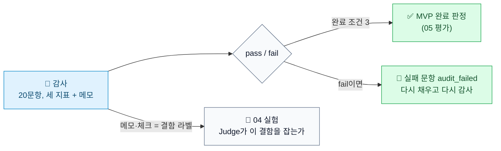
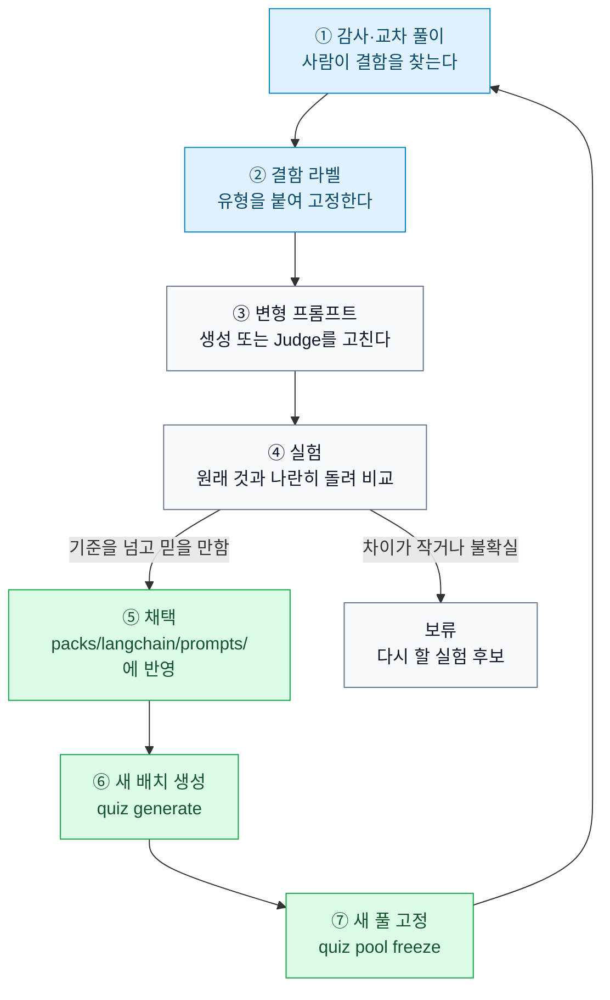

# 감사 지표와 문제 품질을 높이는 과정

작성일: 2026-11-06. 기준 커밋 `c417f20`. 이 문서는 설명용이다. 새 값이나 규칙을 정하지 않는다. 값과 규칙의 기준은 [requirements.md](../01-requirements/output/requirements.md) 7.2와 [design.md](../02-spec-design/output/design.md) 6.6이다. 감사 절차(풀이와의 차이, `audit_failed` 처리, 다시 고정하기)는 [question-set-flow.md](question-set-flow.md) 4.1에 있다.

## 한 문장으로

감사는 AI가 만든 문제를 사람이 표본으로 검수해 나쁜 문제를 걸러내는 일이다. 감사를 반복한다고 문제가 저절로 좋아지지는 않는다. 감사에서 나온 결함 기록으로 프롬프트를 고치고, 실험으로 효과를 확인해 운영에 넣어야 다음에 만드는 문제가 좋아진다.

## 1. 감사가 만드는 세 지표

감사는 고정한 풀(출제에 쓰는 문제 묶음)에서 무작위 20문항을 뽑아 본인이 한 문항씩 본다. 문항마다 체크박스 세 개와 메모 칸이 있다(`web/src/AuditPage.tsx`).

| 지표(DB 칸) | 화면 문구 | 뜻 | 허용 개수(20문항 중) |
| --- | --- | --- | --- |
| `answer_key_error` | 정답 키 오류 | 앱이 정답이라고 저장한 답이 틀렸다 | 1개 이하 |
| `quote_unsupported` | 인용이 정답을 뒷받침하지 않는다 | 근거로 붙인 공식 문서 원문 문장이 정답을 증명하지 못한다. 문장 자체는 원문과 같아도 다른 이야기를 하는 경우다 | 2개 이하 |
| `mapping_unfaithful` | 영·한 매핑 중 충실하지 않은 구절이 있다 | 영어 문제 구절과 짝지은 한국어가 뜻을 빠뜨리거나 바꿨다 | 2개 이하 |

- 20문항을 다 기록하면 앱이 결과를 계산한다. 세 지표가 모두 허용 개수 안이면 `pass`, 하나라도 넘으면 `fail`이다(`app/quiz/audit.py`의 `LIMITS`).
- 같은 풀이면 같은 20문항이 나온다. 풀 ID로 무작위 시드를 정하기 때문이다.
- 저장 위치는 `audits`(감사 한 번)와 `audit_records`(문항별 기록)다.

`mapping_unfaithful` 예: 03 단계 감사의 `03-023`은 영어 문제의 "TWO를 고르라"가 한국어 매핑에서 빠졌다.

### 세 지표만으로는 부족하다

03 단계 평가 대상 감사 `au_326384fb5422`(2026-11-05 14:19)의 지표는 정답 키 오류 0, 인용 미지지 0, 매핑 불충실 1이었다. 체크박스로만 보면 거의 문제가 없다.

그런데 같은 감사의 메모에는 체크박스에 없는 결함이 더 있었다([experiments.md](../04-prompt-model-experiments/output/experiments.md) 1.4).

| 메모에 적힌 결함 | 수 | 뜻 |
| --- | --- | --- |
| 해설 오류 | 4 | 정답은 맞지만 해설 설명이 틀렸다 |
| 단서·지문 정답 노출 | 5 | 보기 길이나 말투만 보고 정답을 고를 수 있다 |
| 인용 무관 | 2 | 인용이 문제와 관계없다 |
| 모호·전제 누락 | 4 | 문제만 읽고는 답을 하나로 정할 수 없다 |

세 지표는 MVP 완료 여부를 가르는 최소 기준이다. 문제 품질 전체를 재는 자가 아니다. 다음 개선에 쓰이는 정보는 메모에 더 많다. 감사할 때 체크박스에 해당하지 않아도 이상한 점은 메모에 적는다.

## 2. 지표가 쓰이는 곳

| 쓰이는 곳 | 하는 일 | 근거 |
| --- | --- | --- |
| MVP 완료 조건 3 "본인 감사 통과" | 05 평가가 `au_326384fb5422`의 결과로 통과를 확인했다 | requirements 7.1, [evaluation.md](../05-evaluation-review/output/evaluation.md) 3.1 |
| 풀 걸러내기 | `fail`이면 실패 문항을 `audit_failed`로 바꿔 풀에서 빼고, 60개로 다시 채운 뒤 새 20문항으로 다시 감사한다 | requirements 7.2, TASKS.md T5.6 |
| 04 실험의 정답 라벨 | EXP-1이 "Judge(문제를 검사하는 AI)가 사람이 찾은 결함을 떨어뜨리는가"를 잴 때, 감사 메모와 체크에서 나온 결함을 정답으로 썼다 | experiments.md 3장 |

풀 걸러내기에 대해 알아 둘 점:

- 첫 감사가 `pass`라 T5.6(감사 미달 처리)은 하지 않았다. `audit_failed`로 바꾸는 명령도 없다. 바꾸려면 백업한 뒤 SQL로 한다.
- `pass`이면 표본에서 체크된 문항도 풀에 그대로 남는다. 위 감사의 매핑 불충실 1문항은 지금도 출제된다.
- 감사는 20문항만 본다. 풀의 나머지 40문항에 있는 결함은 감사로 걸러지지 않는다.

## 3. 품질을 높이는 과정

감사는 "이미 만든 문제"를 걸러낸다. "앞으로 만들 문제"를 좋게 하려면 문제를 만드는 쪽, 곧 생성 프롬프트와 Judge를 고쳐야 한다. 그 과정은 아래 순서다.

| 단계 | 하는 일 | 이 과제에서 한 것 |
| --- | --- | --- |
| ① 결함 찾기 | 감사(사람)와 교차 풀이(Claude가 아닌 모델 2개가 정답 키 없이 풀어 봄)로 결함 후보를 찾는다 | 03 감사 20문항, 교차 풀이 |
| ② 결함 라벨 | 결함마다 유형을 붙여 실험 데이터로 고정한다 | EXP-1 실제 결함 18개: 모호·전제 누락 4, 단서 5, 해설 오류 4, 정답 키 1, 매핑 불충실 1, 인용 무관 3 |
| ③ 변형 만들기 | 결함을 잡거나 막도록 프롬프트를 고친 사본을 만든다. 운영 프롬프트는 건드리지 않는다 | `QUIZ_PROMPTS_DIR`로 사본 디렉토리를 가리킨다 |
| ④ 실험 | 같은 문항·같은 조건에서 원래 것(`control`)과 변형(`arena`)을 비교한다. 판정 기준은 돌리기 전에 정한다 | `quiz experiment judge`, `quiz experiment summary` |
| ⑤ 채택 또는 보류 | 기준을 넘고 결과를 믿을 만하면 운영 프롬프트에 반영한다 | 아래 표 |
| ⑥~⑦ 다시 만들고 고정 | 채택한 프롬프트로 새 문제를 만들고 풀을 다시 고정한다 | 하지 않았다 |
| ① 다시 | 새 풀을 감사해 결함이 실제로 줄었는지 본다 | 하지 않았다 |

04 단계에서 실제로 돈 결과:

| 실험 | 고친 것 | 출발점 | 결과 | 결정 |
| --- | --- | --- | --- | --- |
| EXP-1 | Judge 프롬프트 | 감사 메모의 결함을 Judge가 하나도 떨어뜨리지 않았다 | 실제 결함 18개 중 1개를 더 잡았다(원래 0개). 정상 문항 1개를 잘못 떨어뜨렸다. 더 싼 모델(Haiku 4.5)은 결함을 덜 잡았다 | 보류. 차이가 1문항이라 믿기 어렵다 |
| EXP-2 | 생성 프롬프트(인용 베끼기) | 기준선 지표. 첫 시도 인용 일치 0.44, `quote_mismatch` 157회 | 첫 시도 6개 중 5개 일치(원래 2개). 재생성 6번에서 1번, 문제당 비용 0.39에서 0.23달러 | 채택. `packs/langchain/prompts/generate.md`에 반영 |

- 감사 결과에서 출발한 EXP-1은 아직 운영에 들어가지 않았다.
- 채택된 EXP-2는 감사가 아니라 기준선 지표(`data/metrics/baseline.json`)에서 출발했다.
- 채택한 `generate.md`로 새 배치를 만들어 효과를 확인하는 일(⑥~⑦, ① 다시)은 하지 않았다. experiments.md에 "미확인"으로 남아 있다.

## 4. 자주 묻는 것

**감사를 반복하면 문제 품질이 좋아지나?**

저절로는 아니다. 감사 결과는 `pass`/`fail`과 메모로 DB에 남을 뿐, 생성 프롬프트나 Judge로 자동으로 돌아가지 않는다. 반복하면 결함 기록이 쌓이고, 그 기록으로 3장의 ③~⑤를 해야 다음 문제가 좋아진다.

**`fail`이 나오면 풀은 좋아지나?**

표본 20문항 안의 실패 문항은 빠진다. 다시 채운 문항은 같은 프롬프트로 만들기 때문에 같은 종류의 결함이 다시 나올 수 있다. 그래서 다시 채운 풀을 새 표본으로 다시 감사한다(requirements 7.2).

**연습용 DB에서 감사해도 되나?**

된다. `data/experiments/qa-base.db`를 복사해 `QUIZ_DB`로 가리키면 운영 DB(`data/quiz.db`)와 완료 조건에 영향이 없다. 다만 그 DB의 풀은 QA용 53문항 풀이라 제출용 60문항 풀과 다르다. 연습 감사의 메모도 결함 라벨로 쓸 수 있지만, 어느 풀의 문항인지 함께 적어 둔다.

## 5. 남은 빈칸

| 항목 | 상태 | 확인 방법 |
| --- | --- | --- |
| 채택한 `generate.md`가 운영 배치에서도 인용 일치를 올리는가 | 미확인 | 다음 `quiz generate` 배치의 첫 시도 `quote_match`를 기준선 0.44와 비교한다(experiments.md 1.8) |
| 감사 라벨이 다른 사람에게도 같게 나오는가 | 미확인. 감사자 한 명과 설계자가 붙였다 | 두 번째 사람이 같은 문항에 라벨을 붙여 일치를 본다 |
| 해설 오류·단서·모호를 체크박스로 따로 셀 것인가 | 요구사항에 없다 | 바꾸려면 requirements 7.2와 FR-9.2 변경이 먼저다 |
