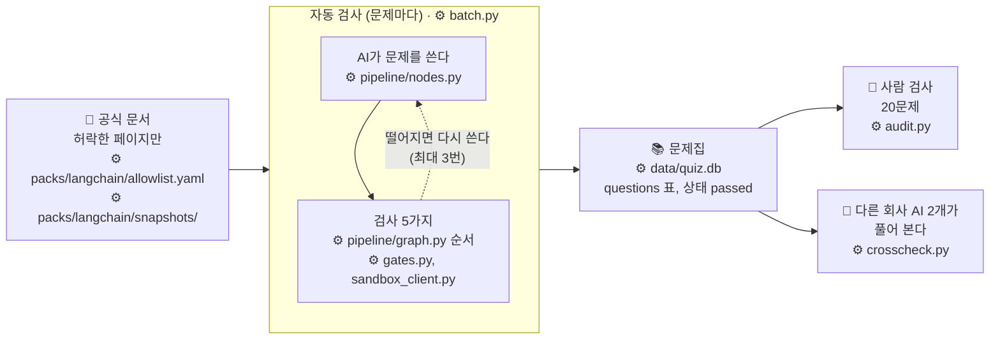
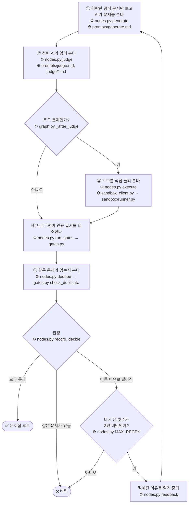
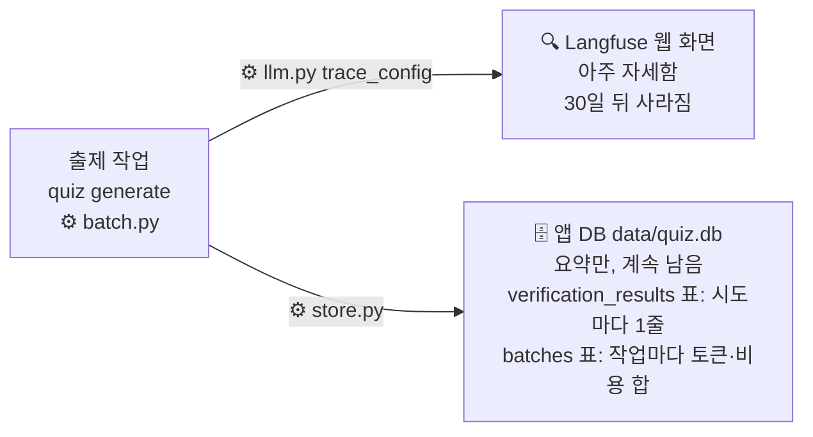

# 문제 검사와 기록

작성일: 2026-11-05. 수정: 2026-11-05, 쉬운 말로 다시 썼다. 이 문서는 설명용이다. 규칙의 기준은 [design.md](../02-spec-design/output/design.md)다.

## 한 문장으로

AI가 만든 문제는 다섯 번 검사를 통과해야 문제집에 들어간다. 그 과정은 모두 기록으로 남는다.

## 큰 그림

그림 속 ⚙️ 줄은 그 일을 하는 코드 위치다. 경로는 저장소 루트 기준이고, `app/quiz/`는 줄여서 뺐다.



## 비유: 새로 온 출제위원

AI를 새로 온 출제위원이라고 생각하면 쉽다. 일은 잘하지만 가끔 그럴듯한 거짓말을 한다. 그래서 이렇게 일하게 한다.

1. **정해진 참고서만 준다.** LangChain 공식 문서 중 허락한 페이지만 보고 문제를 쓴다.
2. **선배가 읽어 본다.** 다른 AI가 문제를 읽고 정답이 맞는지, 오답 보기가 정말 틀렸는지 본다.
3. **코드는 직접 돌려 본다.** 코드 문제면 보기의 코드를 실제로 실행해 본다. 앱과 떨어진 칸막이 안에서 돌린다.
4. **프로그램이 글자를 대조한다.** "문서에 이렇게 써 있다"고 인용한 문장이 원문에 글자 그대로 있는지 본다.
5. **같은 문제가 있는지 본다.** 이미 있는 문제와 너무 비슷하면 버린다.

검사 다섯 가지를 모두 마친 뒤 한꺼번에 판정한다.



- 모두 통과하면 문제집 후보가 된다.
- 같은 문제가 이미 있으면 다시 쓰지 않고 바로 버린다.
- 다른 이유로 떨어지면 떨어진 이유를 알려 주고 다시 쓰게 한다. 다시 쓰기는 최대 3번이다. 그래도 안 되면 버린다.

문제집이 다 모이면 검사가 두 번 더 있다.

- **사람 검사**: 사람이 20문제를 뽑아 직접 본다.
- **다른 회사 AI 풀이**: Claude가 아닌 AI 2개가 정답을 모른 채 풀어 본다. 답이 다르게 나오면 사람이 다시 본다.

## 검사마다 잡는 실수

| 검사 | 잡는 실수 |
| --- | --- |
| 참고서 제한 | 블로그나 지어낸 내용을 근거로 쓰는 것 |
| 선배 AI 검토 | 정답이 틀림, 오답 보기가 사실은 맞음, 정답 힌트가 문제에 드러남, 한국어 번역이 뜻과 다름 |
| 코드 실행 | 코드 문제의 정답이 실제 실행 결과와 다름 |
| 글자 대조 | 문서에 없는 문장을 있는 것처럼 인용함 |
| 중복 확인 | 같은 문제를 두 번 냄 |
| 사람 검사, 다른 AI 풀이 | 위 검사가 모두 놓친 실수 |

## 지금 약한 곳

- **선배 AI가 너무 너그럽다.** 209번 검토 중 204번을 통과시켰다. 사람 검사에서 틀린 해설, 정답 힌트, 관계없는 인용이 나왔다. 04 단계에서 고친다.
- **해설은 아무 AI도 보지 않는다.** 해설이 틀리면 사람 검사로만 잡힌다. 04 단계에서 해설 검토 항목을 더해 시험한다.
- **코드 실행 칸막이가 완벽하지 않다.** 인터넷 차단을 우회하는 방법이 남아 있다. 05 단계에서 다룬다.
- **동시에 만든 두 문제는 서로 중복 확인을 못 한다.** 다음 구현 때 다룬다.
- **코드 문제 11개는 다른 회사 AI가 풀어 보지 않았다.** 04 또는 05 단계 후보다.

## 기록은 어디에 남나



| 어디 | 무엇 | 얼마나 |
| --- | --- | --- |
| Langfuse(웹 화면) | AI에게 보낸 글, 받은 답, 걸린 시간, 비용. 아주 자세하다 | 30일 뒤 사라진다 |
| 앱 DB(`data/quiz.db`) | 문제마다 검사 결과와 떨어진 이유, 토큰, 비용 합계 | 지우기 전까지 |

Langfuse 기록 읽는 법은 [reading-traces.md](reading-traces.md)에 있다.

Langfuse는 `.env`에 키 3개가 모두 있을 때만 켜진다(`LANGFUSE_PUBLIC_KEY`, `LANGFUSE_SECRET_KEY`, `LANGFUSE_BASE_URL`). 없어도 문제 만들기는 그대로 된다. 기록만 남지 않는다.

---

## 부록: 개발자용

### 코드 위치

괄호 안 번호는 위 그림의 검사 번호(①~⑤)다.

```text
packs/langchain/                  LangChain 문제를 만들 때 쓰는 재료 묶음
├── allowlist.yaml                ① 근거로 써도 되는 공식 문서 페이지 목록
├── snapshots/                    ① 그 페이지 원문을 저장한 파일. AI는 이 원문만 받는다. 손으로 고치지 않는다
├── snapshot-manifest.yaml        ① 원문 파일마다 받아 올 때의 sha256. 원문이 바뀌었는지 비교하는 기준값
└── prompts/
    ├── generate.md               ① 문제를 쓰는 AI에게 주는 지시문
    ├── judge.md                  ② 선배 AI에게 주는 검토 지시문(공통)
    └── judge/                    ② 형식별 검토 지시문
        ├── choice.md                  선택형
        ├── short.md                   단답형
        └── code.md                    코드형

app/quiz/
├── allowlist.py                  ① 페이지 목록을 만든다. 원문 파일 sha256이 기준값과 다르면 멈춘다
│                                    (`quiz allowlist build`)
├── pipeline/
│   ├── graph.py                  검사 순서를 정한다: 쓰기 → ② → (코드면 ③) → ④ → ⑤ → 판정 → 다시 쓰기
│   │                                :46 Langfuse 기록 설정을 받아 넘긴다
│   └── nodes.py                  각 단계를 실제로 한다
│                                    :15-17 ② 선배 AI 검토 항목 이름
│                                    :288-305 판정 규칙: 다시 쓰기 최대 3번, 중복이면 바로 버림
├── gates.py                      ④⑤ AI 없이 코드로 하는 검사
│                                    :15  ④ 인용이 원문에 글자 그대로 있나(공백 차이는 무시)
│                                    :47  ④ 인용한 페이지가 허용 목록에 있나
│                                    :51  ④ 영·한 구절 짝이 있나
│                                    :65  ④ 단답 허용 답안이 1~5개인가
│                                    :113 ⑤ 같은 버킷에 인용이 같거나 문장이 60% 이상 겹치는 문제가 있나
│                                    :140 ④ 위 검사를 한 번에 돌린다(근거가 하나도 없으면 여기서 떨어진다)
├── sandbox_client.py             ③ 코드를 앱 밖 칸막이로 보내 실행하고 결과를 받는다
│                                    :20 `AWS_*`, `LANGFUSE_*` 비밀 값을 칸막이에 넘기지 않는다
│                                    :48 보기 하나당 30초가 넘으면 멈춘다
├── llm.py                        AI 호출 설정
│                                    :157-190 Langfuse 키가 있을 때만 기록을 켠다
├── audit.py                      사람 검사 20문제를 뽑고 결과를 DB에 적는다
└── crosscheck.py                 다른 회사 AI 2개에게 정답 없이 풀게 하고 결과를 `data/crosscheck/*.json`에 적는다

sandbox/                          ③ 코드 문제를 돌리는 칸막이. 앱과 다른 Python 환경
├── runner.py                        :30-40 인터넷 연결을 막는다
├── pyproject.toml                   칸막이 안에 설치할 패키지 목록
└── uv.lock                          그 패키지 버전 고정
```

선배 AI 검토 항목 이름(`nodes.py:15-17`): `answer_key_correct`, `quote_supports_answer`, `distractors_wrong`, `mapping_faithful`, `distractors_plausible`(선택형만), `no_cue`(선택형만). 하나라도 실패하면 `judge_fail:<항목>`이다.

### 직접 확인하는 법

| 확인 | 명령 | Bedrock 호출 |
| --- | --- | --- |
| 전체 테스트 | `cd app && uv run pytest` | 없음 |
| 글자 대조 등 | `cd app && uv run pytest tests/test_gates.py` | 없음 |
| 코드 실행 칸막이 | 먼저 `cd sandbox && uv sync`, 그다음 `cd app && uv run pytest tests/test_sandbox_client.py` | 없음 |
| Langfuse 켜고 끄기 | `cd app && uv run pytest tests/test_observe.py` | 없음 |
| 문제마다 떨어진 이유 | `data/quiz.db`의 `verification_results.fail_reasons_json` | 없음 |

새 worktree에는 `sandbox/.venv`가 없다. `uv sync` 없이 테스트하면 샌드박스 테스트 6개가 실패한다.

### 확인 기록

| 날짜 | 확인 | 결과 |
| --- | --- | --- |
| 2026-11-05 | `cd app && uv run pytest` | 처음 6개 실패(`sandbox/.venv` 없음). `uv sync` 뒤 323개 모두 통과 |
| 2026-11-05 | `.env`의 Langfuse 키 이름 | 3개 있음(값은 보지 않았다) |
| 2026-11-05 | 그래프 순서(`graph.py:27-41`) | 생성 → Judge → (코드면 실행) → 글자 대조 등 → 중복 → 기록 → (실패면 다시 생성) |
| 미확인 | 지금 Langfuse 화면에 기록이 쌓이는지 | 04 첫 실험 배치 때 확인 |
