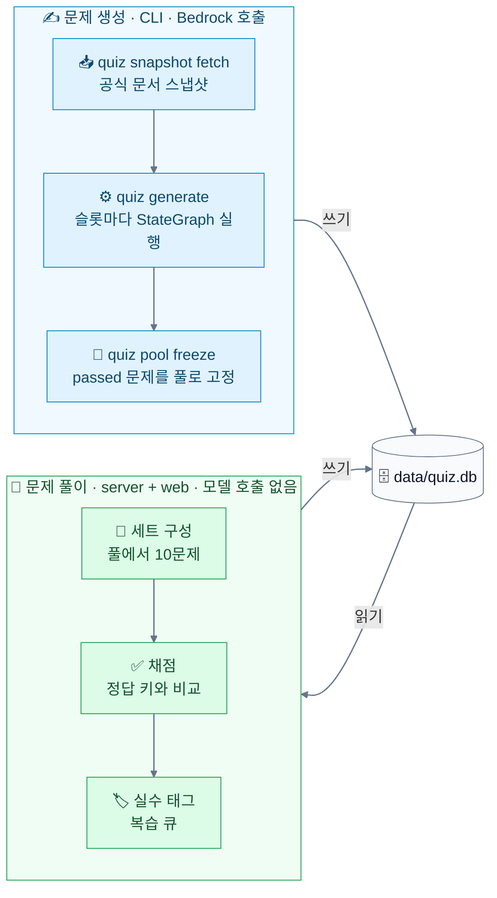
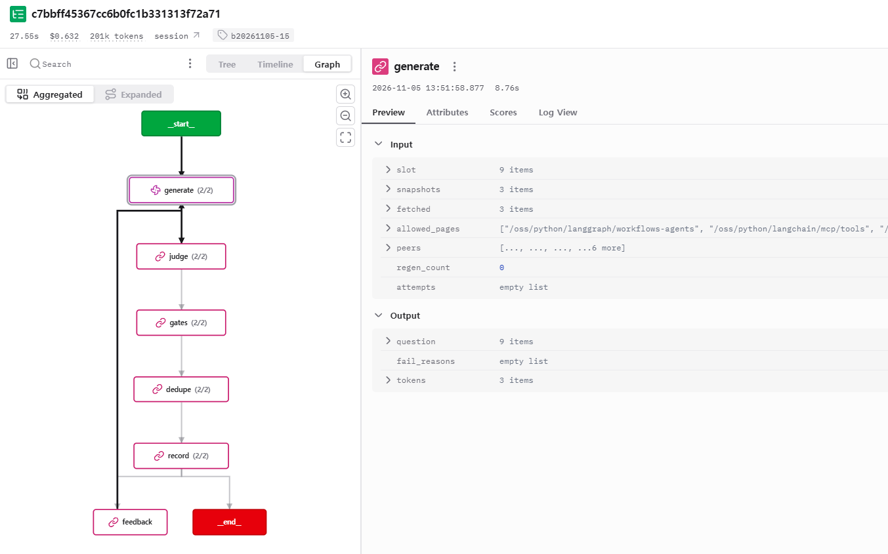
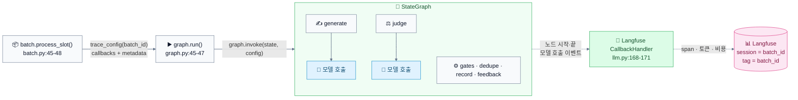
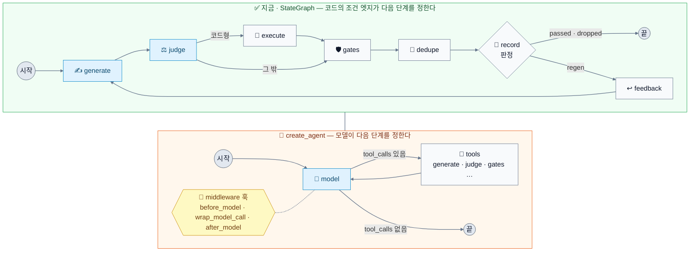
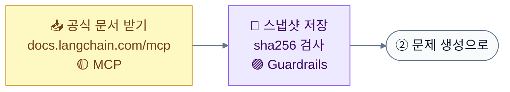
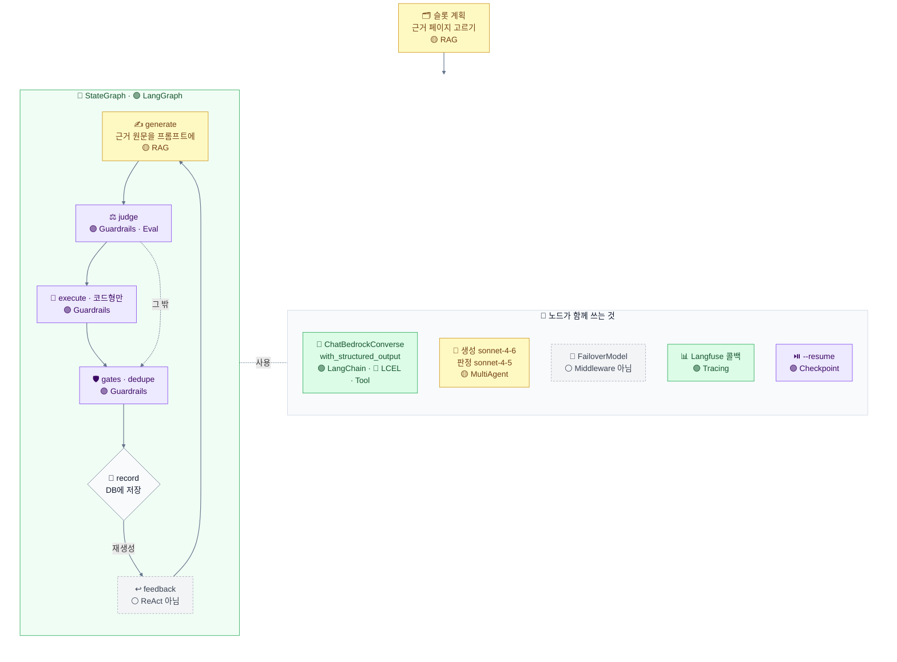
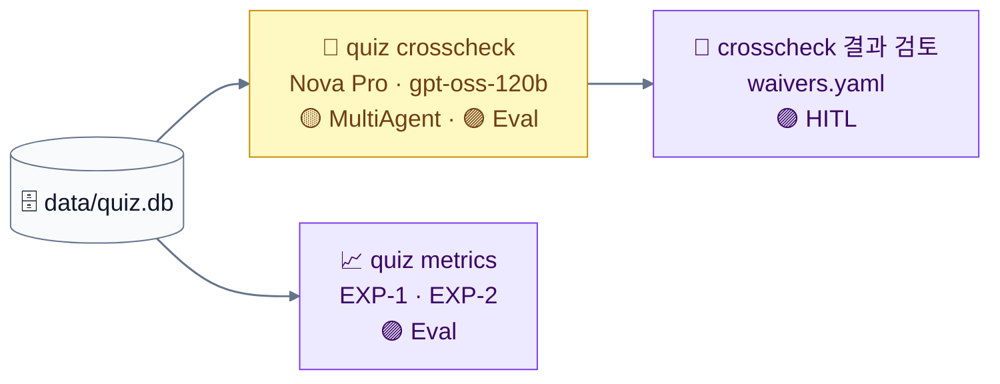
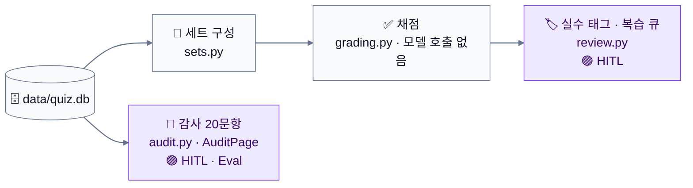

# LangChain 사용 범위와 개념 매핑

작성일: 2026-11-05. 기준 커밋 `2823d37`. 이 문서는 설명용이다. 구현 값의 기준은 [design.md](../02-spec-design/output/design.md)다.

앱은 **문제 생성**과 **문제 풀이** 두 경로로 나뉜다. 두 경로는 `data/quiz.db`를 사이에 두고만 이어진다. LangChain, LangGraph, Langfuse는 생성 경로에만 있다. 이 구분을 먼저 보이고, 그 위에서 세 질문에 답한다.

- Q1. 앱이 LangChain으로 구현됐나? callback, middleware 클래스를 쓰나?
- Q2. `create_agent`로 구현하면 이점이 있지 않나?
- Q3. LangChain 학습 개념 14개가 이 프로젝트에서 각각 어떻게 적용되고 구현됐나?

## 전체 구조: 문제 생성과 문제 풀이

문제는 생성 경로에서 그래프를 거쳐 DB에 저장된다. 풀이 경로는 이미 만들어진 문제를 DB에서 읽어 와서 푼다.

| 항목 | 문제 생성 | 문제 풀이 |
| --- | --- | --- |
| 실행 | CLI: `quiz snapshot fetch`, `quiz generate`, `quiz pool freeze` | `uvicorn quiz.server:app` + `web/`(`npm run dev`) |
| 모델 호출 | 있음. Bedrock, 자격 증명은 `.env` | 없음. `server.py`는 `quiz.llm`, `quiz.env`를 import하지 않는다 |
| LangChain, LangGraph, Langfuse | 사용 | 사용하지 않음 |
| DB에 쓰는 표 | `batches`, `batch_slots`, `questions`, `verification_results`, `grounding_records`(`store.py`), `pool_snapshots`, `pool_snapshot_items`(`pool.py`) | `quiz_sets`(`sets.py`), `attempts`(`server.py`), `review_items`(`review.py`), 감사 시 `audits`, `audit_records`(`audit.py`) |
| DB에서 읽는 것 | 같은 버킷의 passed 문제(중복 검사용) | 현재 풀 스냅샷의 문제 |

생성 경로:

- `quiz generate`가 슬롯마다 그래프를 한 번 돌린다. 순서는 generate, judge, (코드형이면 execute), gates, dedupe, record다. 실패하면 feedback을 거쳐 generate로 돌아간다(최대 3회 재생성).
- 그래프 결과를 `questions` 표에 쓴다(`batch.py:49-57`). 통과한 문제(`passed`)만이 아니라 버린 문제(`dropped`)도 이유와 함께 쓴다. 시도별 검증 기록은 `verification_results`에 쓴다.
- `quiz pool freeze`가 `passed`이고 변형이 아닌 문제를 풀 스냅샷으로 고정한다(`pool.py:13-23`). 풀이 경로는 이 풀만 본다.

풀이 경로:

- 서버는 SQLite만 읽고 쓴다(`server.py` docstring, design.md 8.5).
- 세트는 항상 10문제이고 현재 풀 스냅샷 안에서만 고른다. 순서는 기한이 된 복습 문제 최대 3개, 새 문제, 맞힌 문제 재출제다(`sets.py`).
- 채점은 정답 키와 비교만 한다. 모델을 부르지 않는다(`grading.py`, FR-3.4).
- 오답에는 실수 태그를 받고(`PUT /api/attempts/{attempt_id}/tag`), 복습 큐에 넣는다(`review.py`).

## Q1. 앱이 LangChain으로 구현됐나? callback, middleware 클래스를 쓰나?

아래 Langfuse 그래프 화면(배치 `b20261105-15`의 슬롯 하나)을 보고 나온 질문이다. 생성 경로의 `quiz generate`가 남긴 기록이다.

화면 읽기:

- 상단: 27.55s, $0.632, 201k tokens, 태그 `b20261105-15`.
- 노드 옆 `(2/2)`는 그 노드가 2번 실행됐다는 뜻이다. `feedback`이 1번 돌아 `generate`로 돌아갔다(재생성 1회).
- `execute` 노드가 없다. 코드 선택 문제가 아니어서 `judge` 다음에 `gates`로 갔다(`app/quiz/pipeline/graph.py:16-17`).

### 답

생성 경로를 LangChain 계열로 구현했다. 쓴 범위는 LangGraph 그래프와 LangChain 모델 래퍼다. callback은 쓰고 middleware는 쓰지 않는다. 풀이 경로에는 LangChain이 없다.

| 기능 | 사용 여부 | 위치 |
| --- | --- | --- |
| Callback | 사용 | `app/quiz/llm.py:168-181` |
| Middleware | 미사용 | 없음 |

### 쓰는 LangChain 부품

버전은 `app/pyproject.toml`에서 고정한다: `langchain==1.4.7`, `langchain-core==1.7.0`, `langgraph==1.2.17`, `langchain-aws==1.9.0`, `langfuse>=5.1.0`(설치본 5.1.0).

| 부품 | 하는 일 | 위치 |
| --- | --- | --- |
| `langgraph.graph.StateGraph` | 노드 흐름(generate, judge, execute, gates, dedupe, record, feedback) | `app/quiz/pipeline/graph.py:24-42` |
| `langchain_aws.ChatBedrockConverse` | Bedrock 모델 호출 | `app/quiz/llm.py:42` |
| `.with_structured_output(..., include_raw=True)` | 문제와 판정을 Pydantic 스키마로 받음 | `app/quiz/pipeline/nodes.py:109`, `:226` |
| `langfuse.langchain.CallbackHandler` | 실행 기록을 Langfuse로 보냄 | `app/quiz/llm.py:168-171` |

### Callback

- Langfuse의 `CallbackHandler`를 쓴다. 이 클래스는 LangChain `BaseCallbackHandler`를 상속한다(`langfuse/langchain/CallbackHandler.py:127`). 직접 만든 콜백 클래스는 없다.
- 연결 경로:
  1. `llm.trace_config(batch_id)`가 config를 만든다: `{"callbacks": [CallbackHandler()], "metadata": {"langfuse_session_id": batch_id, "langfuse_tags": [batch_id]}}`(`llm.py:174-181`).
  2. `batch.process_slot()`이 이 config를 `slot_graph.run()`에 넘긴다(`batch.py:45-48`).
  3. `graph.run()`이 `recursion_limit`을 더해 `graph.invoke(state, config)`를 부른다(`graph.py:45-47`).
  4. LangGraph가 콜백을 각 노드와 노드 안의 모델 호출까지 전달한다. 그래서 화면에 노드마다 span이 생기고 토큰과 비용이 집계된다.
- 화면의 태그 `b20261105-15`는 `batch_id`를 `langfuse_tags`로 단 값이다.
- Langfuse 키(`LANGFUSE_PUBLIC_KEY`, `LANGFUSE_SECRET_KEY`)와 호스트 키(`LANGFUSE_BASE_URL` 또는 `LANGFUSE_HOST`)가 모두 있을 때만 켜진다(`llm.py:163-165`). 없으면 config가 빈 dict이고 콜백 없이 돈다.

### Middleware

- LangChain 1.x의 middleware(`AgentMiddleware`)는 `create_agent`로 만든 에이전트 루프에 끼우는 훅이다. 루프는 모델 호출, 도구 호출, 다시 모델 호출 순으로 돈다.
- 이 앱은 `create_agent`를 쓰지 않는다. `StateGraph`에 노드를 직접 연결한다. 그래서 middleware를 붙일 자리가 없다.
- middleware가 하던 역할은 그래프 노드와 직접 만든 코드가 맡는다. 대응 관계는 [Q2의 대응 표](#middleware로-얻는-것은-이미-직접-구현했다)에 있다.
- 코드에 나오는 `middleware_hitl_guardrails`는 문제 주제 분류(버킷) 이름이다(`app/quiz/slots.py:33`). 기능 코드가 아니다.

## Q2. create_agent로 구현하면 이점이 있지 않나?

### 답

생성 경로의 그래프 전체를 `create_agent`로 바꾸면 얻는 것보다 잃는 것이 크다. 현 구조를 유지한다. 구조를 바꾸려면 design.md를 고쳐야 하므로 사용자 승인이 필요하다. 풀이 경로는 모델을 부르지 않으므로 해당 없다.

### create_agent가 맞는 경우와 이 앱의 차이

파란 상자는 모델 호출, 회색 상자는 결정적 코드다.

- `create_agent`는 모델이 다음 행동을 고르는 일에 맞다. 도구를 부를지, 어떤 도구를 부를지, 언제 끝낼지를 모델이 정한다.
- 이 앱의 순서는 고정이다: generate, judge, (코드형이면 execute), gates, dedupe, record. 실패하면 feedback을 거쳐 generate로 돌아간다(최대 3회 재생성).
- 다음 단계는 코드의 조건 엣지가 정한다(`_after_judge`, `_after_record`, `graph.py:16-21`). 모델이 정할 부분이 없다.

### 바꾸면 잃는 것

| 항목 | 지금(StateGraph) | create_agent로 바꾸면 |
| --- | --- | --- |
| 재현성 | 모든 문제가 gates와 dedupe를 반드시 거친다 | 모델이 검사 도구 호출을 건너뛸 수 있다 |
| 수용 기준 추적 | design.md 6.1의 노드 순서와 실패 이유가 코드 구조에 그대로 있다 | 에이전트 루프 안에서 단계 경계가 흐려진다 |
| 비용 | 단계 전환에 모델 호출이 없다 | 단계를 넘길 때마다 모델이 도구 호출을 판단해 토큰이 더 든다(증가량 미확인) |
| 04 실험 | `quiz experiment judge`가 judge 단계만 떼어 돌린다 | 단계가 분리되지 않아 단독 실행이 어렵다 |

### middleware로 얻는 것은 이미 직접 구현했다

| middleware | 이 앱의 대응 | 차이 |
| --- | --- | --- |
| `ModelFallbackMiddleware` | `FailoverModel`(`app/quiz/llm.py:67`) | 아래 표 |
| `ModelRetryMiddleware` | botocore 재시도(분당 요청 스로틀) | 모델 호출 계층 대신 AWS SDK 계층에서 재시도 |
| 가드레일 계열 | `gates`, `dedupe` 노드 | 모델 응답 뒤 훅 대신 결정적 코드로 검사 |
| (재시도 루프) | `record`에서 `feedback`을 거쳐 `generate`로 가는 엣지(`graph.py:20-21`, `:40-41`) | 실패 이유를 다음 생성 입력에 넣는다 |

`ModelFallbackMiddleware`와 `FailoverModel`의 차이(설치본 `langchain==1.4.7` 소스 `langchain/agents/middleware/model_fallback.py:390-429`로 확인):

| 항목 | `ModelFallbackMiddleware` | `FailoverModel` |
| --- | --- | --- |
| 넘어가는 조건 | `GraphBubbleUp`을 뺀 모든 `Exception` | 일일 토큰 한도 스로틀만(`is_daily_throttle`, `llm.py:58`). 다른 오류는 그대로 낸다 |
| 다음 호출의 시작점 | 매 호출마다 기본 모델부터 다시 시도 | 넘어간 프로필에 머문다(2026-11-05 사용자 결정) |
| 단가 계산 | 해당 없음 | 실제로 부른 모델 ID를 결과에 `model_id`로 붙인다 |

같은 동작을 내장 middleware로 얻으려면 커스텀 middleware를 따로 써야 한다.

### 쓸 만한 곳: 노드 안 에이전트

- 노드 하나 안에서 모델이 도구를 여러 번 불러야 할 때만 이득이다.
- 예: generate가 스냅샷을 스스로 검색하는 경우, judge가 코드를 실행해 보고 판정하는 경우.
- 이때는 그 노드 안에서만 `create_agent`를 쓰고 바깥 `StateGraph`는 유지한다.
- 지금은 스냅샷을 프롬프트에 미리 넣으므로 이 필요가 없다.

## Q3. LangChain 학습 개념이 이 프로젝트에서 어떻게 적용·구현됐나?

### 두 층

- **출제 내용:** 14개 개념은 모두 문제 주제다. 출제 버킷 6개(`rag`, `langgraph_basics`, `tool_mcp`, `middleware_hitl_guardrails`, `multi_agent`, `ops_quality`)에 들어 있다(`app/quiz/slots.py:33`). 코드 선택 문제는 생성 중 `sandbox/`에서 실제 LangChain 코드를 가짜 모델(`sandbox/fakes.py`의 `GenericFakeChatModel`, `ToolCallingFakeChatModel`)로 돌린다. 샌드박스에는 `create_agent`, 도구 호출, MCP 어댑터 예시가 돌 수 있도록 `langchain`, `langgraph`, `mcp`, `fastmcp`, `langchain-mcp-adapters`를 설치한다(`sandbox/pyproject.toml`).
- **앱 구현:** 앱이 그 개념을 실제로 쓰는지다. 아래 그림과 표는 이 층만 다룬다.

### 개념 배치도

점 색은 적용 구분이다: 🟢 사용 · 🔵 간접 · 🟡 변형 · 🟣 대체 · ⚪ 미사용. 상자 색은 그 상자의 주된 적용 구분을 따른다. 개념 대부분은 생성 경로에 있다.

#### 생성 경로 ① 준비 · `quiz snapshot fetch`

#### 생성 경로 ② 문제 생성 · `quiz generate`

#### 생성 경로 ③ 생성 뒤 점검 · CLI

#### 풀이 경로 · server + web

LangChain 개념이 없다. 사람이 판단을 남기는 자리만 HITL에 해당한다. 감사도 서버와 웹 화면(`AuditPage`)으로 하지만, 대상은 생성된 문제다.

### 매핑 표

적용 구분: **사용**(라이브러리 기능을 그대로 씀), **간접**(앱 코드에는 없고 쓰는 부품 내부에서 씀), **변형**(개념의 일부만 다른 방식으로 씀), **대체**(라이브러리 기능 대신 직접 구현), **미사용**.

| 개념 | 경로 | 적용 | 구현 |
| --- | --- | --- | --- |
| LangChain | 생성 | 사용 | `ChatBedrockConverse`로 Bedrock을 부른다(`app/quiz/llm.py:42`). `with_structured_output`으로 Pydantic 출력을 받는다(`pipeline/nodes.py:109`, `:226`). 생성 모델은 `global.anthropic.claude-sonnet-4-6`, 판정 모델은 `global.anthropic.claude-sonnet-4-5-20250929-v1:0`(temperature 0)이다(`llm.py:12-16`, `:144-148`). |
| LCEL | 생성 | 간접 | 앱 코드에 `\|` 합성은 없고 `.invoke()`만 부른다. `with_structured_output(include_raw=True)`가 내부에서 `RunnableMap(raw=llm) \| parser_with_fallback` 체인을 만든다(`langchain_aws/chat_models/bedrock_converse.py:1877`). |
| RAG | 생성 | 변형 | 검색기, 임베딩, 벡터 DB가 없다. 슬롯 계획이 허용 목록(`packs/langchain/allowlist.yaml`)에서 근거 페이지를 고르고(`slots.py`), 그 스냅샷 원문 전체를 `<document page=...>`로 프롬프트에 넣는다(`nodes.py:77`). 근거 인용은 `gates.check_quote`가 원문과 대조한다(`gates.py:15`). |
| LangGraph | 생성 | 사용 | `StateGraph`로 노드 7개를 잇는다. 조건 엣지 2개(`_after_judge`, `_after_record`), `feedback`에서 `generate`로 가는 순환, `recursion_limit=50`(`pipeline/graph.py:13-47`). |
| ReAct pattern | - | 미사용 | 모델이 도구를 고르는 루프가 없다. 대신 생성, 판정, 피드백, 재생성의 고정 루프가 있다(최대 3회 재생성). |
| Tool | 생성 | 간접 | 앱 모델에 업무용 도구를 붙이지 않는다. `with_structured_output`이 내부에서 스키마를 도구로 바인딩해 function calling으로 출력 형식을 강제한다(`bedrock_converse.py:1835`, `bind_tools([schema])`). |
| MCP | 생성(준비) | 변형 | `quiz snapshot fetch`가 Python MCP 클라이언트로 `https://docs.langchain.com/mcp`를 부른다(`app/quiz/snapshots.py:14-19`, `:97`). `snapshot fetch-ref`는 `https://reference.langchain.com/mcp`를 부른다(`:123`). `quiz generate` 실행 중에는 MCP를 부르지 않는다. |
| Middleware | - | 미사용 | [Q1 Middleware](#middleware), [Q2 대응 표](#middleware로-얻는-것은-이미-직접-구현했다) 참고. |
| HITL | 생성, 풀이 | 대체 | LangGraph `interrupt`를 쓰지 않는다. 사람 판단은 그래프 밖에서 받는다. 생성 쪽: 교차 풀이 결과 검토(`crosscheck.py`의 `reviewed`: ok, key_error, weak_grounding, ambiguous), 범위 면제 기록(`data/waivers.yaml`). 풀이 쪽: 감사 표본 20문항(`audit.py`, `/api/audits*`, `server.py:418-447`), 오답 실수 태그(`PUT /api/attempts/{attempt_id}/tag`, `server.py:357`). |
| Guardrails | 생성 | 대체 | ① 결정적 검사: 인용 원문 대조, 허용 페이지, 단답 허용 답안(`gates.py`). ② LLM 판정(`nodes.judge`, `nodes.py:211`). ③ 샌드박스 실행: 네트워크 차단, 보기당 30초 제한, 자식 환경에서 `AWS_*`, `LANGFUSE_*` 제거(`sandbox_client.py`, `sandbox/runner.py`). ④ 중복 검사: 같은 quote 또는 본문 Jaccard 0.6 이상(`nodes.dedupe`, `nodes.py:277`). ⑤ 스냅샷 sha256 검사(`allowlist.py`). ⑥ MCP 결과 안의 지시문은 데이터로만 다룬다(`snapshots.py`, GR-1.5). |
| Checkpoint | 생성 | 대체 | `g.compile()`에 checkpointer가 없다(`graph.py:42`). 배치 재개는 `batch_slots` 표와 `quiz generate --resume <batch_id>`가 맡는다. 끝나지 않은 슬롯을 처음부터 다시 돈다(`batch.py`). EXP-1은 오류 없이 끝난 문항을 건너뛴다(`experiments.py`). DB 백업은 `backup.py`가 마이그레이션과 배치 전에 한다. |
| MultiAgent | 생성 | 변형 | 에이전트끼리 메시지를 주고받는 구조는 없다. 역할별로 모델 호출을 나눴다: 생성 모델과 판정 모델(`build_graph(gen_model, judge_model)`, `graph.py:24`), Claude 계열이 아닌 2개 모델(`us.amazon.nova-pro-v1:0`, `openai.gpt-oss-120b-1:0`)이 정답 키 없이 푸는 교차 풀이(`crosscheck.py:25`). |
| Observability/Tracing | 생성 | 사용 | Langfuse `CallbackHandler`, `batch_id`를 세션 ID와 태그로 단다([Q1 Callback](#callback)). 시도별 토큰과 비용은 DB에 남긴다(`nodes._add_tokens`, `pricing.py`). 트레이스 내보내기 파일은 `data/metrics/trace-*.json`이다. |
| Eval | 생성, 풀이 | 대체 | 생성 쪽: 생성 중 LLM 판정(judge), 교차 풀이, 기준선 지표(`quiz metrics`가 `data/metrics/baseline.json`을 씀), 04 실험(EXP-1: 판정 프롬프트와 모델 조합 비교, `data/experiments/EXP-1/*.json`. EXP-2: 생성 비교, arm별 실험 DB). 풀이 쪽: 사람 감사 20문항. LangSmith 평가는 쓰지 않는다. |

### 묶어 보기

| 적용 | 개념 |
| --- | --- |
| 사용 | LangChain, LangGraph, Observability/Tracing |
| 간접 | LCEL, Tool |
| 변형 | RAG, MCP, MultiAgent |
| 대체 | HITL, Guardrails, Checkpoint, Eval |
| 미사용 | ReAct pattern, Middleware |

풀이 경로에 걸리는 개념은 HITL과 Eval(사람 감사)뿐이다. 둘 다 LangChain 기능 없이 서버 API와 DB로 구현했다.

## 확인 기록

| 날짜 | 확인한 것 | 방법 | 결과 |
| --- | --- | --- | --- |
| 2026-11-05 | 앱의 LangChain, LangGraph, Langfuse import와 middleware 사용 여부 | `app/` 아래 `*.py` grep(`from langchain`, `from langgraph`, `CallbackHandler`, `middleware`, `create_agent`, `callbacks=`) | `create_agent`, `AgentMiddleware` 사용 없음. `middleware`는 버킷 이름에만 나온다 |
| 2026-11-05 | Langfuse `CallbackHandler`의 부모 클래스 | 설치본 `langfuse==5.1.0` 소스 | `LangchainCallbackHandler(BaseCallbackHandler)` |
| 2026-11-05 | `ModelFallbackMiddleware`의 넘어가는 조건과 시작점 | 설치본 `langchain==1.4.7` 소스, [Built-in middleware 문서](https://docs.langchain.com/oss/python/langchain/middleware/built-in#model-fallback) | 모든 `Exception`에서 넘어가고, 매 호출 기본 모델부터 시작 |
| 2026-11-05 | middleware는 `create_agent`에 붙인다 | [Middleware overview 문서](https://docs.langchain.com/oss/python/langchain/middleware/overview) | 확인 |
| 2026-11-05 | `with_structured_output`이 만드는 체인과 도구 바인딩 | 설치본 `langchain-aws==1.9.0` 소스 `bedrock_converse.py:1771-1879` | `bind_tools([schema])` 후 `RunnableMap(raw=llm) \| parser_with_fallback` |
| 2026-11-05 | checkpointer, `interrupt`, 검색기·임베딩, `bind_tools`·`@tool` 사용 여부 | `app/quiz` grep(`checkpoint`, `MemorySaver`, `interrupt(`, `embed`, `retriev`, `bind_tools`, `@tool`, `Runnable`) | 앱 코드에 없음 |
| 2026-11-05 | 생성과 풀이 경로의 DB 쓰기 표, 서버 import | `app/quiz` grep(`INSERT INTO`, `INSERT OR IGNORE INTO`), `server.py` import 목록 | 생성: `store.py`, `pool.py`. 풀이: `sets.py`, `server.py`, `review.py`, `audit.py`. 서버는 `quiz.llm`, `quiz.env`를 import하지 않음 |
| 2026-11-05 | 모듈별 역할 | `app/quiz/*.py`, `sandbox/runner.py`, `sandbox/fakes.py` docstring | Q3 표에 반영 |
| - | `create_agent`로 바꿀 때의 토큰 증가량 | 측정 안 함 | 미확인 |
