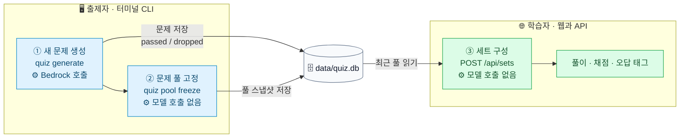
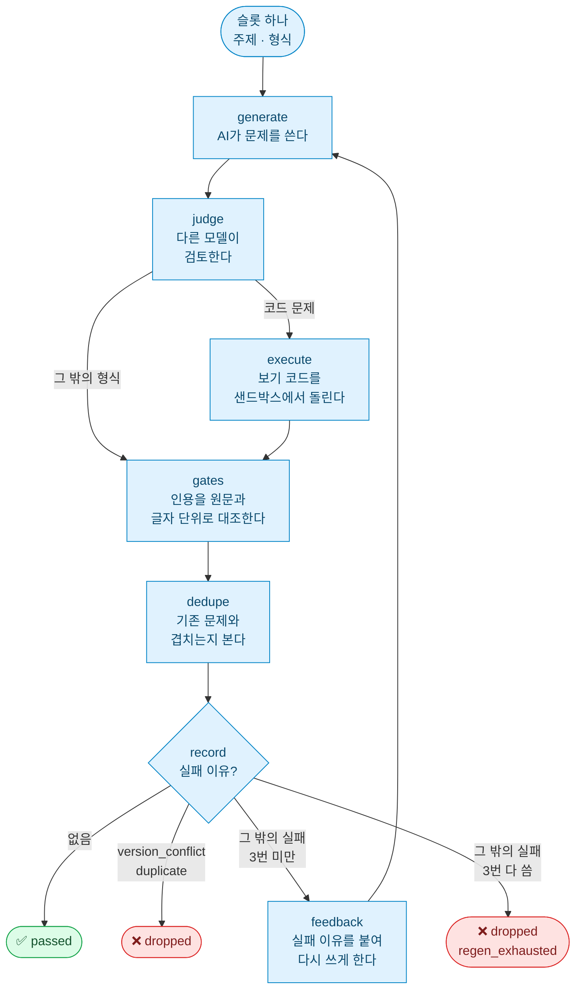
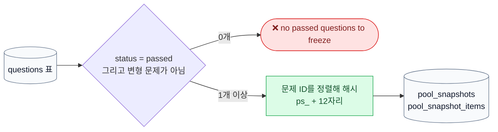
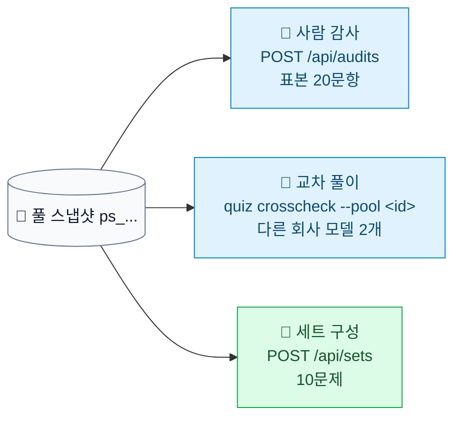
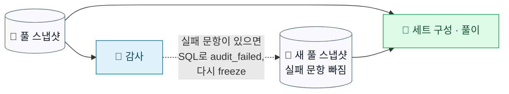

# 문제 생성에서 풀 고정, 세트 구성까지

작성일: 2026-11-06. 기준 커밋 `0189846`. 이 문서는 설명용이다. 새 값이나 규칙을 정하지 않는다. 값과 규칙의 기준은 [design.md](../02-spec-design/output/design.md)다. 검사 하나하나의 뜻은 [guardrails-and-tracing.md](guardrails-and-tracing.md), 용어 표는 [quize-pipeline.md](quize-pipeline.md) 1장에 있다.

## 한 문장으로

AI가 만든 문제는 검사를 모두 통과해야 `passed`가 된다. `passed` 문제가 하나라도 있으면 풀을 고정할 수 있고, 고정한 풀이 있어야 세트를 만들 수 있다.

## 1. "문제세트 생성"의 세 가지 뜻

"문제세트를 만든다"는 말은 이 앱에서 서로 다른 세 가지 일을 가리킬 수 있다. 누가, 어디서, 무엇을 만드는지가 다르다.

| | ① 새 문제 생성 | ② 문제 풀 고정 | ③ 세트 구성 |
| --- | --- | --- | --- |
| 쉬운 말 | AI가 문제를 새로 쓴다 | 통과한 문제들을 "이번 문제집"으로 묶어 이름을 붙인다 | 문제집에서 오늘 풀 10문제를 뽑는다 |
| 비유 | 출제위원이 문제를 쓰고 검토를 받는다 | 검토를 마친 문제로 문제집을 인쇄한다 | 문제집에서 오늘 숙제 10문제를 고른다 |
| 실행 방법 | CLI `uv run quiz generate --plan pilot\|pool\|fill` | CLI `uv run quiz pool freeze` | API `POST /api/sets` (웹 화면의 "새 세트") |
| 모델 호출 | 있음 (Bedrock) | 없음 | 없음 |
| 결과 | `questions` 표의 문제. 상태 `passed` 또는 `dropped` | 풀 스냅샷 `ps_...` (`pool_snapshots`, `pool_snapshot_items`) | 세트 `set_id`, 10문제 (정답 키·해설은 응답에 없음) |
| 코드 | `app/quiz/batch.py`, `app/quiz/pipeline/` | `app/quiz/pool.py` | `app/quiz/sets.py`, `app/quiz/server.py` |

①과 ②는 출제하는 사람이 터미널에서 돌린다. ③은 학습자가 웹에서 누른다. ①만 AWS 자격 증명(`.env`)을 읽는다. 서버에는 `AWS_*`를 넘기지 않으므로 서버는 모델을 부를 수 없다. 그래서 API로는 새 문제를 만들 수 없다.



## 2. 새 문제 하나가 `passed`가 되기까지

`quiz generate` 한 번(배치)은 여러 자리(슬롯)를 만든다. 슬롯 하나는 "어느 주제에서 어떤 형식으로 1문제"라는 주문서다. 슬롯마다 아래 그래프가 돈다(`app/quiz/pipeline/graph.py`). 배치를 시작하기 전에 `data/quiz.db`를 백업한다(`batch.py`).

검사는 모두 마친 뒤 마지막 `record`에서 한꺼번에 판정한다. 중간에 하나가 떨어져도 나머지 검사는 계속 돈다. 그래야 다시 쓸 때 실패 이유를 한 번에 알려 줄 수 있다.



### 단계별로 붙는 실패 이유

| 단계 | 하는 일 | 실패 이유 | 코드 |
| --- | --- | --- | --- |
| judge | 정답 키가 맞는지, 인용이 정답을 뒷받침하는지, 오답 보기가 정말 틀렸는지, 영·한 매핑이 맞는지 본다. 선택형은 오답이 그럴듯한지, 정답 힌트가 없는지도 본다 | `judge_fail:<항목>`, 출력 형식이 깨지면 `judge_fail:schema_invalid` | `pipeline/nodes.py` `judge` |
| execute | 코드 선택 문제만. 보기마다 실행 결과를 문서 기준 기대값, Judge 예측과 비교한다 | `version_conflict`, `sandbox_module_missing`, `judge_exec_mismatch` | `pipeline/nodes.py` `execute`, `sandbox_client.py` |
| gates | 근거 인용이 있는지, 허용 목록 페이지인지, 스냅샷 원문과 글자가 같은지, 영·한 구절 매핑이 있는지, 단답의 허용 답안 수가 맞는지 본다 | `grounding_missing`, `page_not_allowed`, `quote_too_short`, `quote_mismatch`, `mapping_missing`, `accepted_answers_count` | `gates.py` `run_gates` |
| dedupe | 같은 버킷의 `passed` 문제와 인용이 같거나 본문 Jaccard가 0.6 이상이면 중복이다 | `duplicate` | `gates.py` `check_duplicate` |
| record | 위 이유를 모아 판정한다 | 재생성 한도를 넘기면 `regen_exhausted` | `pipeline/nodes.py` `decide` |

`version_conflict`와 `duplicate`는 다시 써도 같은 이유로 떨어지므로 바로 버린다. 나머지는 실패 이유를 피드백으로 넣어 최대 3번 다시 쓴다(`MAX_REGEN = 3`).

### 세 가지 생성 계획

| 계획 | 슬롯 수 | 쓰는 때 |
| --- | --- | --- |
| `pilot` | 버킷당 1개, 6슬롯. 네 형식이 모두 나온다 | 처음 파이프라인을 시험할 때 |
| `pool` | 버킷당 10개, 60슬롯 | 풀을 처음 채울 때 |
| `fill` | 모자란 만큼만. 버킷당 10, 형식당 10에서 `passed` 수를 뺀 만큼 | `dropped`로 빈 자리를 채울 때 |

배치가 중간에 끊기면 `uv run quiz generate --resume <batch_id>`로 끝나지 않은 슬롯만 이어서 돈다.

## 3. 풀 고정의 조건

`quiz pool freeze`가 보는 조건은 하나다(`app/quiz/pool.py` `freeze`).

> `questions.status = 'passed'`이고 `variant_of IS NULL`(복습용 변형 문제가 아님)인 문제가 1개 이상 있다.

- 따로 승인하는 단계는 없다. 2장의 검사를 통과해 `passed`가 된 것이 곧 고정 자격이다.
- 0개면 `no passed questions to freeze` 오류로 멈춘다.
- 문제 수는 검사하지 않는다. 60문항 목표는 `generate --plan pool`과 `fill`이 맞춘다.
- 풀 ID는 문제 ID 목록의 해시다(`ps_` + sha256 앞 12자리). 같은 문제 집합이면 몇 번 고정해도 같은 ID가 나온다. 한 문제라도 늘거나 줄면 새 ID가 생긴다.
- 앱은 가장 최근에 고정한 풀을 쓴다(`current_pool`). 예전 풀 기록은 지우지 않는다.



## 4. 고정한 뒤에 하는 일

아래는 고정의 조건이 아니라, 고정한 풀을 대상으로 하는 일이다.



| 일 | 하는 것 | 조건과 결과 | 코드 |
| --- | --- | --- | --- |
| 사람 감사 | 풀에서 20문항을 뽑아 본인이 검토한다. 같은 풀이면 같은 표본이 나온다(풀 ID로 시드를 정함) | 풀이 20문항보다 작으면 거부한다. 정답 키 오류 1개 이하, 인용 불일치 2개 이하, 매핑 불일치 2개 이하면 `pass` | `audit.py` |
| 교차 풀이 | Claude가 아닌 모델 2개가 정답 키를 모른 채 풀어 본다. 정답 키 오류 후보를 찾는 보조 점검이다 | `us-east-1`에서만 돈다. 결과는 `data/crosscheck/<대상 ID>.json`, `.md` | `crosscheck.py` |
| 세트 구성 | 아래 5장 | 고정한 풀이 없으면 `no_pool` | `sets.py` |

### 4.1 문제풀이와 감사는 무엇이 다른가

둘 다 고정한 풀에서 문제를 뽑아 사람이 본다. 목적이 다르다. 문제풀이는 학습자가 공부하는 일이고, 감사는 출제자가 AI가 만든 문제를 검수하는 일이다. 이 과제에서는 본인이 두 역할을 다 한다.

| | 문제풀이 | 감사 |
| --- | --- | --- |
| 누가 | 학습자 | 출제자(본인)가 검수자로 |
| 목적 | 문제를 풀고 채점받아 공부한다 | AI가 만든 문제가 맞는지 사람이 확인한다 |
| 대상 | 현재 풀에서 뽑은 세트 10문제 | 현재 풀에서 뽑은 표본 20문항. 풀 ID로 시드를 정해 같은 풀이면 같은 표본이다 |
| 보는 것 | 내 답이 맞았는지, 해설 | 정답 키가 맞는지, 인용이 정답을 뒷받침하는지, 영·한 매핑이 맞는지 |
| 정답 키 | 답을 내기 전에는 응답에 없다 | 처음부터 보인다 |
| API | `POST /api/sets`, `POST /api/sets/{set_id}/answers` | `POST /api/audits`, `PUT /api/audits/{audit_id}/records/{question_id}` |
| 결과 | 채점 결과, 오답 태그, 복습 큐 | 문항별 기록. 20개가 다 차면 `pass` 또는 `fail` |
| 코드 | `sets.py`, `grading.py`, `review.py` | `audit.py` |

#### 감사 없이도 문제를 풀 수 있다

풀 수 있다. 설계가 그렇게 정했다.

- 세트 구성은 고정한 풀이 있는지만 본다(`sets.py` `compose`의 `current_pool`). 감사가 있는지, 통과했는지는 보지 않는다.
- design.md 결정 D-1: "`passed`는 결정적 게이트 3개와 Judge 통과다. 감사는 표본에만 적용한다." 감사를 통과 조건에 넣는 안은 채택하지 않았다.
- 그래서 감사는 풀이 전에 거치는 관문이 아니다. 풀 품질을 표본으로 확인하는 사후 점검이다.



감사와 풀이가 만나는 곳은 감사에 실패한 문항뿐이다.

- 감사에서 실패한 문항은 `audit_failed`로 바꾸고 풀에서 뺀다(design.md 5.3). `audit_failed`로 바꾸는 명령은 없다. 백업한 뒤 SQL로 바꾼다(implementation.md).
- 상태만 바꾸면 현재 풀에는 그 문항이 그대로 남는다. 세트 구성은 문제 상태를 보지 않고 현재 풀 스냅샷의 문제 목록을 쓰기 때문이다. `quiz pool freeze`를 다시 돌려 새 풀을 만들어야 빠진다.
- 새 풀이 된 뒤로는 그 문항이 세트에도, 복습에도 나오지 않는다(design.md 6.3). 그 전에 푼 기록은 `attempts`에 남는다.

#### 제출 기준에는 감사가 들어간다

앱은 감사 없이 돌지만, 과제 완료 기준(seed.yaml 수용 기준 2)은 "본인 감사 통과"다. 평가 대상 감사 `au_326384fb5422`는 2026-11-05 14:19에 `pass`였다. 정답 키 오류 0, 인용 미지지 0, 매핑 불충실 1이다(TASKS.md T5.5).

## 5. 세트 구성 규칙

`POST /api/sets`는 가장 최근 풀 안에서만 10문제를 고른다(`app/quiz/sets.py`).

1. 기한이 된 복습 문제를 최대 3개 넣는다. 개념 실수로 태그한 문제는 통과한 변형 문제가 있으면 그것을 낸다.
2. 남은 자리는 한 번도 풀지 않은 새 문제로 무작위로 채운다.
3. 새 문제가 바닥나면, 맞힌 적이 있고 복습 대기 중이 아닌 문제를 오래전에 푼 순서로 채운다.

거부하는 경우:

| 응답 | 이유 |
| --- | --- |
| 409 `untagged_wrong` | 직전 세트의 오답에 아직 태그를 다 붙이지 않았다 |
| 409 `no_pool` | 고정한 풀이 없다 |
| 409 `pool_too_small` | 위 규칙으로 10문제를 채우지 못한다 |

응답에는 문제와 보기만 있다. 정답 키, 해설, 매핑, 근거는 답을 낸 뒤 `POST /api/sets/{set_id}/answers` 응답에서 받는다.

## 6. 처음부터 끝까지 명령 순서

`app/`에서 돌린다. 자세한 점검 순서는 [m0-smoke.md](../03-implementation/output/m0-smoke.md)에 있다.

```bash
uv run quiz migrate                       # 스키마 적용
uv run quiz generate --plan pool          # ① 새 문제 생성 (Bedrock)
uv run quiz generate --plan fill          #    dropped로 빈 자리 채우기 (필요할 때)
uv run quiz pool freeze                   # ② 문제 풀 고정 -> pool_snapshot_id=ps_...
uv run quiz crosscheck --pool <ps_id>     #    교차 풀이 (선택, us-east-1)
uv run uvicorn quiz.server:app --port 8000
# ③ 세트 구성: 웹 화면(web/에서 npm run dev) 또는 POST /api/sets
```

## 7. 왜 새 문제 생성은 CLI에만 있나

### 7.1 설계 근거

문서에 적힌 근거:

- 요구사항 FR-1.3: 세트는 미리 생성한 풀에서 낸다. 풀이 시점에 문제를 생성하지 않는다.
- 요구사항 FR-3.4: 풀이 시점에는 LLM 채점을 하지 않는다.
- design.md 2.1: 생성 경로(개발자가 CLI로 미리 돌림)와 풀이 경로(서버, SQLite만 씀)를 나눈다. 두 경로는 DB 파일 하나로만 만난다.
- design.md 3.2, 8.5: AWS 자격 증명은 CLI만 쓴다. 서버와 샌드박스에는 넘기지 않는다.

"왜"를 한 줄로 적은 곳은 없다. 아래는 문서의 규칙과 측정값으로 짐작한 이유다(미확인).

| 이유 | 설명 |
| --- | --- |
| 고정한 풀에서만 낸다 | 생성한 문제는 자동 검사(2장)를 통과해 풀로 고정되고, 표본 감사로 풀 품질을 확인한다(4장, 4.1). 감사는 풀이 전에 거치는 관문이 아니다. 풀이 화면에서 바로 만들면 고정한 풀 밖의 문제가 나가므로 표본 감사가 그 문제를 덮지 못한다 |
| 오래 걸리고 비싸다 | 본 생성 60슬롯 한 번에 1,334초(약 22분), 18.60 USD(design.md 1.4, 2026-11-05). 웹 요청 하나로 처리할 길이가 아니다 |
| 자격 증명을 떼어 둔다 | 서버에 AWS 키가 없으면 서버에 버그나 공격이 있어도 키가 새거나 비용이 나가지 않는다 |
| 풀이는 모델 없이 돈다 | Bedrock 한도나 장애가 있어도 문제 풀이는 된다 |

### 7.2 화면에 "문제 생성" 버튼을 만들면

지금 설계로는 문제가 생긴다.

| 문제 | 설명 |
| --- | --- |
| 고정 결정을 바꾼다 | 서버가 Bedrock을 부르려면 서버에 `AWS_*`를 넘겨야 한다. CLAUDE.md 고정 결정과 design.md 3.2, 8.5를 바꾸는 일이다. 05 평가 계획 2단계는 "서버 환경에 `AWS_*`, `LANGFUSE_*`가 없다"를 수용 기준 5의 증거로 본다 |
| 인증이 없다 | 로컬 전용이라 인증이 없다(design.md D-7). 화면에 들어온 누구나 버튼 한 번으로 약 18 USD를 쓸 수 있다 |
| 요청이 너무 길다 | 약 22분 걸린다. 백그라운드 작업 관리(진행 상태, 취소, `--resume`)를 새로 만들어야 한다 |
| 품질 확인이 빠질 수 있다 | 생성한 문제가 풀 고정 없이 바로 세트에 나가면 표본 감사로 풀 품질을 확인할 수 없다. FR-1.3이 지키는 "미리 만든 풀"이 흔들린다 |

필요하면 요구사항과 설계를 바꾸는 일이므로 06 이후에 다룬다. 방향은 둘 중 하나다.

- 버튼은 실행할 명령만 보여 주고, 실행은 CLI로 한다.
- 서버와 떨어진 출제자용 작업 프로세스를 따로 두고 인증을 붙인다.

### 7.3 05 평가 중에 CLI로 새 문제를 생성하면

2026-11-06 기준, 05 단계(평가와 리뷰)가 진행 중일 때의 판단이다.

운영 DB(`data/quiz.db`)에 돌리면 문제가 생긴다.

| 문제 | 설명 |
| --- | --- |
| 계획을 어긴다 | 05 계획 결정 7: 운영 생성 배치를 돌리지 않는다. 2026-11-06 17:00 전에는 운영 DB를 바꾸지 않는다 |
| 행 수 대조가 실패한다 | 05 계획은 0단계와 5단계에 `data/quiz.db` 표별 행 수를 세어 같은지 본다. 생성하면 `questions`, `batches` 등이 늘어난다 |
| 평가 대상 풀이 바뀐다 | 평가 대상은 고정 풀 `ps_326384fb5422`(60문항)와 감사 `au_326384fb5422`다. 새로 고정하면 앱이 가장 최근 풀을 쓰므로 세트 구성과 수용 기준 증거가 평가 대상과 어긋난다 |
| 비용과 한도가 겹친다 | 생성 비용이 더 든다. Bedrock 일일 토큰 한도를 05 계획 4단계(이월 항목)의 교차 풀이와 함께 쓴다 |

별도 빈 DB에 돌리면 운영 DB와 평가 대상 풀은 그대로다. 04 실험과 같은 방식이다(design.md D-16).

```bash
cd app
QUIZ_DB=../data/experiments/scratch.db uv run quiz migrate
QUIZ_DB=../data/experiments/scratch.db uv run quiz generate --plan pilot
```

- `data/quiz.db`를 복사해서 쓰지 않는다. 생성 계획은 같은 입력이면 같은 버킷·주제·형식의 슬롯을 만들기 때문에, 이미 있는 60문항과 겹쳐 `duplicate`로 버려지는 문제가 많아진다.
- `pilot`은 6슬롯, 약 1.7 USD다(파일럿 슬롯당 0.286 USD, design.md 1.4).
- 실제 예(2026-11-06): 빈 `scratch.db`에 `--plan pool --count 36`(passed 30, 8.55 USD), 이어서 `--plan fill`(passed 23, 9.67 USD)로 53문항을 만들었다.
- `.env`가 필요하므로 코디네이터 worktree에서만 돌린다.
- `data/experiments/*.db`는 git에서 빠진다.
