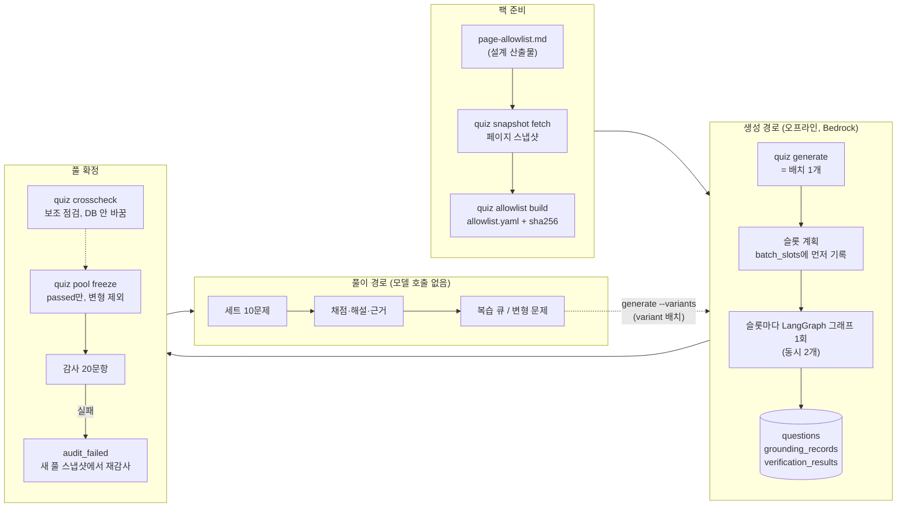
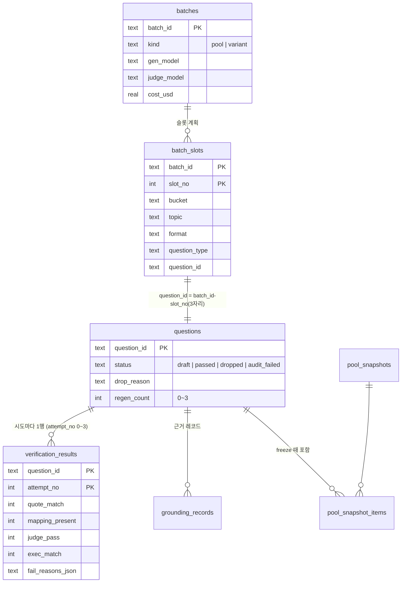
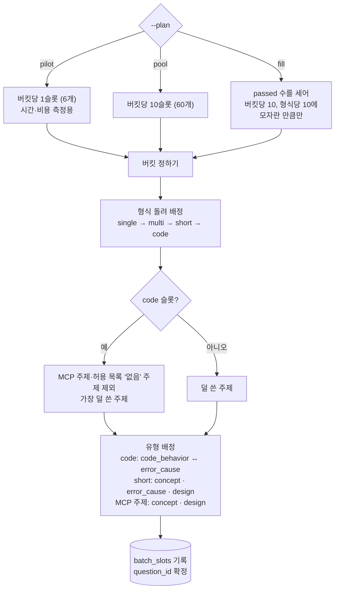
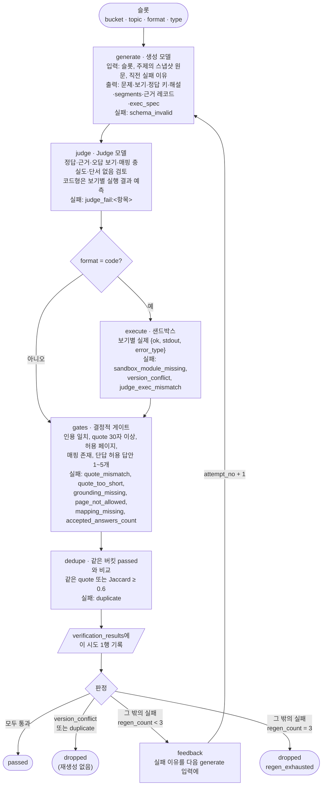
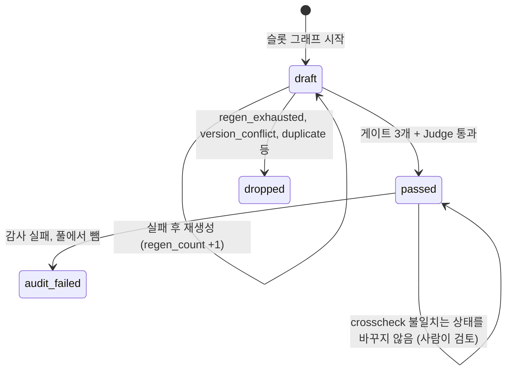
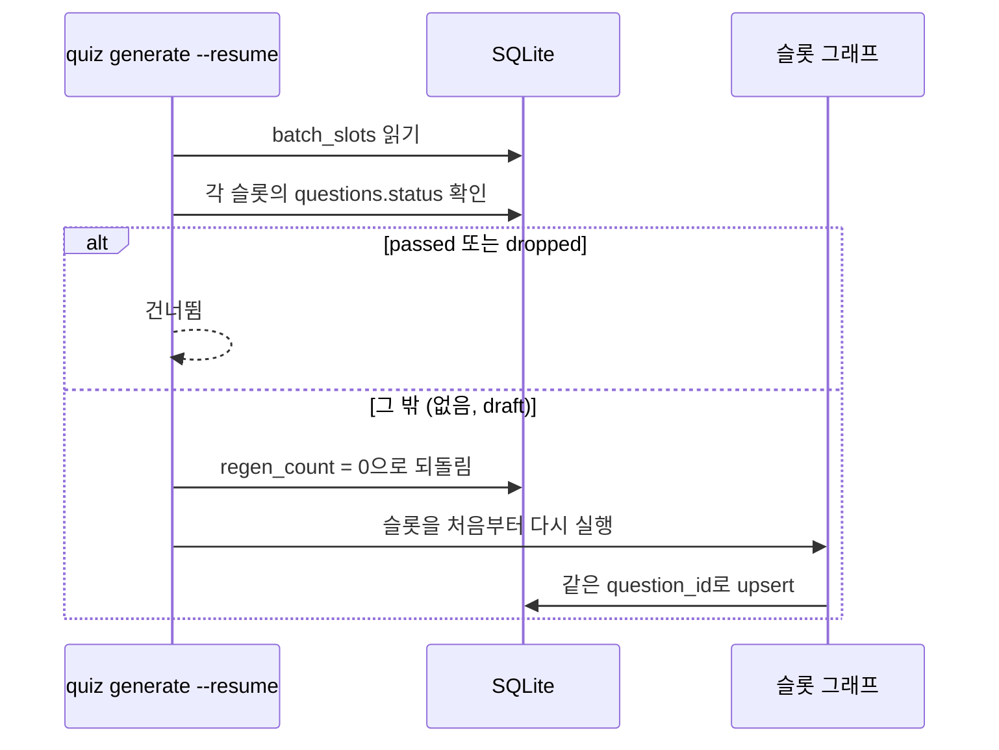

# 문제 출제 파이프라인과 개념 지도

작성일: 2026-11-05. 이 문서는 설명용이다. 새 값이나 규칙을 정하지 않는다. 값과 규칙의 기준은 [design.md](../02-spec-design/output/design.md)이고, 문서끼리 다르면 [requirements.md](../01-requirements/output/requirements.md)가 우선한다.

## 1. 개념 한눈에 보기

| 개념 | 뜻 | 저장 위치 | 기준 |
| --- | --- | --- | --- |
| 팩 | 한 학습 영역의 문제 풀과 근거 자료 묶음. MVP는 LangChain 팩 | `packs/langchain/` | 요구사항 1.4 |
| 허용 목록 | 인용해도 되는 공식 문서·API 레퍼런스 페이지 목록 | `packs/langchain/allowlist.yaml` | GR-2, design 4.3 |
| 페이지 스냅샷 | 허용 목록 페이지 원문을 조회 날짜와 함께 저장한 파일 | `packs/langchain/snapshots/` | design 4.3 |
| 배치 | `quiz generate` 1회 실행 | `batches` | design 1.3 |
| 슬롯 | 배치가 만들 문제 1개의 자리. 버킷·주제·형식·유형을 정한다 | `batch_slots` | design 1.3, 6.1 |
| 버킷 | 출제 주제 묶음. 학습 노트 day2~day7과 1:1 | 슬롯·문제의 `bucket` | CR-1, design 5.2 |
| 주제 | 버킷 안의 세부 주제. 허용 목록 행과 묶인다 | 슬롯·문제의 `topic` | design 6.1 |
| 형식 | 답하는 방식: `single`, `multi`, `short`, `code` | `format` | CR-3 |
| 유형 | 묻는 내용: `concept`, `code_behavior`, `error_cause`, `design` | `question_type` | CR-4 |
| 시도 | 슬롯 하나의 생성~검사 1회. 재생성마다 `attempt_no`가 는다 | `verification_results` | design 1.3 |
| 근거 레코드 | 정답 근거 한 건 `{page, quote, fetched_at, answer_basis}` | `grounding_records` | GR-3 |
| 영·한 구절 매핑 | 영어 문제 구절마다 한국어를 짝지은 것 `{segment_id, en, ko}` | `questions.segments_json` | GR-5 |
| Judge | 생성과 다른 모델 호출로 문제를 검토하는 단계 | `verification_results.judge_*` | GR-6 |
| 결정적 게이트 | 모델 없이 코드로 판정하는 검사 | `verification_results` | GR-4, GR-5, GR-7 |
| 샌드박스 | 코드형 보기를 실행하는 분리된 Python 환경 | `sandbox/` | GR-7, design 8.2 |
| 문제 상태 | `draft`, `passed`, `dropped`, `audit_failed` | `questions.status` | design 5.3 |
| 풀 / 풀 스냅샷 | 검증을 통과한 문제 집합 / 그 집합을 특정 시점에 고정한 것 | `pool_snapshots` | design 5.2 |
| 감사 | 풀 스냅샷 표본 20문항을 본인이 직접 검토 | `audits`, `audit_records` | FR-9, design 6.6 |
| 교차 풀이 점검 | Claude 아닌 모델 2개가 정답 키 없이 풀어 정답 키 오류 후보를 찾는 보조 점검. 요구사항 밖(사용자 승인 2026-11-05) | `data/crosscheck/<대상 ID>.json` | `TASKS.md` T2.10 |

## 2. 전체 흐름

문서 수집부터 풀이까지의 큰 흐름이다. 생성 경로(오프라인)와 풀이 경로는 SQLite 파일 하나로만 만난다(design 2.1).

## 3. 배치, 슬롯, 시도, 문제의 관계

배치 1개가 슬롯 여러 개를 갖고, 슬롯 1개가 문제 1개가 된다. 문제 1개에는 시도가 1~4번(처음 + 재생성 최대 3번) 쌓인다.

- `question_id`는 슬롯에서 결정적으로 나온다. 예: 배치 `b20261105-01`의 7번 슬롯은 `b20261105-01-007`이다(design 5.2).
- 쓰기는 `question_id`(검증은 `question_id, attempt_no`) 기준 upsert다. 그래서 중단돼도 같은 자리에 다시 쓴다(design 6.2, D-13).

## 4. 슬롯 계획: 슬롯이 어떤 값을 받는가

`generate --plan`이 시작할 때 슬롯 목록을 먼저 만든다. 세부 규칙은 design 6.1 "슬롯 계획"과 7.2 `generate` 행에 있다.

- 허용 목록 상태가 `근접`인 주제는 프롬프트에 "문서가 그 이름으로 패턴을 정의한다고 쓰지 말 것"을 넣는다.
- MCP 주제는 코드형을 내지 않는다(D-9).

## 5. 슬롯 하나의 그래프: 시도와 판정

그래프 상태는 슬롯 1개다. 노드 순서는 FR-7.1을 따른다(D-10). 각 박스 옆의 이름이 그 단계에서 나올 수 있는 실패 이유다.

- `sandbox_module_missing`은 `version_conflict`보다 먼저 판정한다. 피드백에 샌드박스 패키지 목록을 넣고 재생성한다.
- `version_conflict`는 실행 결과가 정답 키와 다른데 Judge도 정답 키에 동의한 경우다. 문서와 고정 버전의 충돌로 보고 버린다(GR-7.5).
- `duplicate`로 버린 자리는 다음 `generate --plan fill`이 새 슬롯으로 채운다.
- 생성·Judge 모델은 호출 실패 시 프로필과 리전을 바꿔 다시 부른다. 순서는 design 3.1 전환 행을 따른다.
- 마지막 판정만 `questions.status`에 반영한다.

## 6. 문제 상태

## 7. 배치 재개

배치가 중간에 멈추면 `quiz generate --resume <batch_id>`로 이어 간다.

## 8. 관련 명령

| 명령 | 개념 | Bedrock |
| --- | --- | --- |
| `quiz snapshot fetch <page...>` | 페이지 스냅샷 | 아니오 |
| `quiz allowlist build` | 허용 목록 | 아니오 |
| `quiz generate --plan pilot\|pool\|fill [--count N]` | 배치, 슬롯 계획, 슬롯 그래프 | 예 |
| `quiz generate --resume <batch_id>` | 배치 재개 | 예 |
| `quiz generate --variants` | 변형 배치(`kind='variant'`). design 7.2에 있으나 CLI에는 아직 없다(2026-11-05 `app/quiz/cli.py` 확인) | 예 |
| `quiz crosscheck --batch <batch_id>` / `--pool <id>` | 교차 풀이 점검(us-east-1만) | 예 |
| `quiz pool freeze` | 풀 스냅샷 | 아니오 |

명령 세부는 design 7.2, 처음부터 끝까지 도는 순서는 [m0-smoke.md](../03-implementation/output/m0-smoke.md)에 있다.
