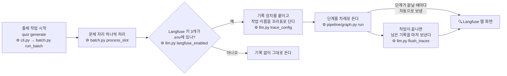
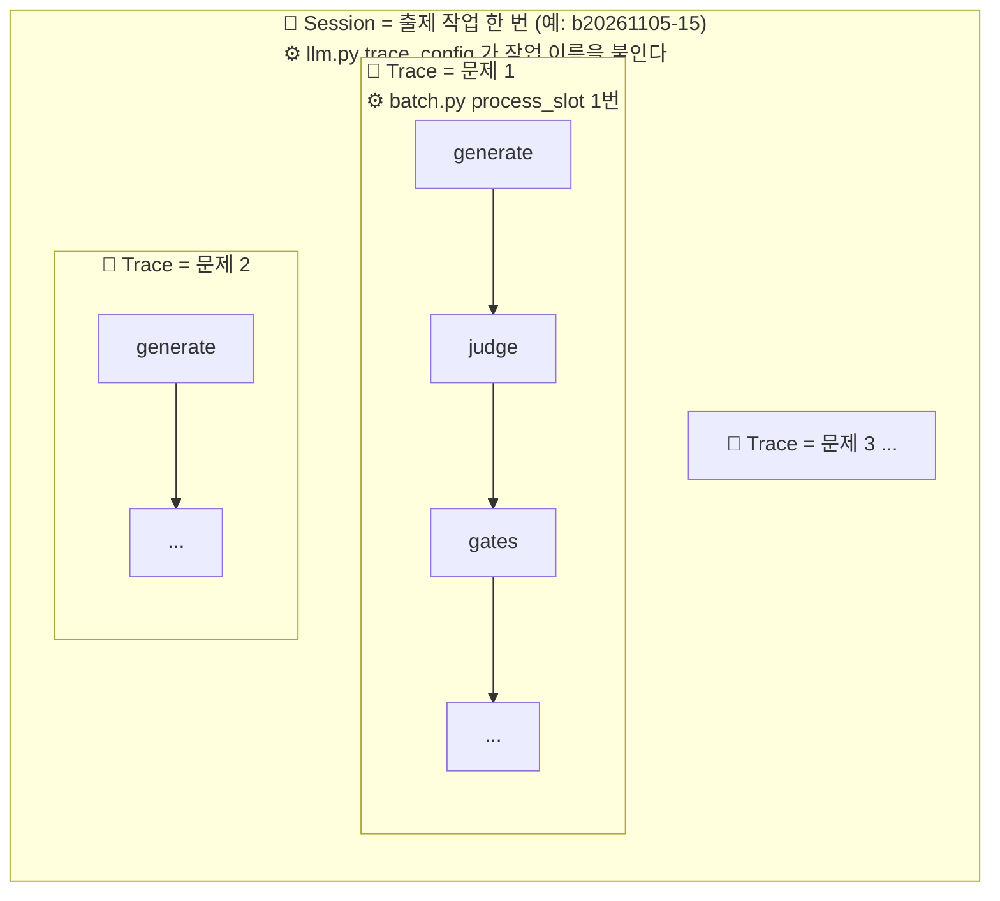
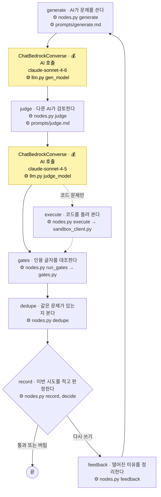
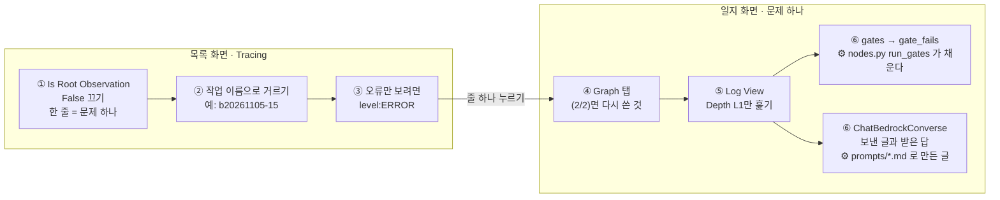
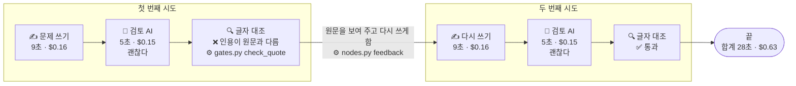
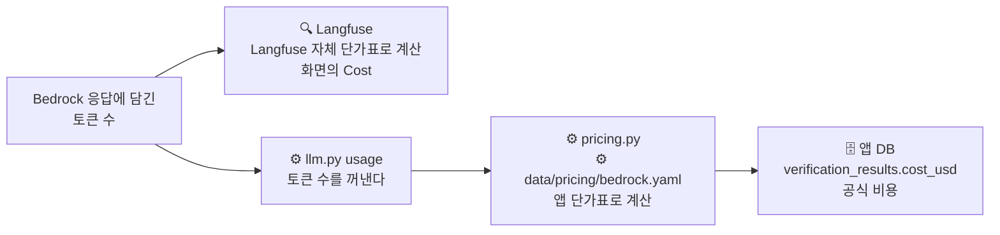

# Langfuse 기록 읽는 법

작성일: 2026-11-05. 수정: 2026-11-05, 쉬운 말과 그림으로 다시 썼고 그림마다 코드 위치를 붙였다. 같은 날 "화면 보는 순서"를 실제 목록 화면(Tracing)과 일지 화면에 맞춰 고쳤다. 이 문서는 설명용이다. 규칙의 기준은 [design.md](../02-spec-design/output/design.md) 8.3이다. 검사 과정 자체는 [guardrails-and-tracing.md](guardrails-and-tracing.md)에 있다.

## 한 문장으로

Langfuse 기록은 **문제 하나가 만들어지는 과정을 단계마다 적어 둔 일지**다.

그림 속 ⚙️ 줄은 그 일을 하는 코드 위치다. 경로는 저장소 루트 기준이고, `app/quiz/`는 줄여서 뺐다.

## 큰 그림: 기록은 어떻게 생기나



- 기록 장치는 Langfuse가 만든 부품(`langfuse.langchain.CallbackHandler`)이다. 앱은 붙이기만 한다. 단계마다 무엇을 적을지는 이 부품이 정한다.
- 키가 없으면 장치를 붙이지 않는다. 문제 만들기는 그대로 되고 기록만 남지 않는다.

## 기록은 세 겹이다



| 화면 이름 | 쉬운 말 | 이 앱에서 |
| --- | --- | --- |
| Session | 폴더 | 출제 작업 한 번. 이름은 작업 이름(`batch_id`)과 같다 |
| Trace | 일지 한 권 | 문제 하나. 다시 쓰기까지 모두 한 권에 들어간다 |
| Observation | 일지의 한 줄 | 단계 하나, 또는 AI 호출 하나 |

## 일지 한 권의 단계

일지 한 권은 이 순서로 적힌다. 노란 칸이 AI를 실제로 부른 곳이다. 시간과 돈은 노란 칸에만 적힌다.



- 단계 이름(`generate`, `judge` 등)은 `pipeline/graph.py`에 등록한 이름이 그대로 화면에 나온다.
- `_after_judge`, `_after_record`도 화면에 나온다. 다음에 갈 단계를 고르는 작은 단계다(`pipeline/graph.py`). Output에 다음 단계 이름이 있다. `__end__`는 끝이라는 뜻이다.
- `Runnable...`로 시작하는 이름과 `_RepairingPydanticToolsParser`는 AI 답을 정해진 JSON 형태로 받는 LangChain 내부 부품이다. 무시해도 된다.
- `record`는 판정만 한다. 앱 DB에 쓰는 것은 일지가 끝난 뒤 `batch.py process_slot`이 `store.py`로 한다. 그래서 DB 쓰기는 일지에 나오지 않는다.

## 화면 보는 순서

Langfuse 화면은 두 가지다. 모든 기록이 섞여 나오는 **목록 화면(Tracing)**과, 줄 하나를 눌러 여는 **일지 화면(문제 하나)**이다.



### 목록 화면(Tracing)

처음 열면 모든 일지의 모든 줄이 시간순으로 섞여 나온다(2026-11-05 기준 약 6,250줄). 다음 순서로 줄인다.

1. 왼쪽 필터 `Is Root Observation`에서 `False`를 끈다. 한 줄이 문제 하나(일지 한 권)가 된다. 그 줄의 Name은 `LangGraph`다. `Trace Name` 칸은 비어 있다. 앱이 일지 이름을 따로 달지 않기 때문이다(⚙️ `llm.py trace_config`).
2. 출제 작업 하나만 보려면 작업 이름(예: `b20261105-15`)으로 거른다. 앱은 작업 이름을 Session과 꼬리표(tag)로 단다(⚙️ `llm.py trace_config`). 왼쪽 필터에서 이 항목의 정확한 이름은 미확인이다.
3. 오류만 보려면 위쪽 검색창에 `level:ERROR`를 넣는다.

왼쪽 Name 목록의 개수로 작업 전체를 가늠할 수 있다. 2026-11-05 화면 예시 숫자를 함께 적는다.

| 이름 | 개수가 뜻하는 것 | 예시 |
| --- | --- | --- |
| `LangGraph` | 처리한 문제 자리 수 | 117 |
| `generate` | 문제를 쓴 횟수. `LangGraph`보다 많은 만큼이 다시 쓴 횟수다 | 215(다시 쓰기 98) |
| `judge`, `gates`, `dedupe`, `record` | 단계를 돈 횟수 | 213 |
| `ChatBedrockConverse` | AI 호출 수. 돈은 여기에만 적힌다 | 503 |

AI 호출 수(503)가 `generate`와 `judge`의 합(428)보다 많다. 차이(75)는 하루 사용량 한도에 걸려 다른 경로(프로필·리전)로 다시 부른 호출로 보인다(미확인). 이 전환은 ⚙️ `llm.py FailoverModel`이 한다.

### 일지 화면(문제 하나)

목록에서 줄 하나를 누르면 열린다. 맨 위 줄에 걸린 시간, 돈, 토큰 수, 작업 이름(꼬리표)이 있다. `session ↗`을 누르면 같은 작업의 다른 문제로 간다.

**Graph 탭: 단계 흐름**

- 상자 옆 `(2/2)`는 그 단계를 두 번 돌았다는 뜻이다. 한 번 떨어지고 다시 쓴 것이다.
- `record`에서 `feedback`을 거쳐 `generate`로 돌아가면 다시 쓰기다. `_end_`로 가면 끝이다.
- `_start_`는 초록, `_end_`는 빨강이다. 시작과 끝 표시로 보인다(미확인). 오류는 목록 화면의 `level:ERROR`로 본다.
- `execute` 상자는 코드 선택 문제에만 나온다.
- `Aggregated`는 같은 단계를 한 상자로 합쳐 보여 준다. `Expanded`는 시도마다 따로 펼친다.

**Log View: 줄 목록**

`Depth` 칸만 보면 정리된다.

| Depth | 뜻 | 볼까? |
| --- | --- | --- |
| L0 `LangGraph` | 일지 표지 | 전체 시간만 본다 |
| L1 `generate`, `judge`, `gates`, `_after_judge` 등 | 실제 단계 | 여기만 훑는다 |
| L4 `ChatBedrockConverse`(보라색 아이콘) | AI 호출. 돈과 토큰이 여기 적힌다 | 눌러서 보낸 글과 받은 답을 본다 |
| L2~L6 나머지(`Runnable...`, `_RepairingPydanticToolsParser`) | AI 답을 JSON으로 받는 내부 부품 | 무시한다 |

- `Start`는 일지가 시작된 뒤 몇 초째에 시작했는지다. `Duration`은 걸린 시간이다.
- 위쪽 `Search observations...`에 `gates`나 `ChatBedrockConverse`를 넣으면 그 줄만 남는다.

**떨어진 이유와 AI가 주고받은 글**

- 떨어진 이유: L1 `gates`를 누른다. Output의 `gate_fails`가 비어 있으면 통과다. 무언가 적혀 있으면 그 이유로 떨어진 것이다.
- AI가 받은 글과 답: `ChatBedrockConverse`를 누른다. Input이 보낸 글, Output이 받은 답이다.

## 실제 예시: Chroma 문제 하나

내보낸 파일 하나(`data/metrics/trace-c7bbff45367cc6b0fc1b331313f72a71.json`)를 읽은 결과다.



**첫 번째 시도**

- AI가 문제를 썼다. 9초, $0.16.
- 검토 AI는 "괜찮다"고 했다. 5초, $0.15.
- 그런데 프로그램 대조에서 떨어졌다. 인용한 문장이 문서 원문과 글자가 달랐다(`quote_mismatch`).
- 프로그램이 "네가 쓴 인용은 이렇고, 원문은 이렇다"고 알려 주고 다시 쓰게 했다.

**두 번째 시도**

- AI가 다시 썼다. 9초, $0.16.
- 검토 AI가 "괜찮다"고 했다. 5초, $0.15.
- 프로그램 대조도 통과했다. 끝.

**합계**: AI 호출 4번, 28초, $0.63.

**여기서 알 수 있는 것**

- 검토 AI가 놓친 실수를 프로그램 대조가 잡았다.
- AI를 한 번 부를 때 문서 원문을 길게 보낸다(약 5만 토큰). 돈은 대부분 여기에 든다.

## 숫자 칸 뜻

`ChatBedrockConverse`를 누르면 보이는 숫자다.

| 칸 | 뜻 |
| --- | --- |
| Latency | 걸린 시간(초) |
| Input tokens | AI에게 보낸 글의 양 |
| Output tokens | AI가 답한 글의 양 |
| Cost | 이 호출에 든 돈(달러) |

비용은 두 곳에서 따로 계산한다.



예시에서는 두 값이 같았다. Langfuse 단가표가 바뀌면 달라질 수 있다. 공식 비용은 앱 DB 값이다.

## 기록에 남지 않는 것

| 남지 않는 것 | 이유 |
| --- | --- |
| 다른 회사 AI 풀이(`quiz crosscheck`) | ⚙️ `crosscheck.py`가 기록 장치를 붙이지 않는다 |
| 검토 AI만 다시 돌리는 실험(`quiz experiment judge`) | ⚙️ `experiments.py`가 기록 장치 없이 `nodes.py judge`를 부른다 |
| 문제 풀이 화면에서 한 일 | API 서버와 코드 실행 칸막이는 Langfuse 키를 받지 않는다 |
| Langfuse 키 없이 돌린 출제 작업 | ⚙️ `llm.py langfuse_enabled`가 꺼진다 |
| 어떤 프롬프트 폴더로 돌렸는지 | ⚙️ `llm.py trace_config`는 작업 이름만 단다. 실험 조건은 작업 이름으로 구분한다 |

04 실험 중 문제를 새로 만드는 쪽(`quiz generate --slots`)은 출제 작업과 같은 길을 지나므로 기록이 남는다.

---

## 부록: 개발자용

### 코드 위치

```text
app/quiz/
├── cli.py                        `quiz generate` 명령을 받아 batch.py로 넘긴다
├── batch.py                      출제 작업 한 번을 돌린다
│                                    process_slot  문제 자리 하나 = 일지 한 권. 끝나면 store.py로 DB에 쓴다
│                                    :128 작업 끝에 flush_traces를 부른다
├── llm.py                        AI 호출과 기록 설정
│                                    :12-16 생성 모델(claude-sonnet-4-6), 검토 모델(claude-sonnet-4-5) 이름
│                                    :151 usage  AI 응답에서 토큰 수를 꺼낸다
│                                    :163 langfuse_enabled  키 3개가 있을 때만 기록을 켠다
│                                    :174 trace_config  기록 장치를 붙이고 작업 이름을 Session과 꼬리표로 단다
│                                    :184 flush_traces  남은 기록을 Langfuse로 마저 보낸다
├── pricing.py                    앱 단가표로 비용을 계산한다(data/pricing/bedrock.yaml)
├── store.py                      시도마다 verification_results 1줄, 작업마다 batches 합계를 쓴다
├── pipeline/
│   ├── graph.py                  단계 순서와 단계 이름. 이 이름이 화면에 그대로 나온다
│   │                                :45 run  기록 설정을 받아 단계를 돌린다
│   └── nodes.py                  단계 하나하나: generate, judge, execute, run_gates, dedupe, record, feedback
├── crosscheck.py                 기록 없음
└── experiments.py                기록 없음(검토 AI만 다시 돌리는 실험)

packs/langchain/prompts/          AI에게 보내는 지시문. 화면의 ChatBedrockConverse Input에 들어간다
data/metrics/trace-<id>.json      Langfuse에서 내보낸 일지 한 권(예시 파일)
```

### 내보낸 파일을 직접 읽기

Langfuse 화면 없이 내보낸 JSON 파일로 같은 내용을 보는 스크립트다. 단계 이름과 AI 호출 숫자를 한 줄씩 찍는다.

```python
import json
import sys

data = json.load(open(sys.argv[1], encoding="utf-8"))
obs = sorted(data["observations"], key=lambda o: o["startTime"])
nodes = {"generate", "judge", "gates", "dedupe", "record", "feedback"}

for o in obs:
    if o["type"] == "GENERATION":
        u, c = o["usageDetails"], o["costDetails"]
        print(f"  model={o['model']} {o['latency']}s in={u['input']} out={u['output']} ${c['total']:.4f}")
    elif o["name"] in nodes:
        out = str(o.get("output") or "")[:80]
        print(f"{o['name']:<10} {out}")

total = sum(o["costDetails"].get("total", 0) for o in obs)
print(f"total ${total:.4f}")
```

`app/`에서 `uv run python <스크립트> ../data/metrics/trace-<trace_id>.json`으로 돌린다.

### 그 밖에 알아 두면 좋은 칸

- 모델 이름과 리전: AI 호출의 `metadata`에 있는 `ls_model_name`, `ls_invocation_params.region_name`
- 오류 문장: `level`이 `ERROR`일 때 `statusMessage`. 예: `ThrottlingException` "Too many tokens per day"
- 캐시: `input_cache_read`가 0이면 프롬프트 캐시를 쓰지 않은 것이다.

내보낸 파일에는 프롬프트 전문이 들어 있다. 커밋하기 전에 `scope.attributes.public_key`를 가린다.
